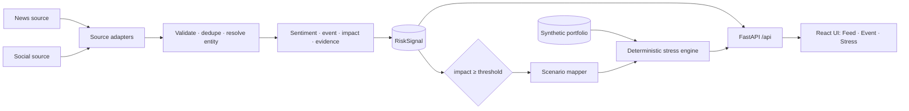

# EventShock — S&P Global & Crisil Campus Hackathon

<p align="center"></p>

**Candidate Name:** Aniket Mandal  
**College Email ID:** [aniket.mandal@iitg.ac.in]  
**College / Campus:** Indian Institute of Technology Guwahati (IITG)  
**Demo Video Link:** [YouTube / Unlisted]  
**Slide Deck Link (if hosted externally):** [Optional Cloud Link / docs/presentation.pdf]  

> **Status: Stage 1 — foundation and first vertical slice.** The full path
> *event → intelligence → risk signal → scenario → portfolio stress → result* works end to end in a
> working UI. The event intelligence is **hand-authored demo fixtures**, not model output. The stress
> engine is **real, deterministic arithmetic**. See [What is real vs. demo](#what-is-real-vs-demo).

## 1. Project Overview / Problem Statement & Approach

Financial risk information shows up in news and social posts long before it appears in structured data.
An analyst must work out *what happened*, *who is affected*, *whether it matters*, and *which portfolios
to look at*. EventShock automates that first pass and connects it to a portfolio stress test (Module B of
the case study).

EventShock keeps three ideas that are usually blurred together separate:

- **Sentiment** — how the text is framed (−1.0 … +1.0).
- **Event** — what happened (an eight-class financial taxonomy).
- **Impact** — how large a market reaction is likely to be (1 … 10, a *market-response proxy*, not a
  probability of loss and not a price forecast).

An event whose impact reaches a configurable threshold (default **7**, a product rule rather than a
learned fact) is mapped to an explicit, illustrative scenario template. A deterministic engine
re-values every position (equities, bonds, loans, derivatives), then shows value before and after and
which positions and risk factors drive the change. Every signal and every stress run carries its
provenance (source, timestamps, model/scenario/engine versions, data origin).

It is decision support, not a trading bot.

### Pain points it answers

| The frustration | What EventShock does about it |
|---|---|
| "A sentiment score isn't an answer." | Sentiment, event type and **impact** are three separate readings; impact (1–10, with the range comparable events realised) is the headline. |
| "I can't see why it said that." | A **Why?** drawer, plain-named drivers and a **Show inputs** panel listing exactly what the model saw, with typeset maths one click away. |
| "Is that look-ahead leakage?" | Every input has an availability class, anything known only afterwards is refused, and a **timeline** shows what was known at each moment, apart from what was learned later and what happened. |
| "How far can I trust it?" | Placeholder / experimental / validated tags, four kinds of number that are never blurred (prediction, history, assumption, outcome), and an evidence page with checks passed out of total. |
| "So what does it do to my portfolio?" | Before → after value, what the scenario did *not* reach, a waterfall, a drill-down to single positions and a what-if severity slider on the real engine. |
| "There's too much on screen." | One story in five chapters; depth sits behind drawers, tabs and expanders. |
| "I have to present this anywhere." | Light by default with a dark toggle, phone to desktop layouts, a deterministic replay and a scripted 3:40 demo. |

Every feature, the pain point behind it, where to see it and how we know it works: [`docs/FEATURES_AND_PAIN_POINTS.md`](docs/FEATURES_AND_PAIN_POINTS.md).

## 2. Architecture & Tech Stack



In Stage 1 everything left of `RiskSignal` (adapters, validation, entity resolution, NLP, impact) is
replaced by fixtures: signals are replayed from `data/fixtures/`. Everything from `RiskSignal`
rightwards is the real, final architecture. Details, contracts and
extension points: [docs/ARCHITECTURE.md](docs/ARCHITECTURE.md).

| Layer | Choice | Why |
|---|---|---|
| API | **FastAPI + Pydantic v2** | Typed contracts are the product contracts; OpenAPI for free |
| Stress engine | Plain Python, pure functions | Deterministic, hand-verifiable, no model needed |
| Config | YAML in `configs/` + `EVENTSHOCK_*` env | Product rules live outside code |
| Frontend | **React 19 + Vite + TypeScript + Tailwind v4 + TanStack Query** | Product-grade UI; types generated from the API schema |
| Tests | pytest (backend), Vitest + Testing Library (frontend) | Contracts, formulas, golden replay, UI states |
| Ingestion (Stage 2) | stdlib only: adapters → validate → entity resolution → dedup → enrichment | Deterministic replay from hash-pinned snapshots |
| Sentiment (Stage 3) | **TF-IDF + logistic regression + temperature scaling** (scikit-learn), trained on Twitter Financial News, committed artifact with model card | Small, CPU-only, byte-reproducible; evaluation and failure modes in [docs/SENTIMENT_MODEL.md](docs/SENTIMENT_MODEL.md) |
| Planned (later stages) | EDGAR/NewsAPI adapters, earnings-calendar features for impact, DuckDB/SQLite | Behind the extension points in `ports.py` |

## 3. Dataset Used

No proprietary S&P Global or Crisil data is used. Full licence notes: [docs/DATA_LICENSES.md](docs/DATA_LICENSES.md).

**Default profile (`replay`) — real documents, frozen for deterministic replay** (`data/replay/`)

| File | Content | Source / licence |
|---|---|---|
| `gdelt/gkg_articles.jsonl` | 1,308-record stratified slice of the GDELT **GKG bulk files** (1,344 files, 1.28M rows read, 127,592 kept for 34 issuers + market themes): title, URL, domain, **publisher time**, machine tone, NER organisations | [GDELT GKG 2.1](https://data.gdeltproject.org/gdeltv2/masterfilelist.txt); free reuse with citation. No article text. |
| `gdelt/articles.jsonl` | news article **metadata** (URL, title, first-seen time, domain, language) for 34 listed issuers (sector OR-queries) plus market-wide queries, requested window 2026-09-17..30 (1,479 unique articles) | [GDELT DOC 2.0 API](https://www.gdeltproject.org/); free reuse with citation. No publisher text stored. |
| `social/tfn_sample.jsonl` | 300-row sample of finance tweets with human sentiment labels | [`zeroshot/twitter-financial-news-sentiment`](https://huggingface.co/datasets/zeroshot/twitter-financial-news-sentiment), MIT per dataset card |
| `entities.json` | entity master: 34 real listed issuers (name, ticker, sector, country, aliases) | public facts, hand-curated |
| `portfolio.json` | **synthetic** book (equities, bonds, loans, derivatives) on those issuers, sector-tilted by a merchant-category spend mix | generated with a fixed seed; not real positions |
| `sector_mix.json` | aggregate merchant-category spend share per sector from 12.4M card transactions | [Kaggle Financial Transactions](https://www.kaggle.com/datasets/computingvictor/transactions-fraud-datasets), Apache-2.0; aggregate only |
| `manifest.json` | sources, licences, window, replay clock, **sha256 of every file** | startup fails if any file changed |

The full Twitter dataset and any fresh GDELT pulls go to `data/raw/` (git-ignored); the server never calls
the network. Assumptions: GDELT `seendate` is first-seen time, not publication time; the tweets have no
timestamps, so replay assigns deterministic ones (flagged `SYNTHETIC_REPLAY_CLOCK` and never used to
correlate stories).

**Demo profile (`EVENTSHOCK_PROFILE=demo`) — Stage-1 fictional fixtures** (`data/fixtures/`): 15 hand-authored
signals, a 51-position synthetic book on 14 fictional issuers, and their entity master; regenerate with
`make fixtures` (byte-stable, asserted by a test).

Assumptions: scenario magnitudes in `configs/scenarios.yaml` are *illustrative* (each is labelled so in
the UI) and are not calibrated to any regulatory framework.

## 4. Quickstart & Installation

Runtime: Python 3.14 (3.12+ works) on macOS / Linux; Node 20+ to build the UI.

```bash
git clone https://github.com/Aniket03052006/IITG-AniketMandal-hackathon.git
cd IITG-Aniket-Mandal-hackathon
pip install -r requirements.txt          # or: make setup  (venv + dev tools + web deps)
cd web && npm ci && npm run build && cd ..   # build the UI once
python src/main.py                        # then open http://127.0.0.1:8000
```

With `make` and [uv](https://docs.astral.sh/uv/) the same thing is:

```bash
make setup      # venv, Python deps, web deps
make run        # builds the UI and serves UI + API on http://127.0.0.1:8000
```

Useful commands:

| Command | What it does |
|---|---|
| `make run-llm` | like `make run`, with a language model reading new text (set `GROQ_API_KEY`; the pasted text is then sent to the provider, the UI says so; answers are cached; any failure falls back, labelled, to the deterministic rules). Without a key everything works in *rule-based demo mode* |
| `make run-live` | like `make run` with the live feed on: polls GDELT DOC 2.0 every 5 minutes (network; if it fails the status says so and replay data keeps serving) |
| `make capture-gdelt` `make run-capture` | capture what GDELT saw recently into `data/live/sample_capture.jsonl` (network, throttled, ~3 min), then replay it as if live (offline, labelled *simulated*) |
| *Portfolios page in the UI* | optional: describe your own portfolio (`AAPL 20%`, `TLT 25%`, `Cash 25%`) and see how an event affects it; the synthetic book stays the default and one click returns to it ([docs/PORTFOLIOS.md](docs/PORTFOLIOS.md)) |
| `make portfolio-betas` | rebuild the single-factor betas used for personal portfolios → `data/replay/market/betas.json` (needs the git-ignored prices; then `make freeze-write`) |
| `make scope-eval` | measure the sector vocabulary on replay documents whose company resolved → `docs/evidence/scope_eval.json` |
| `make dev` | API with reload on :8000 + Vite on :5173 (open http://localhost:5173) |
| `make test` | backend pytest + frontend Vitest |
| `make lint` | ruff + TypeScript typecheck |
| `make outcome-audit severity-validity` | Stage 8 research (offline, needs the git-ignored prices and impact table): audit the realised-outcome target, then test the severity scale against realised moves -> `docs/evidence/outcome_audit.json`, `severity_validity.json` (`docs/FINANCE_THEORY.md`) |
| `make analogue-corpus analogue-embed analogue-index analogue-eval shock-history` | Stage 8: build the historical-analogue index (embedding takes ~45 min on CPU) and its evaluation, and the scenario-vs-history distributions (`docs/ANALOGUES.md`) |
| `make freeze-check` `make smoke` | verify the frozen model/config/data hashes (`docs/freeze_manifest.json`); start the real server and check API, served model ids and artifact hashes, evidence, stress and UI (~2 min) |
| `make fixtures` | regenerate the deterministic Stage-1 demo data |
| `make ingest` | run the ingestion pipeline over `data/replay`, export signals / quarantine / report to `data/processed` |
| `make fetch-prices` | daily prices for all issuers + S&P 500 / VIX / 10y yield from Yahoo (no key) into `data/raw/prices` |
| `make fetch-kaggle` `make fetch-tfn-topic` | Kaggle datasets (needs a token) and the 20-label Twitter topic dataset, into `data/raw` |
| `python scripts/build_history_pack.py` | curate a 2015-2026 history snapshot (tweets, headlines, GKG) for impact modelling; run it with `python -m eventshock.pipeline --replay-dir data/history --export data/processed/history` |
| `make fetch-gkg` | bulk-download GDELT GKG files for a date range, filtered on the fly (zips are discarded); needs `make fetch-gkg-list` once |
| `make fetch-gdelt` `make fetch-tfn` | download fresh source data into `data/raw` (network, throttled) |
| `make replay-pack` | freeze `data/raw` into the committed, hash-pinned `data/replay` |
| `EVENTSHOCK_PROFILE=demo make run` | serve the Stage-1 fictional fixtures instead of the real replay pack |
| `make types` | regenerate the frontend API types from the FastAPI schema |
| `make market-context` | freeze event-time market features (derived statistics, no prices) of the replay window into `data/replay/market/context.json` (needs `data/raw/prices`) |
| `make fetch-edgar` `make fetch-fomc` `make events-calendar` | SEC 8-K filings (needs `EVENTSHOCK_SEC_CONTACT` in `.env`) and FOMC dates into the committed `data/events/` |
| `make impact-table-v2` `make impact-study` `make train-impact-v2` | Stage 4: extended-history table, the pre-registered incremental-value study (`docs/evidence/impact_study.json`), and the served impact-v2 artifact (about 1 h, deterministic) |
| `make bakeoff` `make train-event-hybrid` | Stage 4: representation comparison (`docs/evidence/representation_bakeoff.json`; embeddings need the optional `requirements-embed.txt`) and the hybrid event model |
| `make outcomes` | export the realised moves after the replay reports to `data/outcomes/replay_outcomes.json` (read only by `GET /api/signals/{id}/context`; needs the local impact table) |
| `make impact-table` `make train-impact` | rebuild the impact modeling table, then select / calibrate / evaluate the impact model into `models/impact/` (about 45 min; needs the local data) |

**Risk assessment (Stage 7).** Paste a headline on *Analyze*: EventShock reads it (event class and subtype, tone, entities, sectors, regions, asset classes, severity indicators, verbatim evidence quotes), scores a **transparent severity 1-10** with a scorecard (four anchored answers: intensity, reach, certainty, direction; a fixed matrix; two bounded data adjustments), where the AI's contribution is bounded to one step and every part is labelled AI / data / rules / hybrid / assumption (not a forecast, not validated; the build-up, the omitted factors and a sensitivity range are shown), says whether it crosses the stress trigger, and, one click away, runs the deterministic scenario to show the portfolio before and after. The language model only *reads*; severity, the trigger and the arithmetic are code. Environment variables: `EVENTSHOCK_LLM=1`, `GROQ_API_KEY` (or `ANTHROPIC_API_KEY` with `EVENTSHOCK_LLM_PROVIDER=anthropic`), optional `EVENTSHOCK_LLM_MODEL`, `EVENTSHOCK_LLM_CACHE_PATH` (see `.env.example`; `.env` is git-ignored). If the model is unavailable the app says so and the deterministic rules read the text. Severity benchmark: `python scripts/severity_benchmark.py evaluate` (64 development + 32 held-out headlines, pre-registered bands; recorded model answers replay with no provider calls). Details, results and limits: [`docs/RISK_ASSESSMENT.md`](docs/RISK_ASSESSMENT.md).

**Analyze (Stage 6).** The *Analyze* page takes a pasted headline or post and runs it through the same engine as the live feed: what it is about (a company, a sector, the market, or nothing), tone, event type, impact (labelled), and what it means for the portfolio, then opens as an ordinary event you can stress-test. Pasted and live text is scored by the TF-IDF event model (the served hybrid needs an encoder that is not installed by default) and says so.

Without the UI build, `python src/main.py` still serves the API; interactive docs are at `/api/docs`.

**Demo path (3 minutes 40 seconds, fully scripted in [`docs/DEMO_SCRIPT.md`](docs/DEMO_SCRIPT.md)):** Risk Feed (the pipeline in four real numbers) → **Open the event story** on Nike's Q3 earnings preview → *What the text says* (event type, sentiment, **Why?**) → *How severe* (**Show inputs**, **How calculated?**) → *What supports it* (comparable events; drag the timeline to see what EventShock knew at each moment) → **Run scenario** (portfolio before/after, uncovered exposure, drill-down) → **Test a different severity** → **Evidence** ("how much evidence supports EventShock?"). Everything is read from the frozen replay pack, so the same numbers appear on every run. Light theme is the default; the toggle is in the left rail. Screenshots of every screen, both themes and three viewport sizes are in [`docs/screenshots/`](docs/screenshots/README.md).

For the Stage-1 walkthrough (`EVENTSHOCK_PROFILE=demo`): Risk Feed → open *Meridian Bancorp flags funding gap…* (impact 9) → read sentiment, event type, impact drivers and evidence → **Run scenario** → before/after portfolio value, drill-down, assumptions, audit. Then try a low-impact event (*run as what-if*), the partial signal (blocked, with the reason), and the unresolved-entity macro event.

## 5. Key Results & Domain Impact

What the prototype demonstrates today:

- A feed of multi-source events with sentiment, event class (or "not an event" / "uncertain") and 1–10 impact, each with its evidence
  trail and a persistent *demo fixture* label.
- A rule-based trigger (`impact ≥ 7`) that maps an event class to an explicit scenario template and
  runs it against a multi-asset portfolio. For the headline demo event the book moves from
  **$558.8M to $548.6M (−$10.2M, −1.82%)**, driven mostly by the issuer's own bonds and equity (demo profile). On the default replay profile the
  hero event (Nike's Q3 earnings preview, impact 7, experimental model) moves the synthetic book from **$860.1M to $853.1M (−$6.9M, −0.81%)**, and the
  UI states that 63.8% of the book was outside that scenario's reach.
- Honest failure handling: partial signals are never given invented scores; below-threshold events are
  reported as *not triggered*; unresolved entities only receive market-wide shocks; positions a
  scenario cannot reach are listed as uncovered rather than treated as safe.
- Deterministic replay: the same inputs produce the same run id and numbers (pinned by a golden test).

Why it matters: an analyst sees the event, the evidence, the scenario assumptions and the portfolio
consequence in one place, and can inspect every number behind it.

### What is real vs. simulated (Stage 2)

| Part | Status |
|---|---|
| Domain contracts, config validation, API, UI | **Real** |
| Source documents (GDELT news metadata, Twitter Financial News posts) | **Real**, frozen for replay |
| Validation / quarantine, entity resolution, de-duplication, corroboration counts, provenance | **Real** (deterministic rules) |
| Stress engine, scenario scaling, attribution, run ids | **Real, deterministic** |
| Sentiment | **Trained model** (`tfidf-lr-v1`): macro-F1 0.78 on held-out Twitter Financial News, 0.47 on Financial PhraseBank, 0.44 on our own AI-labelled sources (95% CIs and baselines in the model card); labelled `MODEL` in the UI, with per-signal confidence and an *in-sample* flag |
| Event type | **Experimental trained model** (`hybrid-event-v2`: TF-IDF keywords plus a frozen e5-large sentence vector, one 9-way classifier, calibrated) trained on 2.3k AI-annotated in-domain labels. It can say *not a market event* or *uncertain*. Served macro-F1 (an "uncertain" counts as wrong) is 0.54 [0.42, 0.66] on gold v1, 0.60 [0.51, 0.67] on gold v2 and 0.78 [0.65, 0.83] on the replay check, against 0.33, 0.38 and 0.25 for the keyword rules on the same sets. It passes the three inherited acceptance checks but **fails the fourth, an evaluation set that took no part in adopting it**: all gold labels are AI-annotated, human adjudication was not done, so it is *experimental*. The impact stage keeps reading the TF-IDF reference model it was trained on (`tfidf-lr-event-v1`); see [docs/FINAL_MODEL_REPORT.md](docs/FINAL_MODEL_REPORT.md), [docs/EVENT_MODEL.md](docs/EVENT_MODEL.md) |
| Impact | **Experimental trained model** (`impact-v2`, [docs/EVIDENCE_V2.md](docs/EVIDENCE_V2.md), [docs/IMPACT_MODEL.md](docs/IMPACT_MODEL.md)): predicts the size of the market's reaction from market state and an event calendar (earnings timing, filings, FOMC) known at event time; calibrated 1-10 score with an empirical range. Measured on 9,897 held-out 2024-25 issuer episodes: the calendar adds real skill, the text-model outputs add none, and most of the skill is still volatility regime (placebo check fails), so it is labelled *experimental*. Signals it cannot score keep the labelled placeholder rule; none for non-events |
| Impact "drivers" bars | The model's own attributions (labelled exact or sensitivity); placeholder-rule terms are labelled *not a trained model* |
| Portfolio | **Synthetic** positions on real issuers |
| Scenario magnitudes | Illustrative configuration |
| Final model table, lifecycle decisions, frozen-state hashes | [docs/FINAL_MODEL_REPORT.md](docs/FINAL_MODEL_REPORT.md), `make freeze-check` |
| Contradiction detection, domain-adapted sentiment, human-adjudicated labels | Not built yet |

## Limitations

Impact is an experimental model (calendar-aware, but most skill is volatility regime and nothing is validated: see [docs/EVIDENCE_V2.md](docs/EVIDENCE_V2.md) and the in-app Model-evidence page); the 2023-25 news is a 6%-of-flow, titles-only sample and the earnings calendar is inferred from past filings; sentiment is a trained model but weak outside its training domain (see [docs/SENTIMENT_MODEL.md](docs/SENTIMENT_MODEL.md)); event type is a trained model whose labels come from an AI annotator (no human labels exist) and which is unreliable on several classes (see [docs/EVENT_MODEL.md](docs/EVENT_MODEL.md)); the entity resolver is a 34-issuer dictionary; GDELT supplies headlines only (no article text); tweets carry no real timestamps; contradiction detection is not built; in-memory state only (the pipeline reruns at startup); no FX/commodity factors or option gamma; single-currency
synthetic book; no authentication. See [docs/ARCHITECTURE.md](docs/ARCHITECTURE.md) for the roadmap and
[docs/PROJECT_JOURNEY.md](docs/PROJECT_JOURNEY.md) for what was built, what broke, and how it was fixed.

## License

MIT — see [LICENSE](LICENSE).
