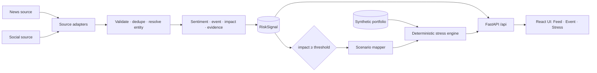

# EventShock — S&P Global & Crisil Campus Hackathon

<p align="center"></p>

**Candidate Name:** Aniket Mandal  
**College Email ID:** [aniket.mandal@iitg.ac.in]  
**College / Campus:** Indian Institute of Technology Guwahati (IITG)  
**Demo Video Link:** [YouTube / Unlisted]  
**Slide Deck Link (if hosted externally):** [Optional Cloud Link / docs/presentation.pdf]  

> **Status: Stage 1 — foundation and first vertical slice.** The full path
> *event → intelligence → risk signal → scenario → portfolio stress → result* works end to end in a
> working UI. The event intelligence is **hand-authored demo fixtures**, not model output. The stress
> engine is **real, deterministic arithmetic**. See [What is real vs. demo](#what-is-real-vs-demo).

## 1. Project Overview / Problem Statement & Approach

Financial risk information shows up in news and social posts long before it appears in structured data.
An analyst must work out *what happened*, *who is affected*, *whether it matters*, and *which portfolios
to look at*. EventShock automates that first pass and connects it to a portfolio stress test (Module B of
the case study).

EventShock keeps three ideas that are usually blurred together separate:

- **Sentiment** — how the text is framed (−1.0 … +1.0).
- **Event** — what happened (an eight-class financial taxonomy).
- **Impact** — how large a market reaction is likely to be (1 … 10, a *market-response proxy*, not a
  probability of loss and not a price forecast).

An event whose impact reaches a configurable threshold (default **7**, a product rule rather than a
learned fact) is mapped to an explicit, illustrative scenario template. A deterministic engine
re-values every position (equities, bonds, loans, derivatives), then shows value before and after and
which positions and risk factors drive the change. Every signal and every stress run carries its
provenance (source, timestamps, model/scenario/engine versions, data origin).

It is decision support, not a trading bot.

## 2. Architecture & Tech Stack



In Stage 1 everything left of `RiskSignal` (adapters, validation, entity resolution, NLP, impact) is
replaced by fixtures: signals are replayed from `data/fixtures/`. Everything from `RiskSignal`
rightwards is the real, final architecture. Details, contracts and
extension points: [docs/ARCHITECTURE.md](docs/ARCHITECTURE.md).

| Layer | Choice | Why |
|---|---|---|
| API | **FastAPI + Pydantic v2** | Typed contracts are the product contracts; OpenAPI for free |
| Stress engine | Plain Python, pure functions | Deterministic, hand-verifiable, no model needed |
| Config | YAML in `configs/` + `EVENTSHOCK_*` env | Product rules live outside code |
| Frontend | **React 19 + Vite + TypeScript + Tailwind v4 + TanStack Query** | Product-grade UI; types generated from the API schema |
| Tests | pytest (backend), Vitest + Testing Library (frontend) | Contracts, formulas, golden replay, UI states |
| Ingestion (Stage 2) | stdlib only: adapters → validate → entity resolution → dedup → enrichment | Deterministic replay from hash-pinned snapshots |
| Sentiment (Stage 3) | **TF-IDF + logistic regression + temperature scaling** (scikit-learn), trained on Twitter Financial News, committed artifact with model card | Small, CPU-only, byte-reproducible; evaluation and failure modes in [docs/SENTIMENT_MODEL.md](docs/SENTIMENT_MODEL.md) |
| Planned (later stages) | Calibrated impact model (XGBoost + SHAP), EDGAR/NewsAPI adapters, DuckDB/SQLite | Behind the extension points in `ports.py` |

## 3. Dataset Used

No proprietary S&P Global or Crisil data is used. Full licence notes: [docs/DATA_LICENSES.md](docs/DATA_LICENSES.md).

**Default profile (`replay`) — real documents, frozen for deterministic replay** (`data/replay/`)

| File | Content | Source / licence |
|---|---|---|
| `gdelt/gkg_articles.jsonl` | 1,308-record stratified slice of the GDELT **GKG bulk files** (1,344 files, 1.28M rows read, 127,592 kept for 34 issuers + market themes): title, URL, domain, **publisher time**, machine tone, NER organisations | [GDELT GKG 2.1](https://data.gdeltproject.org/gdeltv2/masterfilelist.txt); free reuse with citation. No article text. |
| `gdelt/articles.jsonl` | news article **metadata** (URL, title, first-seen time, domain, language) for 34 listed issuers (sector OR-queries) plus market-wide queries, requested window 2026-09-17..30 (1,479 unique articles) | [GDELT DOC 2.0 API](https://www.gdeltproject.org/); free reuse with citation. No publisher text stored. |
| `social/tfn_sample.jsonl` | 300-row sample of finance tweets with human sentiment labels | [`zeroshot/twitter-financial-news-sentiment`](https://huggingface.co/datasets/zeroshot/twitter-financial-news-sentiment), MIT per dataset card |
| `entities.json` | entity master: 34 real listed issuers (name, ticker, sector, country, aliases) | public facts, hand-curated |
| `portfolio.json` | **synthetic** book (equities, bonds, loans, derivatives) on those issuers, sector-tilted by a merchant-category spend mix | generated with a fixed seed; not real positions |
| `sector_mix.json` | aggregate merchant-category spend share per sector from 12.4M card transactions | [Kaggle Financial Transactions](https://www.kaggle.com/datasets/computingvictor/transactions-fraud-datasets), Apache-2.0; aggregate only |
| `manifest.json` | sources, licences, window, replay clock, **sha256 of every file** | startup fails if any file changed |

The full Twitter dataset and any fresh GDELT pulls go to `data/raw/` (git-ignored); the server never calls
the network. Assumptions: GDELT `seendate` is first-seen time, not publication time; the tweets have no
timestamps, so replay assigns deterministic ones (flagged `SYNTHETIC_REPLAY_CLOCK` and never used to
correlate stories).

**Demo profile (`EVENTSHOCK_PROFILE=demo`) — Stage-1 fictional fixtures** (`data/fixtures/`): 15 hand-authored
signals, a 51-position synthetic book on 14 fictional issuers, and their entity master; regenerate with
`make fixtures` (byte-stable, asserted by a test).

Assumptions: scenario magnitudes in `configs/scenarios.yaml` are *illustrative* (each is labelled so in
the UI) and are not calibrated to any regulatory framework.

## 4. Quickstart & Installation

Runtime: Python 3.14 (3.12+ works) on macOS / Linux; Node 20+ to build the UI.

```bash
git clone https://github.com/Aniket03052006/IITG-AniketMandal-hackathon.git
cd IITG-Aniket-Mandal-hackathon
pip install -r requirements.txt          # or: make setup  (venv + dev tools + web deps)
cd web && npm ci && npm run build && cd ..   # build the UI once
python src/main.py                        # then open http://127.0.0.1:8000
```

With `make` and [uv](https://docs.astral.sh/uv/) the same thing is:

```bash
make setup      # venv, Python deps, web deps
make run        # builds the UI and serves UI + API on http://127.0.0.1:8000
```

Useful commands:

| Command | What it does |
|---|---|
| `make dev` | API with reload on :8000 + Vite on :5173 (open http://localhost:5173) |
| `make test` | backend pytest + frontend Vitest |
| `make lint` | ruff + TypeScript typecheck |
| `make fixtures` | regenerate the deterministic Stage-1 demo data |
| `make ingest` | run the ingestion pipeline over `data/replay`, export signals / quarantine / report to `data/processed` |
| `make fetch-prices` | daily prices for all issuers + S&P 500 / VIX / 10y yield from Yahoo (no key) into `data/raw/prices` |
| `make fetch-kaggle` `make fetch-tfn-topic` | Kaggle datasets (needs a token) and the 20-label Twitter topic dataset, into `data/raw` |
| `python scripts/build_history_pack.py` | curate a 2015-2026 history snapshot (tweets, headlines, GKG) for impact modelling; run it with `python -m eventshock.pipeline --replay-dir data/history --export data/processed/history` |
| `make fetch-gkg` | bulk-download GDELT GKG files for a date range, filtered on the fly (zips are discarded); needs `make fetch-gkg-list` once |
| `make fetch-gdelt` `make fetch-tfn` | download fresh source data into `data/raw` (network, throttled) |
| `make replay-pack` | freeze `data/raw` into the committed, hash-pinned `data/replay` |
| `EVENTSHOCK_PROFILE=demo make run` | serve the Stage-1 fictional fixtures instead of the real replay pack |
| `make types` | regenerate the frontend API types from the FastAPI schema |

Without the UI build, `python src/main.py` still serves the API; interactive docs are at `/api/docs`.

**Demo path (about 90 seconds):** open the **Data Pipeline** page (what came in, what was quarantined, what was folded) → Risk Feed → open a high-impact signal from a real outlet → read its **Provenance** card (source record, entity decision, duplicates folded) → **Run stress test**. For the Stage-1 walkthrough (`EVENTSHOCK_PROFILE=demo`): Risk Feed → open *Meridian Bancorp flags funding gap…* (impact 9) →
read sentiment, event type, impact drivers and evidence → **Run stress test** → before/after portfolio
value, largest contributors, shock assumptions, per-position formulas, audit panel. Then try a
low-impact event (*What-if*), the partial signal (blocked), and the unresolved-entity macro event.

## 5. Key Results & Domain Impact

What the prototype demonstrates today:

- A feed of multi-source events with sentiment, event class (or "not an event" / "uncertain") and 1–10 impact, each with its evidence
  trail and a persistent *demo fixture* label.
- A rule-based trigger (`impact ≥ 7`) that maps an event class to an explicit scenario template and
  runs it against a multi-asset portfolio. For the headline demo event the book moves from
  **$558.8M to $548.6M (−$10.2M, −1.82%)**, driven mostly by the issuer's own bonds and equity.
- Honest failure handling: partial signals are never given invented scores; below-threshold events are
  reported as *not triggered*; unresolved entities only receive market-wide shocks; positions a
  scenario cannot reach are listed as uncovered rather than treated as safe.
- Deterministic replay: the same inputs produce the same run id and numbers (pinned by a golden test).

Why it matters: an analyst sees the event, the evidence, the scenario assumptions and the portfolio
consequence in one place, and can inspect every number behind it.

### What is real vs. simulated (Stage 2)

| Part | Status |
|---|---|
| Domain contracts, config validation, API, UI | **Real** |
| Source documents (GDELT news metadata, Twitter Financial News posts) | **Real**, frozen for replay |
| Validation / quarantine, entity resolution, de-duplication, corroboration counts, provenance | **Real** (deterministic rules) |
| Stress engine, scenario scaling, attribution, run ids | **Real, deterministic** |
| Sentiment | **Trained model** (`tfidf-lr-v1`): macro-F1 0.78 on held-out Twitter Financial News, 0.47 on Financial PhraseBank, 0.44 on our own AI-labelled sources (95% CIs and baselines in the model card); labelled `MODEL` in the UI, with per-signal confidence and an *in-sample* flag |
| Event type | **Trained model** (`tfidf-lr-event-v1`) trained on 2.3k AI-annotated in-domain labels. It can say *not a market event* or *uncertain*; it separates events from non-events with F1 0.70 on our own AI-labelled sources (the old keyword rules: 0.49), but names the exact type far less reliably (macro-F1 0.53 vs 0.33), never asserts `M&A / Corporate Action`, and **missed its pre-registered acceptance bar on the gold set** (0.33 [0.26, 0.38] vs 0.33); the full card, per-class reliability and error analysis are in [docs/EVENT_MODEL.md](docs/EVENT_MODEL.md) |
| Impact | **Placeholder heuristic** (`placeholder-v0`), labelled in the UI; reads the models' category and tone; none for non-events |
| Impact "drivers" bars | Placeholder heuristic terms, labelled *not a trained model* |
| Portfolio | **Synthetic** positions on real issuers |
| Scenario magnitudes | Illustrative configuration |
| Calibrated impact model, contradiction detection, domain-adapted sentiment, human-adjudicated labels | Not built yet |

## Limitations

Impact is a placeholder rule, not a model; sentiment is a trained model but weak outside its training domain (see [docs/SENTIMENT_MODEL.md](docs/SENTIMENT_MODEL.md)); event type is a trained model whose labels come from an AI annotator (no human labels exist) and which is unreliable on several classes (see [docs/EVENT_MODEL.md](docs/EVENT_MODEL.md)); the entity resolver is a 34-issuer dictionary; GDELT supplies headlines only (no article text); tweets carry no real timestamps; contradiction detection is not built; in-memory state only (the pipeline reruns at startup); no FX/commodity factors or option gamma; single-currency
synthetic book; no authentication. See [docs/ARCHITECTURE.md](docs/ARCHITECTURE.md) for the roadmap and
[docs/PROJECT_JOURNEY.md](docs/PROJECT_JOURNEY.md) for what was built, what broke, and how it was fixed.

## License

MIT — see [LICENSE](LICENSE).
