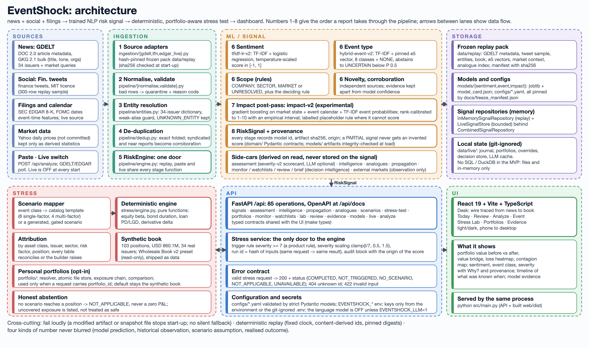
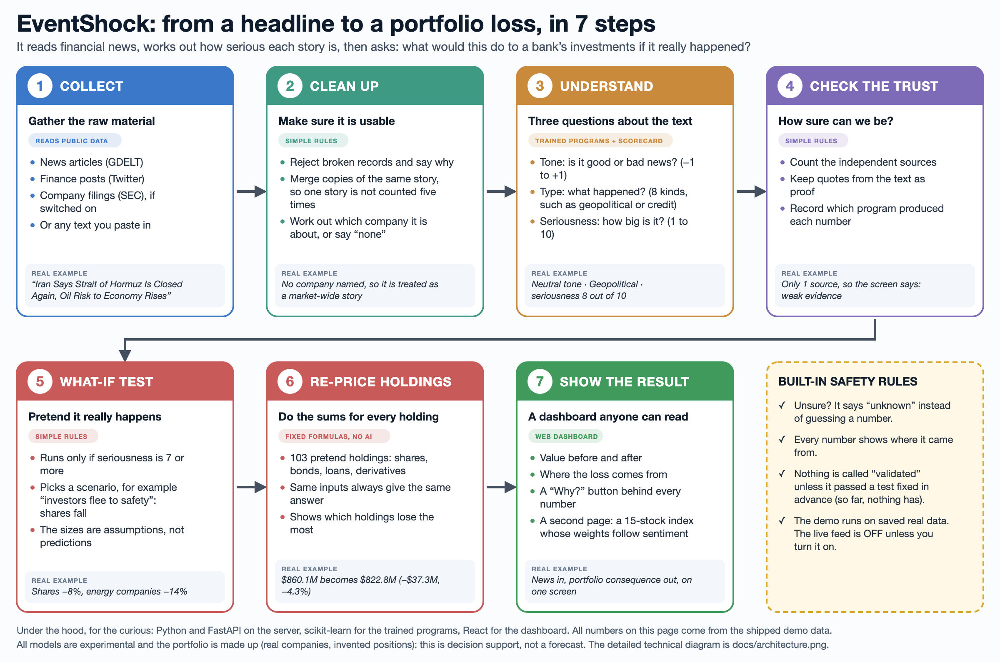

# EventShock — S&P Global & Crisil Campus Hackathon

<p align="center"></p>

**Candidate Name:** Aniket Mandal  
**College Email ID:** [aniket.mandal@iitg.ac.in] *(placeholder: confirm before submitting)*  
**College / Campus:** Indian Institute of Technology Guwahati (IITG)  
**Demo Video Link:** *TODO: add the YouTube (unlisted) link once recorded; the scripted path is [`docs/notes/DEMO_SCRIPT.md`](docs/notes/DEMO_SCRIPT.md)*  
**Slide Deck Link (if hosted externally):** *TODO: `docs/presentation.pdf` is not created yet*  

**EventShock — an event-driven financial risk engine and portfolio stress lab.** It reads financial text from more than one source,
turns each report into a structured risk signal (sentiment, event class, 1–10 score), and shows what that signal would do to a
synthetic wholesale-banking book under an explicit, deterministic stress scenario (Module B of the case study). It also drives a **tactical index rebalancer** (Module A): a mock 15-stock index whose weights follow each company's sentiment, with a weights-over-time dashboard at `/rebalancer`.

> **Honesty box.** Sentiment, event type and impact are trained models, but all three are **experimental**: none has passed a
> pre-registered validation bar. The 1–10 numbers are triage scales, not forecasts. The portfolio is **synthetic** (real issuers,
> invented positions). Scenario shocks are **assumptions**. The demo runs on a **frozen replay** of real public data, not a live feed
> (a live switch exists and is OFF at every start). Details: [Limitations](#13-limitations).

## Run it

**You need:** [Python](https://www.python.org/downloads/) **3.14** (3.12+ is declared but untested), [Node.js](https://nodejs.org/) **22** (20+ expected; used once, to build the UI) and Git. No API key, account or network access is needed for the demo: it runs on the committed replay data in `data/`.

The steps are the same everywhere: clone, create a virtual environment, install the Python packages, build the UI once, start the server. Only the shell syntax differs.

<details open>
<summary><b>macOS</b> (Terminal, zsh)</summary>

```bash
git clone https://github.com/Aniket03052006/IITG-AniketMandal-hackathon.git
cd IITG-AniketMandal-hackathon

python3 -m venv .venv
source .venv/bin/activate
pip install -r requirements.txt

(cd web && npm ci && npm run build)      # build the UI once

python src/main.py                        # then open http://127.0.0.1:8000
```

Python and Node are easiest to get with Homebrew: `brew install python@3.14 node@22`.
</details>

<details>
<summary><b>Linux</b> (bash)</summary>

```bash
git clone https://github.com/Aniket03052006/IITG-AniketMandal-hackathon.git
cd IITG-AniketMandal-hackathon

python3 -m venv .venv
source .venv/bin/activate
pip install -r requirements.txt

(cd web && npm ci && npm run build)

python src/main.py                        # then open http://127.0.0.1:8000
```

On Debian/Ubuntu, `python3 -m venv` needs `sudo apt install python3-venv`.
</details>

<details>
<summary><b>Windows</b> (PowerShell)</summary>

```powershell
git clone https://github.com/Aniket03052006/IITG-AniketMandal-hackathon.git
cd IITG-AniketMandal-hackathon

py -3.14 -m venv .venv
.venv\Scripts\Activate.ps1
pip install -r requirements.txt

cd web
npm ci
npm run build
cd ..

python src\main.py                        # then open http://127.0.0.1:8000
```

- If activation is blocked ("running scripts is disabled"), run `Set-ExecutionPolicy -Scope Process -ExecutionPolicy Bypass` once in that window, then activate again. In **Command Prompt** use `.venv\Scripts\activate.bat` instead.
- `py -3.14` is the Python launcher that ships with the python.org installer; if you installed another version, use `py -3.12` (or `python -m venv .venv`).
- `make` is not installed on Windows by default. Everything in this README works with the plain commands above; the `make ...` shortcuts are optional (install them with `winget install GnuWin32.Make`, or run the commands listed in the [`Makefile`](Makefile) by hand).
- **WSL** also works: follow the Linux steps inside the Linux distribution and open the same URL in your Windows browser.
</details>

<details>
<summary><b>With <code>uv</code> and <code>make</code></b> (macOS / Linux, or Windows with make)</summary>

```bash
make setup      # creates .venv, installs Python deps and the web deps
make run        # builds the UI and serves UI + API on http://127.0.0.1:8000
```
</details>

**Then:** open **http://127.0.0.1:8000**. The dashboard opens on the Desk; the three-minute guided path is [`docs/notes/DEMO_SCRIPT.md`](docs/notes/DEMO_SCRIPT.md). The interactive API docs are at `/api/docs`, and the Module A rebalancer is at `/rebalancer`. Press `Ctrl+C` in the terminal to stop the server.

**Options and troubleshooting**

| Situation | What to do |
|---|---|
| Port 8000 is busy | `python src/main.py --port 8010`, then open that port |
| Reach it from another device on your network | `python src/main.py --host 0.0.0.0` (the app has no login; use a trusted network only) |
| Skip Node entirely | Run `python src/main.py` without building the UI: the API still works at `/api/docs`, the dashboard is not served |
| `pip install` fails on Python 3.12 / 3.13 | `requirements.txt` was resolved for Python 3.14 with binary wheels only; use 3.14, or `pip install -r requirements.in` to let pip resolve versions for your Python |
| `python` not found (macOS / Linux) | Use `python3`; once the virtual environment is active, `python` works |
| Command not found after a restart | Re-activate the environment (`source .venv/bin/activate` / `.venv\Scripts\Activate.ps1`) in each new terminal |
| Hot-reload development (API :8000, Vite :5173) | `make dev` (macOS / Linux) |
| Run the tests | `make test` or `python -m pytest` and `cd web && npm test` |

The live feed and the language-model reader are **off by default**; the full list of run modes and environment variables is in [§4](#4-quickstart--installation).

## Reproduce the results

Everything below runs from a fresh clone after the install steps above (virtual environment active), without `make`, so the commands are the same on macOS, Linux and Windows. Each step says what it needs and what you should see. Steps 1 to 3 need no download and no network.

**1. Verify the frozen state (seconds).** Every served model, config, gold set, calendar, replay file and evidence file is checked against its recorded sha256.

```bash
python scripts/freeze_manifest.py --check
```

Expected: `freeze check passed: 88 files, 6 models, snapshot replay-2026-09-30-v1`. A mismatch names the file that changed.

**2. Re-run the pipeline on the replay data (about a minute).** Raw documents are normalised, validated, de-duplicated, entity-resolved and enriched, then exported to `data/processed/` (git-ignored).

```bash
python -m eventshock.pipeline --export data/processed
```

Expected: `snapshot replay-2026-09-30-v1: read=3455 quarantined=240 folded=184 kept=3031 signals=2334 (resolved=1184 unknown=1150)`. The `digest` line it prints is the digest of this plain pipeline with placeholder enrichment. It is **not** the served digest: the served signals use the three trained models, and their digest (`078a70ae...`) is pinned by the next step.

**3. Run the tests that pin the served output.**

```bash
python -m pytest tests/e2e/test_replay_served.py -q       # served digest, scope/status/impact mixes, model ids
python -m pytest -q                                        # whole backend suite
(cd web && npm test)                                       # frontend suite
python scripts/smoke_e2e.py                                # starts the real server and checks API, hashes, stress and UI (~2 min)
```

Expected for the first command: all tests pass. It recomputes the served signals from the replay pack and compares them with the pinned digest and class mixes, so a change in any model, config or scoring rule fails it by name.

**4. Retrain the sentiment model (about a minute).** Training data is committed (`data/modeling/sentiment.jsonl`), and seeds are fixed.

```bash
python -m eventshock.modeling train-sentiment --config sentiment_model_v2.yaml
```

Expected: `model tfidf-lr-v2: ... C=3.0, class_weight=balanced, T=0.99`, artifact sha256 starting `d8b694c1363d`, TFN-test macro-F1 0.783, PhraseBank 0.525. The retrained `model.joblib` is byte-identical to the committed one. One field in the regenerated `model_card.json`, `config_digest`, differs from the committed card (the committed value predates a config edit, a pre-existing drift that does not affect the model). `freeze-check` will then report that card as changed; restore it with `git checkout models/sentiment/tfidf-lr-v2/model_card.json`. Training overwrites files under `models/`, so check `git status` afterwards.

**5. What needs data you download yourself.** These are reproducible in principle but not from a bare clone, because the inputs are large or licensed and are git-ignored (see [Dataset Used](#3-dataset-used) and `docs/notes/DATA_LICENSES.md`).

| What | Needs | Command |
|---|---|---|
| Event model (`tfidf-lr-event-v1`) | committed `data/modeling/event_train.jsonl` | `python -m eventshock.modeling train-event` |
| Hybrid event model, impact models | e5 embeddings (optional `.venv-emb`), daily prices, the impact tables; impact takes about 45 min to 1 h | `make fetch-prices`, then `make impact-table-v2 train-event-hybrid train-impact-v2` |
| Module A back-test and strategy lab | daily prices (`make fetch-prices`, Yahoo, no key) | `make rebalancer-backtest rebalancer-risk-inputs rebalancer-lab` |
| A fresh replay pack | network; GDELT rate-limits, so a re-fetch will not match the frozen pack | `make fetch-gdelt fetch-tfn replay-pack` |

Re-fetched data is not expected to reproduce the committed numbers: the frozen pack in `data/replay/` is the authoritative input, which is why steps 1 to 3 are the supported check. Re-running a Module A build against newly downloaded prices will report the committed `data/rebalancer/*.json` as stale if the result differs.

**What was verified for this section.** Steps 1, 2 and the `test_replay_served.py` run in step 3 and step 4 were executed on macOS (Apple Silicon, Python 3.14) while writing it. The full backend and frontend suites, the smoke test, the Windows and Linux runs, the event-model retrain and everything in step 5 were not re-run here.

Contents: [Run it](#run-it) · [Reproduce](#reproduce-the-results) · [1 Overview](#1-project-overview--problem-statement--approach) · [2 Architecture](#2-architecture--tech-stack) · [3 Dataset](#3-dataset-used) ·
[4 Quickstart](#4-quickstart--installation) · [5 Results](#5-key-results--domain-impact) · [6 ML](#6-ml-approach) · [7 Stress](#7-portfolio-stress-testing) ·
[8 API](#8-api) · [9 Dashboard](#9-dashboard) · [10 Structure](#10-project-structure) · [11 Evaluation](#11-evaluation) · [12 Failures](#12-failure-handling) ·
[13 Limitations](#13-limitations) · [14 Secrets](#14-security-and-secrets) · [15 Reproducibility](#15-reproducibility) · [16 Links](#16-submission-checklist-and-project-journey) · [17 Future](#17-future-work)

## 1. Project Overview / Problem Statement & Approach

Risk information shows up in news and social posts long before it appears in structured data, and an analyst has to work out *what
happened*, *who is affected*, *whether it matters*, and *which portfolios to look at*. The problem is not finding financial news; it is
converting fast-moving unstructured text into an **auditable risk signal** and then connecting that signal to **portfolio consequences**
in a way a reviewer can inspect number by number.

EventShock keeps three ideas that are usually blurred into one "sentiment score" separate:

- **Sentiment**: how the text is framed (−1.0 … +1.0).
- **Event**: what happened (eight financial classes — Geopolitical, Macroeconomic, Credit/Funding, M&A/Corporate action, Regulatory/Legal,
  Product/Operations, Earnings/Financial performance, Market/Valuation — plus *not an event* and *uncertain*).
- **Impact / severity**: how large the development is (1–10). Two readings exist and are never merged: `impact-v2`, a trained,
  experimental estimate of the *size of the market's reaction*, and **severity-v2**, a transparent four-question scorecard that is the
  headline number and the stress trigger (see [§6](#6-ml-approach)). Neither is a probability of loss or a price forecast.

An event whose severity reaches a configurable threshold (default **7**, a product routing rule, not a statistical fact) is mapped to an
explicit scenario template (or a scenario generated from the event's own scope). A deterministic engine re-values every position
(equities, bonds, loans, derivatives) and shows value before and after, which positions and risk factors drive the change, and what the
scenario did **not** reach. Every signal and every stress run carries its provenance (source, timestamps, model/scenario/engine versions
and data origin). It is decision support, not a trading bot and not a regulatory model.

**Why EventShock is built this way.** None of the pieces is novel on its own (TF-IDF/logistic regression, gradient boosting, first-order
revaluation). The defensible contribution is the **complete, honest chain**: *event → calibrated impact → evidence → exposure-aware
stress*, with an availability class on every input (look-ahead is refused), pre-registered acceptance bars that were never edited after
results, abstention instead of invented numbers, and four kinds of number — model prediction, historical observation, scenario
assumption, realised outcome — that are never blurred. The pain-point-by-pain-point rationale is in
[`docs/notes/FEATURES_AND_PAIN_POINTS.md`](docs/notes/FEATURES_AND_PAIN_POINTS.md).

## 2. Architecture & Tech Stack



*([`docs/architecture.png`](docs/architecture.png), 2400 × 1600, Stage 16 with the Module A lane; regenerate with `python scripts/make_architecture_diagram.py --png`.)*

**New to the technology?** Start with the plain-language version, [`docs/architecture_simple.png`](docs/architecture_simple.png): the same flow in seven steps, with one real headline followed through to the portfolio loss.



**Every component, module by module:** [`docs/architecture_detailed.png`](docs/architecture_detailed.png) (3600 × 2644; regenerate with `python scripts/make_detailed_diagram.py --png`) shows ingestion, pipeline, models, signal core, side-cars, stress and portfolio, API routers and dashboard with the real module names.

```
sources ─► adapters ─► normalise/validate ─► entity resolution ─► dedup ─► [sentiment · event · scope · novelty] ─► impact post-pass
        ─► RiskSignal (+provenance) ─► side-cars (assessment, intelligence, analogues, propagation, monitor …)
        ─► FastAPI /api ─► stress service ─► scenario mapper ─► deterministic engine ─► attribution ─► React dashboard
```

Everything left of `RiskSignal` is **the same code** for the frozen replay run, pasted text (`POST /api/analyze`) and the optional live
feed (`pipeline/engine.py::RiskEngine`). The server never calls the internet unless the Live switch is turned on by the user.
The authoritative description, with contracts, module boundaries, failure behaviour and trade-offs, is
[`docs/ARCHITECTURE.md`](docs/ARCHITECTURE.md).

| Layer | Choice | Why |
|---|---|---|
| Language / runtime | Python 3.14 (≥ 3.12 declared in `pyproject.toml`; only 3.14 tested), Node 22 for the UI build (tested; 20+ expected) | wheels for every pinned dependency verified on 3.14 |
| API | **FastAPI + Pydantic v2** | typed contracts are the product contracts; OpenAPI for free; the UI types are generated from it |
| Ingestion | standard library only (`urllib`, `hashlib`, `difflib`) behind adapters | deterministic replay from hash-pinned snapshots; one module (`ingestion/fetch.py`) owns all HTTP |
| Sentiment | **TF-IDF + logistic regression + temperature scaling** (scikit-learn) | small, CPU-only, byte-reproducible; trained on 9.3k human-labelled finance tweets |
| Event type | **TF-IDF ‖ frozen e5-large sentence vector → logistic regression**, calibrated, with abstention | beat five other representations on a pre-registered comparison; vectors for the replay are pinned, so no torch at run time |
| Impact | **additive gradient boosting** (scikit-learn) on market state, event calendar and event probabilities, rank-calibrated to 1–10 | tabular, heterogeneous features; exact additive attributions instead of SHAP |
| Severity | rubric-based scorecard (`configs/severity.yaml`), optional LLM *reader* (Groq or Anthropic over `urllib`) | the LLM reads, code decides; the app works with no key |
| Stress engine | plain Python, pure functions | hand-verifiable, deterministic, no model needed |
| Storage | hash-pinned JSON/JSONL/NPZ files, `joblib` artifacts, in-memory repositories, git-ignored local state in `data/live/` | no SQL/DuckDB/Parquet in the MVP; nothing needs persistence beyond files |
| Config | YAML in `configs/`, validated by strict Pydantic models, `EVENTSHOCK_*` env | product rules live outside code; a bad config stops start-up |
| Frontend | **React 19 + Vite + TypeScript + Tailwind v4 + TanStack Query** | product-grade, accessible, light/dark UI; no charting library (CSS/SVG) |
| Tests | pytest (2,368 tests in 152 files), Vitest + Testing Library (782 tests in 42 files) | contracts, formulas, golden replay, leakage invariants, UI states |

### Key components

| Component | Purpose → Technology → Why → Output |
|---|---|
| Source adapters (`ingestion/`) | read GDELT DOC/GKG, Twitter Financial News, EDGAR 8-K → stdlib adapters, one per provider → provider logic stays replaceable → `RawDocument` or a `Rejected` with a reason |
| Validation + normalisation (`pipeline/validate.py`) | refuse malformed rows → closed set of reject codes → nothing silently dropped → clean documents + a quarantine report |
| Entity resolution (`pipeline/entities.py`) | link text to one of 34 listed issuers → cashtag, legal name, alias, weak-alias guard, restrained fuzzy match → a wrong company is worse than none → `EntityMention` (or `UNKNOWN_ENTITY`, kept as a first-class state) |
| De-duplication (`pipeline/dedup.py`) | stop one story being counted five times → exact / syndicated / near / same-event clustering, star-anchored → corroboration must be independent → clusters; duplicates folded, not counted |
| Sentiment (`pipeline/sentiment_model.py`) | framing of the text → `tfidf-lr-v2` → cheap and inspectable → probabilities + score in [−1, 1] |
| Event classification (`pipeline/event_model.py`) | what happened → `hybrid-event-v2`, 9-way with abstention → abstain rather than guess → class, probability vector, status |
| Scope (`pipeline/scope.py`) | what the report is about when no company is named → deterministic vocabulary rules → company resolution is an enrichment, not a gate → COMPANY / SECTOR / MARKET / UNRESOLVED with the matched terms |
| Impact (`pipeline/impact_model.py`) | size of the market reaction → `impact-v2` → measured against pre-registered checks → 1–10 score, interval, attributions, lifecycle label |
| Calibration | score on a rank scale → empirical rank calibration (no hand-set thresholds) → "7+" means "a move this large happened this often in similar regimes" → score + 10–90% range |
| Evidence layer (`domain/`, `intelligence/`) | provenance and trust → model ids and artifact hashes on every stage, independent-source count, evidence tier kept apart from model confidence → a reviewer can see why → `RiskSignal.provenance`, `EventIntelligence` |
| Assessment (`assessment/`, `llm/`) | explainable severity → four anchored answers, fixed matrix, two bounded data adjustments → transparent triage → `RiskAssessment` (severity 1–10, scorecard, provenance, sensitivity range) |
| Scenario mapper (`stress/scenarios.py`, `propagation/scenario_gen.py`) | pick the shocks → catalog templates (8 single-factor + 4 multi-factor) or a generated, gated scenario → shocks are assumptions, labelled → `Scenario` or `SCENARIO UNAVAILABLE` with the failed gate |
| Stress engine (`stress/engine.py`) | revalue the book → pure functions per asset class → deterministic → `StressResult` with a formula per position |
| FastAPI (`api/`) | expose everything → thin routers over services → one contract for UI and other consumers → 93 operations under `/api` |
| Storage | frozen replay pack, model artifacts, configs, local state → files → reproducible clone-and-run → see [ARCHITECTURE §Storage](docs/ARCHITECTURE.md#5-storage) |
| Dashboard (`web/`) | tell the story from news to book → React → see [§9](#9-dashboard) |
| Replay mode | the same inputs give the same numbers → clock pinned to 2026-10-01 12:00 UTC, content-derived ids, golden digests → a demo that cannot drift → `output_digest` `078a70ae…` |

### End-to-end example (real output of the shipped replay)

A GDELT report, *"After Iran Says Strait of Hormuz Is Closed Again, Oil Risk to Economy Rises Once More"* (aol.com, first seen
2026-09-20), is validated and resolved to **no listed company** (`UNKNOWN_ENTITY`; scope `MARKET`, region `MIDEAST`). The event model
calls it **Geopolitical (P 0.72)**; sentiment is **neutral (+0.02)**. The severity scorecard reads it as **8/10 (High)**; the trained
`impact-v2` score for the same text is **2** and is shown beside it as a labelled reference, because the two answer different
questions and disagree (this is visible in the UI and is deliberate). Severity ≥ 7 triggers the Geopolitical flight-to-safety scenario,
scaled for this event; the engine re-values the 103-position synthetic book from
**$860.1M to $822.8M (−$37.3M, −4.33 %)** and attributes the loss to equities, bonds, derivatives and loans. Only **one** independent
source reported it, so the evidence tier is *insufficient*, and the dashboard says so next to the loss. The numbers are reproduced in
[§5](#5-key-results--domain-impact) from the running server (see `docs/notes/SUBMISSION_CHECKLIST.md`).

## 3. Dataset Used

No proprietary S&P Global or Crisil data is used. Licence notes and removal procedures: [`docs/notes/DATA_LICENSES.md`](docs/notes/DATA_LICENSES.md).

**Sources actually used**

| Source | Type | Purpose | Live / Replay | Licence / access notes |
|---|---|---|---|---|
| [GDELT DOC 2.0](https://www.gdeltproject.org/) | news article **metadata** (URL, title, first-seen time, domain) | the *news* source of the risk signal | **Replay** (1,847 records, window 2026-09-17..30); **live** polling opt-in | free reuse with citation; no publisher text stored |
| [GDELT GKG 2.1](https://data.gdeltproject.org/gdeltv2/masterfilelist.txt) | news metadata + machine tone + organisations | second news feed; also 2023-25 history for model evaluation | Replay (1,308-record slice committed); raw git-ignored | same GDELT terms |
| [Twitter Financial News](https://huggingface.co/datasets/zeroshot/twitter-financial-news-sentiment) | finance **social posts** with human sentiment labels | the *social* source; sentiment training data | Replay (300-row sample committed); full data git-ignored | MIT per dataset card; tweets originate on X |
| SEC EDGAR 8-K | official filings (form, acceptance time, item codes) | event calendar for the impact model; optional second live source | Derived table committed (`data/events/`); live Atom feed opt-in | US public domain; fair-access User-Agent (`EVENTSHOCK_SEC_CONTACT`) |
| FOMC calendars | decision dates | event calendar feature | derived, committed | US public domain |
| Yahoo Finance chart endpoint | daily prices of the 34 issuers, S&P 500, VIX, 10y yield | impact targets and market context | **not committed**; only derived statistics are (`data/replay/market/`) | unofficial endpoint, research use |
| Kaggle card transactions (`computingvictor`) | 13.3M retail card transactions | **only the merchant-category spend mix** that tilts the synthetic book by sector | aggregate only (`sector_mix.json`) | Apache-2.0 |
| Kalshi public markets | prediction-market prices | *observation* beside an event, never an input to any score | captured snapshot (default); live opt-in | public API, no key |

Other Kaggle/HF datasets are used only for local training or evaluation and are never committed (listed in `notes/DATA_LICENSES.md`). Not obtained:
NewsAPI, Alpha Vantage (need personal keys) and Salad Money Open Banking (not an open download).

**Committed data** (the `data/` folder is what the prototype runs on): `data/replay/` (21 MB, hash-pinned snapshot with
`manifest.json`), `data/fixtures/` (Stage-1 fictional demo profile), `data/events/`, `data/portfolio/`, `data/benchmarks/`, `data/gold*/`
(AI-annotated evaluation sets), `data/live/sample_capture.jsonl` (216 real replay-pack articles first seen after the window, for the
"simulated live" mode).

**Assumptions**

- GDELT `seendate` is when GDELT first saw the page, **not** the publication time (`timestamp_origin = GDELT_FIRST_SEEN`).
- The tweets have no timestamps; replay assigns deterministic ones inside the window, flagged `SYNTHETIC_REPLAY_CLOCK`, and such
  documents are never correlated with others by time. Several time-dependent sections therefore report *unavailable* for them.
- The portfolio is **synthetic**: 103 positions (34 equities, 41 bonds, 19 loans, 9 derivatives; USD 860.1M) on 34 real listed issuers,
  generated with a fixed seed, sector-tilted by the card-spend mix. They are not real holdings.
- Scenario magnitudes (`configs/scenarios.yaml`, `scenarios_multifactor.yaml`) are **illustrative**, not calibrated to any regulatory framework.
- Event labels used to train and evaluate the event model were produced by an AI annotator; no human adjudication was done.

## 4. Quickstart & Installation

Runtime: **Python 3.14** (3.12+ declared, not tested) and **Node 22** (tested; 20+ expected; the UI is built once). Tested on macOS (Darwin 25.6, Apple Silicon). No
external service or API key is needed for the demo.

```bash
git clone https://github.com/Aniket03052006/IITG-AniketMandal-hackathon.git
cd IITG-AniketMandal-hackathon
pip install -r requirements.txt
(cd web && npm ci && npm run build)      # build the UI once (web/dist is not committed)
python src/main.py                        # exact run command; then open http://127.0.0.1:8000
```

With [uv](https://docs.astral.sh/uv/) and `make`: `make setup` (venv, dev tools, web deps) then `make run` (builds the UI and serves UI + API
on `http://127.0.0.1:8000`). Without the UI build, `python src/main.py` still serves the API; interactive docs are at `/api/docs`.

| Task | Command |
|---|---|
| Run backend + dashboard (one process) | `python src/main.py` or `make run` |
| Hot-reload development (API :8000, Vite :5173) | `make dev` |
| Replay / demo path (default; no network) | `make run`, then follow [`docs/notes/DEMO_SCRIPT.md`](docs/notes/DEMO_SCRIPT.md) (3 min 40 s) |
| Serve the Stage-1 fictional fixtures instead | `EVENTSHOCK_PROFILE=demo make run` |
| Language model reads new text (needs a key; sends pasted text to the provider, and says so) | `make run-llm` |
| Live feed (network; GDELT, optionally SEC filings) | the Live switch in the UI, or `make run-live`; **off by default** |
| Offline "simulated live" | `make run-capture` (plays `data/live/sample_capture.jsonl`) |
| Tests (backend + frontend) | `make test` (`make test-api`, `make test-web`) |
| Lint / types | `make lint` (ruff + `tsc`) |
| Verify the frozen model, config, data hashes | `make freeze-check` |
| Smoke test the real server (API, model ids/hashes, stress, UI; ~2 min) | `make smoke` |
| Retrain / re-evaluate | `make train-sentiment-v2`, `make train-event-hybrid`, `make train-impact-v2` (long; need local data, see [`docs/notes/FINAL_MODEL_REPORT.md`](docs/notes/FINAL_MODEL_REPORT.md)) |

All `make` targets are listed in the [`Makefile`](Makefile). **Environment variables:** copy `.env.example` to `.env` (git-ignored). Every key
is optional; defaults work for the demo. Provider keys (`GROQ_API_KEY`, `ANTHROPIC_API_KEY`) and `EVENTSHOCK_SEC_CONTACT` are read from the
environment or `.env` only and are never committed.

## 5. Key Results & Domain Impact

**What the prototype demonstrates** (all on the frozen replay run: 3,455 records read → 244 quarantined, 184 exact duplicates folded →
**2,330 signals**: **1,082** read as market events and scored for severity, **1,248** judged *not a market event* (kept, but given no score), and **27** reach
severity ≥ 7 and so suggest a scenario):

- A feed of multi-source signals with sentiment, event class and a 1–10 score, each with its evidence trail and provenance.
- A severity trigger (≥ 7) that maps the event to an explicit scenario and runs it on a multi-asset portfolio; headline run:
  **$860.1M → $822.8M (−$37.3M, −4.33 %)** under the Geopolitical flight-to-safety scenario, 84.5 % of the book reached. Re-running the same event under the
  *Oil supply shock (multi-factor)* scenario gives −$32.5M (−3.78 %); the propagation-generated scenario (adds propagated sector shocks) gives −$42.2M (−4.91 %). The UI always states what share of the book a scenario did not reach.
- Honest failure handling: partial signals are never given invented scores; below-trigger events report *not triggered*; unresolved
  entities receive only market-wide shocks; positions a scenario cannot reach are listed as uncovered, never as safe.
- Deterministic replay: the same inputs give the same run id and numbers, pinned by golden tests and a served-output digest.
- **Module A, the tactical index rebalancer** (`/rebalancer`): 15 mock stocks, equal-weight benchmark, weights tilted by decayed, one-source-one-vote sentiment inside per-stock bounds and a 4 % turnover cap, a self-check on every cycle and a named reason for every stock. Honest result: +0.19 % against equal weight over 10 sessions, at the 82nd percentile of a 200-shuffle placebo, i.e. within chance; no skill is claimed (`docs/notes/REBALANCER.md`).
- Analyst tooling on top of the signal: what changed since the last cycle (**Today**), a rule-queued **Review** page, watchlists,
  a scenario lab with reverse stress, an executive brief, and a **Live** switch.

**Why it matters.** An analyst sees the event, the evidence, the scenario assumptions and the portfolio consequence in one place, and
can open every number behind it. The same pipeline accepts pasted text, so a desk can ask "what would *this* headline do to *my* book".

### Example output

`GET /api/signals/sig_8f79c8bbd6` (abridged from the shipped replay; fields not shown are omitted):

```json
{
  "id": "sig_8f79c8bbd6",
  "entity": {"entity_id": "UNKNOWN_ENTITY", "link_confidence": 0.0},
  "scope": {"level": "MARKET", "regions": ["MIDEAST"], "matched_terms": {"theme": ["strait of hormuz"]}},
  "sentiment": {"positive": 0.5041, "neutral": 0.0154, "negative": 0.4805, "score": 0.0236},
  "event": {"category": "GEOPOLITICAL", "status": "CLASSIFIED", "probabilities": {"GEOPOLITICAL": 0.7177, "MACROECONOMIC": 0.2563}},
  "impact": {"score": 2, "note": "impact-v2 (experimental model): shown as a reference beside the assessed severity"},
  "model_versions": {"sentiment": "tfidf-lr-v2+d8b694c1", "event": "hybrid-event-v2+3ca17864", "impact": "impact-v2+31545b49"}
}
```

The assessed severity (`GET /api/signals/{id}/assessment`) and the stress run (`POST /api/signals/{id}/portfolio-stress`) for the same signal
return the severity 8/10 scorecard and a `COMPLETED` run with the before/after summary and per-position formulas.

## 6. ML Approach

Every number in this section is read from a committed model card or `docs/evidence/*.json`; `tests/unit/test_final_report.py` fails if a
quoted figure stops matching its source. The consolidated table is [`docs/notes/FINAL_MODEL_REPORT.md`](docs/notes/FINAL_MODEL_REPORT.md).

### Sentiment — `tfidf-lr-v2`
Input: the headline or post text only. Pipeline: TF-IDF (word 1–2-grams + character 2–5-grams) → class-balanced logistic regression →
temperature scaling. Output: P(negative / neutral / positive) and `score = P(positive) − P(negative)` in [−1, 1]. Trained on 9,355
human-labelled finance tweets. Same-source test macro-F1 is **0.778** (v1, 95 % CI [0.749, 0.805]); on the out-of-domain Financial
PhraseBank v2 improves macro-F1 from 0.466 to 0.525, and on news-style gold sets it stays weak (≈ 0.44) with poor calibration. Sentiment
never moves a stress number (tested). FinBERT variants were **probed, not served**: on a 30-pair finance-polarity probe they got 93 % right against 77 % for this model
(a diagnostic, never used to choose; no FinBERT sentiment head was compared with it on a labelled benchmark, so that is the most obvious open improvement). Details: [`docs/notes/SENTIMENT_MODEL.md`](docs/notes/SENTIMENT_MODEL.md).

### Event classification — `hybrid-event-v2`
Taxonomy: the eight classes above plus `NONE` ("not a market event"); the model abstains to `UNCERTAIN` below P = 0.5. TF-IDF features and
a frozen e5-large vector feed one 9-way logistic regression with temperature scaling. Trained on 2,305 **AI-annotated** headlines/tweets.
Served macro-F1 (an abstention counts as wrong): **0.54** [0.42, 0.66] on gold v1, **0.60** [0.51, 0.67] on gold v2 and **0.78** on the
replay check, against 0.33 / 0.38 / 0.25 for the keyword rules. It passes three of four pre-registered checks and **fails the fourth**
(an evaluation set that took no part in adopting it; human adjudication was not done), so it is *experimental*. Weak classes remain
(Geopolitical F1 ≈ 0.28 on one set). Details: [`docs/notes/EVENT_MODEL.md`](docs/notes/EVENT_MODEL.md).

### Impact — `impact-v2` (experimental)
- **What it predicts:** the *size* (not the direction) of the market's reaction over the following two sessions, as
  `log1p(|z|)` with `z` = abnormal return ÷ trailing volatility. Scope `ISSUER` uses one resolved company's abnormal return; scope `MARKET`
  uses the S&P 500's own move for documents naming no company.
- **What the historical target is:** realised prices *after* the report. Future prices are used **only to build labels**, never as features.
- **What is available at decision time:** market state (volatility regime, trailing returns, VIX, 10-year yield), timing, an
  `EventCalendar` (FOMC dates and SEC 8-K schedule, known at event time) and the TF-IDF event model's probabilities. Every feature must be
  registered `AT_EVENT_TIME` in `modeling/leakage.py`; anything known only afterwards is refused as `POST_EVENT`; `unique_domains`,
  `source_count` and `ticker` are banned. A test swaps all later filings for decoys and requires identical features.
- **Protocol:** chronological splits, 5-session embargo, rolling-origin folds for selection and calibration, 2024 validation, 2025 test and
  2026 news each scored once; acceptance checks written before the results (`configs/impact_model.yaml`, `configs/evidence_v2.yaml`) and never
  edited.
- **From continuous output to 1–10:** the raw prediction is mapped to a rank-calibrated score (`ceil(raw × 10)`, minimum 1) with an
  empirical 10–90 % interval. "7+" means *a reaction that large happened about this often in similar regimes*.
- **Measured:** on 9,897 held-out 2024-25 issuer episodes Spearman is **+0.168** [+0.148, +0.187]; on 2026 news +0.084 [+0.013, +0.156]. The
  incremental-value study attributes the skill to the **calendar and the volatility regime**; text-model outputs add none, and a
  pre-event placebo window scores *higher* than the real one. Hence **experimental, not validated**.
- **What the score does not mean:** not a forecast of direction, not a probability of loss, not causal, and not evidence that the model
  "read" the headline. Details: [`docs/notes/IMPACT_MODEL.md`](docs/notes/IMPACT_MODEL.md), [`docs/notes/EVIDENCE_V2.md`](docs/notes/EVIDENCE_V2.md).

### Severity — `severity-v2` (the headline number and the stress trigger)
A transparent scorecard, not a learned model: four anchored answers (**intensity**, **reach**, **certainty**, **direction**) → a fixed matrix
→ certainty × direction scaling → two bounded data adjustments (VIX regime under an explicit freshness policy, novelty) → 1–10. Tone,
model confidence, outlet count and source reliability are not inputs. Each answer is first derived by rules; an optional language model
may move one answer by at most one step with a verbatim quote, and the app works identically without a key (labelled *rule-based*). The
language model **reads**, code **decides**. Against realised market moves the scale is `HEURISTIC_UNCALIBRATED` (2025 test +0.007
[−0.025, +0.039]), shown on the Evidence page's *Outcome check* tab: it is a triage scale, not an outcome-calibrated one. The threshold of
7 is a **product routing rule**. Details: [`docs/notes/RISK_ASSESSMENT.md`](docs/notes/RISK_ASSESSMENT.md), [`docs/notes/FINANCE_THEORY.md`](docs/notes/FINANCE_THEORY.md).

## 7. Portfolio Stress Testing

The default book is synthetic and read-only; a personal portfolio is used only when a request carries `portfolio_id`
([`docs/notes/PORTFOLIOS.md`](docs/notes/PORTFOLIOS.md)). The engine is **deterministic**: no randomness, no model, and shock sizes are
**assumptions, not forecasts**. A read-only *Wholesale Book v2* preset adds ratings, spreads, convexity and counterparty data (synthetic
illustrative values).

Per asset class (shocks are scaled per event by `clamp(severity / 7, 0.5, 1.5)`; the most specific scope wins, issuer > sector > market, so
nothing is double-counted):

| Class | Revaluation |
|---|---|
| Equity | `ΔV = V·β·s` for market-wide shocks, `V·s` for sector / issuer shocks |
| Bond | `ΔP/P = −D·(Δrates + Δspread)/10⁴`, floored at −100 %; optional convexity term |
| Loan | value = EAD − EL; `PD' = PD·(1+(m−1)·sens)`, `LGD' = LGD + a`; `ΔV = −(EAD·PD'·LGD' − EAD·PD·LGD)`; optional spread-to-PD link and CVA |
| Derivative | first-order `ΔV = delta · underlying · s`; optional gamma |

Attribution by risk factor sums exactly to each position's change; every grouped table (asset class, sector, issuer, factor) reconciles to
the total or the builder raises. **Trigger:** assessed severity ≥ 7 (config `trigger_threshold`); below it the result is `NOT_TRIGGERED`
unless the analyst runs a flagged what-if; a signal without a score is `UNAVAILABLE` even when forced. **Exposure mapping:** a shock binds
by scope (`ISSUER` needs a company scope, `SECTOR` a sector, `MARKET` always); a scenario that reaches no position returns
`NOT_APPLICABLE`, never a zero P&L. The generated scenario (`propagation/`) is gated on severity, relevance, direction, mapping and reach
and is always labelled *SCENARIO SIMULATION — NOT A PREDICTION*. Known limits: no curve twist or liquidity factor, FX and commodity act
only where a position carries that exposure, and not a regulatory-grade (FRTB/CCAR-style) model.

## 8. API

Base path `/api`; interactive docs at `/api/docs`, schema at `/api/openapi.json`; **93 operations** (the table lists the core ones; the full
list is in [`docs/ARCHITECTURE.md`](docs/ARCHITECTURE.md#17-api-reference)). A well-formed stress request always returns 200 and `status`
says whether numbers were produced; 404 for unknown ids, 422 for invalid input.

| Method | Endpoint | Purpose | Request | Response |
|---|---|---|---|---|
| GET | `/api/health` | liveness | – | `{"status":"ok"}` |
| GET | `/api/meta` | mode, profile, model versions, capabilities, replay digest | – | `Meta` |
| GET | `/api/signals` | the feed | query: `category`, `source_type`, `min_impact`, `q`, `scope_level`, `channel`, `portfolio_id` | `{total, seq, items[]}` |
| GET | `/api/signals/{id}` | one `RiskSignal` with provenance | path id | `RiskSignal` |
| GET | `/api/signals/{id}/assessment` | severity-v2 scorecard and reading | path id | `RiskAssessment` |
| GET | `/api/signals/{id}/intelligence` | scope, grouping, evidence tier, lifecycle | `as_of?` | `EventIntelligence` |
| GET | `/api/signals/{id}/propagation` | event → factor → holdings graph, materiality, generated scenario | `portfolio_id?` | `PropagationResult` |
| POST | `/api/signals/{id}/portfolio-stress` | run the generated scenario through the engine | `{portfolio_id?}` | run + attribution |
| POST | `/api/analyze` | score pasted text through the same engine | `{text, headline?, url?}` | signal + assessment + intelligence |
| GET | `/api/scenarios` | scenario catalog | – | scenarios + defaults by class |
| POST | `/api/stress-test` | run a catalog scenario for a signal | `{signal_id, scenario_id?, force?, impact_override?, portfolio_id?}` | `StressResult` |
| GET | `/api/stress-runs/{id}` | a stored run | path id | `StressResult` |
| GET | `/api/portfolio/summary` | the default book | – | summary |
| GET/POST/PUT/DELETE | `/api/portfolios…` | personal portfolios (parse, validate, compare, exposure) | portfolio JSON | portfolio / issues |
| GET | `/api/evidence` | model lifecycle and checks | – | evidence tiles |
| GET | `/api/models/{sentiment,event,impact}` | model cards | – | cards |
| GET/PUT/POST | `/api/live/{status,state,refresh}` | live switch | `{enabled, kind}` | status |
| GET | `/api/monitor/{digest,changes,cycles,status}` | what changed, ranked | – | digest |
| GET | `/api/review/queue` · POST `/api/review/decisions` | analyst review queue | decision | queue / decision |
| GET | `/api/rebalancer/{overview,timeline,backtest,lab,ledger}` · `/cycles/{i}` · `/cycles/{i}/decisions` | Module A: index weights over time, trade decisions, back-test, strategy lab, simulated ledger | `tilt?`, `half_life_hours?`, `max_turnover?`, `strategy?`, `include_live?` | weights / decisions / views |
| POST | `/api/rebalancer/proposals/decision` | approve, partially approve or reject a proposed rebalance (simulated; 409 if the proposal changed) | `{proposal_sha256, …}` | ledger entry |

## 9. Dashboard

Nine screens, light theme by default with a dark toggle, phone to desktop; screenshots of every screen are in
[`docs/screenshots/`](docs/screenshots/README.md).

| Screen | What it shows |
|---|---|
| **Desk** `/` | the incoming wire, and the selected event traced through six stations: what happened → what the AI read → how severe → the scenario it triggers → what it reaches → portfolio impact; a *Why trust it* strip |
| **Today** `/today` | what changed since the last cycle, ranked for the active portfolio (no blended score; the sort key is shown) |
| **Review** `/review` | events a person should look at, with the named rule that queued each and append-only decisions |
| **Analyze** `/analyze` | paste any headline; see reading, severity, scope, and open it as an event |
| **Event** `/events/{id}` | one event's full story: understanding, severity (*Why?*, *Show inputs*, *How calculated?*), evidence and timeline of what was known when, propagation, contagion map, stress |
| **Stress Lab** `/stress` | scenario cards, before → after, value bridge, loss heatmap, drill-down, what-if severity, scenario lab and reverse stress |
| **Portfolios** `/portfolios` | your own holdings, exposure heatmap, comparison, watchlists |
| **Rebalancer** `/rebalancer` | Module A: a mock 15-stock index whose weights follow sentiment: stacked weights over time, trade decisions with the rule that bound each stock, strategy lab against equal weight and a placebo, simulated approval ledger |
| **Evidence** `/evidence` | "how much evidence supports EventShock?": verdict tiles, pre-registered checks, outcome check, how it is built |

## 10. Project Structure

```
.
├── README.md  LICENSE  Makefile  pyproject.toml  requirements*.txt  .env.example
├── src/
│   ├── main.py                    # entry point (python src/main.py)
│   └── eventshock/
│       ├── domain/                # Pydantic contracts: RiskSignal, Scenario, StressResult, scope, provenance
│       ├── ingestion/             # adapters (GDELT, TFN, EDGAR), live sources, the only network code (fetch.py)
│       ├── pipeline/              # normalise, validate, entities, dedup, sentiment/event/impact models, scope, engine, enrichers
│       ├── stress/                # scenarios, deterministic engine, attribution, history check
│       ├── services/              # stress service, relevance, signal context, live, evidence, analogues
│       ├── api/                   # FastAPI app and routers (/api)
│       ├── assessment/ llm/       # severity-v2 scorecard, optional language-model reader and its grounding
│       ├── intelligence/ retrieval/ propagation/ adjust/   # multi-scope intelligence, analogues, event → portfolio, manual overrides
│       ├── decision/ monitor/ watchlist/ lab/ explain/ feedback/ brief/ review/ markets/   # decision-intelligence side-cars
│       ├── portfolio/             # personal portfolios, exposure, Wholesale Book v2
│       └── modeling/              # training, leakage guard, evidence studies (offline research code)
├── web/                           # React 19 + Vite + TypeScript dashboard (src/pages, src/components, src/lib)
├── configs/                       # 29 YAML files: taxonomy, scenarios, thresholds, model and evidence pre-registrations
├── data/                          # replay/ (frozen, hash-pinned), fixtures/, events/, portfolio/, benchmarks/, gold*/, live/sample_capture.jsonl
├── models/                        # sentiment/ event/ impact/: joblib artifacts + model_card.json
├── tests/                         # unit/ (116 files), integration/ (20), e2e/ (16)
├── scripts/                       # data builders, freeze manifest, smoke test, severity benchmark, diagram generator
└── docs/                          # ARCHITECTURE.md, architecture.png, notes/PROJECT_JOURNEY.md, notes/SUBMISSION_CHECKLIST.md, model reports, screenshots/
```

## 11. Evaluation

| What | Result | Source |
|---|---|---|
| Sentiment (v1, same-source test, n = 1,169) | macro-F1 0.778 [0.749, 0.805] vs 0.528 for the lexicon rule it replaced | `models/sentiment/*/model_card.json` |
| Sentiment (v2, Financial PhraseBank) | macro-F1 0.466 → 0.525; positive recall still 0.20 | [`docs/notes/SENTIMENT_MODEL.md`](docs/notes/SENTIMENT_MODEL.md) |
| Event (served, abstention counts as wrong) | 0.54 / 0.60 / 0.78 on gold v1 / gold v2 / replay check; **fails the independent-set check** | [`docs/notes/EVENT_MODEL.md`](docs/notes/EVENT_MODEL.md), `docs/notes/FINAL_MODEL_REPORT.md` |
| Impact (issuer, 9,897 held-out episodes) | Spearman +0.168 [+0.148, +0.187]; passes 9 of 11 pre-registered checks, **fails calibration coverage (C5) and the placebo check (C7)** | `docs/notes/FINAL_MODEL_REPORT.md`, `docs/evidence/impact_study.json` |
| Severity vs realised moves | `HEURISTIC_UNCALIBRATED` (+0.007 [−0.025, +0.039], 2025 test) | `docs/evidence/severity_validity.json` |
| Severity benchmark (rules-only fallback, held-out 32 headlines) | Spearman 0.39 (weak, documented) | [`docs/notes/RISK_ASSESSMENT.md`](docs/notes/RISK_ASSESSMENT.md) |
| Analogue retrieval (e5 vs TF-IDF, P@5) | 0.504 vs 0.443; adds no information about the realised move | [`docs/notes/ANALOGUES.md`](docs/notes/ANALOGUES.md) |
| Stress engine | per-class formulas checked against hand-computed values; positions reconcile to the P&L; golden run id pinned | `tests/unit/test_stress_*.py`, `tests/e2e/test_replay_golden.py` |
| Replay reliability | served output digest `078a70ae…` reproduced; `make freeze-check` verifies model, config, data and evidence hashes | `docs/freeze_manifest.json` |
| System metrics | see [`docs/notes/SUBMISSION_CHECKLIST.md`](docs/notes/SUBMISSION_CHECKLIST.md#measured-in-this-repository) | measured in the final validation pass |

An LLM arm of the severity validity study and human adjudication of the event labels are **pending** (provider quota; skipped by decision).

## 12. Failure Handling

| Situation | Behaviour |
|---|---|
| Source failure (live) | status `ERROR`/`DEGRADED` with the reason; replay data keeps serving; a failure never becomes data |
| Malformed / unscorable record | quarantined with a closed reason code (`UNSCORABLE_TEXT`, …); counted in the pipeline report; never silently dropped |
| Duplicate | exact duplicates folded and not counted; syndicated / near reports become corroboration, not new events |
| Unknown entity | kept as `UNKNOWN_ENTITY`; only market-wide shocks apply; the scope says what the text supports |
| Model failure / missing artifact | a *modified* artifact or snapshot stops start-up; a *missing* impact artifact falls back, labelled, to the placeholder rule per signal (`provenance.impact_note`) |
| Event not an event / uncertain | signal is `PARTIAL`; no impact; the stress engine reports `UNAVAILABLE`; no number is invented |
| Language model off, slow or wrong | rules read the text; answers failing grounding (entities not in the text, non-verbatim quotes) are discarded; labelled |
| Missing scenario / no exposure | `NO_SCENARIO` / `NOT_APPLICABLE` with the failed gate; uncovered positions are listed as uncovered, never as safe |
| Invalid config | strict Pydantic models fail at start-up with the field name |

## 13. Limitations

- **Synthetic portfolio**: real issuers, invented positions; the card-spend sector tilt is a crude proxy. Single base currency; no FX/oil
  simulation unless a position carries the exposure.
- **Impact proxy**: the trained score predicts the size of a market reaction, mostly from volatility regime and the event calendar; event-specific
  skill is not demonstrated (placebo ≥ real). The severity scorecard is not outcome-calibrated. Neither is a forecast.
- **Event taxonomy/labels**: eight classes from one annotator family (AI), no human adjudication; several classes are weak.
- **Data quality**: GDELT supplies titles and metadata only (no article text); tweets carry no real timestamps; the 2023-25 news is a ~6 %
  titles-only sample; the earnings calendar is inferred from past filings.
- **Domain shift**: sentiment is trained on tweets and is weak on news headlines; the entity resolver is a 34-issuer dictionary.
- **Replay, not live**: the demo is a frozen 14-day window; live GDELT is rate-limited from some networks and was not observed end to end.
- **Rebalancer (Module A)**: a 14-day window and 10 trading sessions, an equal-weight benchmark (no market-cap data in the repository), a headline naming several companies can credit the wrong one; the back-test illustrates the mechanics and is not evidence of skill.
- **Simplified stress**: first-order revaluation; shock sizes, transmission weights and thresholds are unvalidated judgement priors; no curve
  twist, liquidity factor or regulatory-grade modelling.
- **Prototype scope**: no authentication, in-memory state rebuilt at start-up, single process. No autonomous trading or investment decisions.

## 14. Security and Secrets

`.env` is git-ignored; `.env.example` lists every variable with a harmless default. API keys (`GROQ_API_KEY`, `ANTHROPIC_API_KEY`) and the SEC
contact are read only from the environment or `.env`, never from a config file. The language model is **off** unless `EVENTSHOCK_LLM=1`;
when on, the report text (capped at 2,000 characters) is sent to the provider and the UI says so. No proprietary or personal data is used;
the portfolio is synthetic; raw bulk downloads, personal portfolios, overrides, the journal and the LLM cache are git-ignored.

## 15. Reproducibility

Dependencies are pinned (`requirements.txt`, `uv.lock`); the scikit-learn version is checked when an artifact loads. The replay clock is fixed,
ids derive from content, training is deterministic (fixed seeds), the replay pack is verified by sha256 at start-up, and `make freeze-check`
verifies every model, config, gold set, calendar and evidence file against `docs/freeze_manifest.json`. `make smoke` starts the real server
and checks the served model ids and artifact hashes.

## 16. Submission Checklist and Project Journey

- Requirement-by-requirement status (with open TODOs): [`docs/notes/SUBMISSION_CHECKLIST.md`](docs/notes/SUBMISSION_CHECKLIST.md)
- What was built, what broke, how it was fixed, stage by stage: [`docs/notes/PROJECT_JOURNEY.md`](docs/notes/PROJECT_JOURNEY.md)
- Authoritative architecture: [`docs/ARCHITECTURE.md`](docs/ARCHITECTURE.md) · Demo script: [`docs/notes/DEMO_SCRIPT.md`](docs/notes/DEMO_SCRIPT.md) · Final model report: [`docs/notes/FINAL_MODEL_REPORT.md`](docs/notes/FINAL_MODEL_REPORT.md)

## 17. Future Work

- **Immediate:** record the demo video and build `docs/presentation.pdf`; pin a demo event with conflicting claims; human adjudication of event labels;
  a held-out-set LLM recording for the severity benchmark.
- **Production evolution:** queue + workers for ingestion, a model-serving tier, a signal store (SQLite → Postgres), authentication and per-user portfolios,
  drift monitoring and scheduled retraining, a market-data licence, a real position feed.
- **Research ideas:** a learned grouping/claim model, FX and commodity factors in the engine, curve and liquidity factors, human-labelled
  gold sets, paraphrase-robust contradiction detection. Excluded on purpose: Kafka, Neo4j, autonomous agents, generative RAG.

## License

MIT — see [LICENSE](LICENSE).
