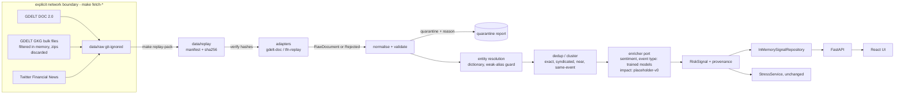
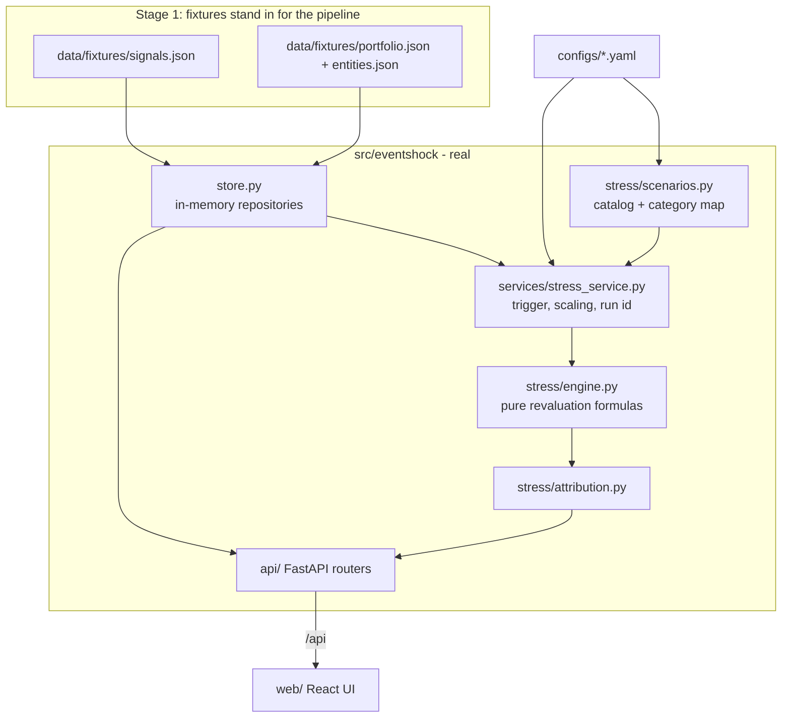

# EventShock — Architecture (Stages 1–2)

EventShock turns financial text into an auditable **risk signal** and shows what that signal would do to
a portfolio under an explicit stress scenario.

```
RawDocument → [validate · dedupe · resolve entity] → [sentiment · event · impact · evidence]
            → RiskSignal → trigger (impact ≥ threshold) → Scenario → stress engine → StressResult → UI
```

The source documents (PRD, architecture, research) live in `guiding files/`. Where this document
differs from them, the difference is listed under [Decisions](#decisions-and-deviations).

## Stage 2: real sources through one pipeline

Real financial text now reaches the **same** `RiskSignal` → stress → UI path. The server never calls the
internet: sources are fetched explicitly (`make fetch-*`), frozen into a hash-pinned snapshot
(`data/replay/`, `make replay-pack`), and replayed through the pipeline at startup.



| Concern | Decision |
|---|---|
| Raw vs processed | `data/raw` (ignored, bulk) → `data/replay` (committed, small, frozen) → in-memory pipeline output (`make ingest` exports to ignored `data/processed`) |
| Determinism | manifest pins sha256 + record counts (mismatch fails startup); replay clock `replay_as_of` is the only "now"; ids derive from content; clusters process in `(published_at, id)` order; output digest is pinned by a golden test and is order-independent |
| Timestamps | GDELT `seendate` = first seen (flagged); TFN has none, so replay assigns deterministic times (flagged `SYNTHETIC_REPLAY_CLOCK`) and such documents are never correlated by time |
| Validation | closed set of reject codes; every record ends in exactly one bucket (quarantined / folded duplicate / report inside a signal) |
| Entity resolution | cashtag → legal name → alias → bare ticker → *weak alias* (ordinary words like Apple/Visa/Target: case-sensitive and only with finance context or another strong mention) → restrained fuzzy; multiple issuers cap confidence; anything uncertain is `UNKNOWN_ENTITY`; the audit records what was considered and refused |
| Dedup | blocked by entity; star clustering against the earliest report (no single-link chaining); exact duplicates are folded and not counted, syndicated/near/same-event reports become `Evidence.corroborating` |
| Enrichment | `Enricher` port. `ModelEnricher` (served) = trained sentiment model (`pipeline/sentiment_model.py`) + trained event model (`pipeline/event_model.py`, 9-way: 8 classes + `NONE`, calibrated, one 0.5 commit threshold) + the `placeholder-v0` impact heuristic. Artifacts in `models/sentiment/` and `models/event/` are integrity-checked at load and never fall back to rules. An event the model judges a non-event (`NO_EVENT`) or will not type (`UNCERTAIN`) gets **no impact**: the signal is `PARTIAL` with a reason and the stress engine reports it unavailable. `ModelSentimentEnricher` and `PlaceholderEnricher` remain as regression anchors. Documents a model cannot score are quarantined (`UNSCORABLE_TEXT`). Every stage is labelled in `SignalProvenance.stage_origins` and `ModelVersions`; `SignalProvenance.sentiment` / `.event` carry model id, artifact sha256, calibrated confidence and `seen_in_training`; `data_origin = REAL_SOURCE_MIXED_NLP` |
| Profiles | `data.profile: replay` (default, real pack) or `demo` (Stage-1 fixtures); same container, same contracts |
| Dependencies | ingestion is stdlib (`urllib`, `difflib`, `hashlib`); the sentiment model adds numpy, scikit-learn, joblib (pinned in `requirements.txt`; the artifact is refused if the scikit-learn version differs) |
| Model cards | `GET /api/models/sentiment` and `GET /api/models/event` serve the typed model cards (`SentimentModelCard`, `EventModelCard`); the Data pipeline page renders both. The event card adds the pre-registered acceptance verdict, per-class reliability and the abstention policy |

What is real: ingestion, validation, entity resolution, deduplication, corroboration counts, provenance, the sentiment
model, the event model (weak, flagged per class, see EVENT_MODEL.md), the stress engine. What is a stand-in: impact (which
reads the models' category and tone), the portfolio (synthetic positions on real issuers), scenario magnitudes.

## What exists today



| Concern | Where | Notes |
|---|---|---|
| Contracts | `src/eventshock/domain/` | Pydantic v2. Validators enforce invariants (probabilities sum to 1, `PARTIAL ⇒ no impact`, per-asset-class required fields, tz-aware timestamps) |
| Config | `configs/app.yaml`, `event_taxonomy.yaml`, `scenarios.yaml` | Loaded and validated at startup; bad config fails loudly. Env overrides: `EVENTSHOCK_*` |
| Extension points | `src/eventshock/ports.py` | `SourceAdapter`, `SignalRepository`, `PortfolioRepository` Protocols |
| Replay source | `ingestion/replay.py` (fixtures), `ingestion/gdelt.py`, `ingestion/tfn.py` (real) | Adapters emit `RawDocument` or `Rejected` |
| Stress engine | `stress/engine.py` | Pure functions; every position records the formula used |
| Orchestration | `services/stress_service.py` | Trigger rule, severity scaling, deterministic run id, audit block |
| HTTP | `api/` | Thin routers; serves `web/dist` at `/` when built |
| UI | `web/src/` | `pages/{FeedPage,EventPage,StressPage}`, `components/`, `api/` (generated types), `lib/` |

## Contracts

- **`RiskSignal`** — document, entity (`UNKNOWN_ENTITY` is a first-class state), sentiment
  (`positive/neutral/negative/score`), event (category + full probability distribution), impact
  (`1–10` + continuous `raw` + drivers) or `null`, evidence (source count, unique outlets, mention
  velocity, novelty, model confidence, contradictions, corroborating items), `status`
  (`COMPLETE | PARTIAL`), `data_origin` (`DEMO_FIXTURE | MODEL_OUTPUT`), `model_versions`.
- **`Scenario`** — id, version, category, `reference_impact`, shocks `{factor, scope, value, rationale}`.
  Factors: `EQUITY`, `RATES_BPS`, `CREDIT_SPREAD_BPS`, `PD_MULTIPLIER`, `LGD_ADD`. Scopes:
  `MARKET`, `SECTOR`, `ISSUER`.
- **`StressResult`** — status (`COMPLETED | NOT_TRIGGERED | NO_SCENARIO | UNAVAILABLE`), severity scaling,
  applied shocks, summary (before/after/P&L), positions with formulas, contributions (asset class,
  sector, issuer, risk factor, top positions), uncovered exposure, audit block.

The OpenAPI schema (`/api/openapi.json`) is exported and turned into TypeScript types (`make types`), so
the UI and API cannot drift silently. All public models inherit `ContractModel`, which makes fields with
defaults appear as always-present in the response schema.

## Stress model

Shocks are specified in `scenarios.yaml` at a `reference_impact` (7) and scaled per event:

```
scale = clamp(impact / reference_impact, 0.5, 1.5)           # shown in the UI
shock' = shock * scale          (PD multiplier: 1 + (m - 1) * scale)
```

For each factor the most specific applicable scope wins (`ISSUER > SECTOR > MARKET`), so nothing is
double counted. Unresolved entities only receive `MARKET` shocks (issuer/sector shocks are marked
not applicable). Per asset class:

| Class | Revaluation |
|---|---|
| Equity | `ΔV = V·β·s` for market-wide shocks; `V·s` for sector/issuer shocks |
| Bond | `ΔP/P = −D·(Δrates + Δspread)/10⁴`, floored at −100% |
| Loan | value = EAD − EL; `PD' = PD·(1+(m−1)·sens)`, `LGD' = LGD + a`; `ΔV = −(EAD·PD'·LGD' − EAD·PD·LGD)` |
| Derivative | `ΔV = delta · underlying · s` (first order; gamma deferred) |

Attribution by risk factor sums exactly to the position change (bond: rates vs. spread; loan: PD vs.
LGD, sequential). Positions that receive no shock are reported as *uncovered*, never as safe.

**Trigger rule:** `impact ≥ trigger_threshold` (config, default 7). Below it the result is
`NOT_TRIGGERED` unless the analyst runs a flagged what-if. A signal without impact is `UNAVAILABLE`
even when forced: the engine never fabricates a score.

**Determinism:** `run_id = sha256(signal, scenario version, impact, force, portfolio hash, status)`.
In replay mode `calculated_at` is the fixture clock, so the same request returns an identical result.
`tests/e2e/test_replay_golden.py` pins the headline demo run.

## Provenance and honesty

| Item | Label |
|---|---|
| Signals | `data_origin = DEMO_FIXTURE`, `model_versions = fixture-v0` |
| Impact drivers | "Fixture drivers · illustrative, not SHAP" |
| Scenario magnitudes | "Illustrative scenario assumptions" |
| Stress arithmetic | "Computed · deterministic engine" |
| Mode | "Replay · demo fixtures" badge on every screen |

## API (`/api`)

`GET /health` · `GET /meta` · `GET /signals` (`category`, `source_type`, `min_impact`, `q`) ·
`GET /signals/{id}` · `GET /scenarios` · `GET /scenarios/{id}` · `GET /portfolio/summary|exposure|assets` ·
`POST /stress-test {signal_id, scenario_id?, force?, impact_override?}` · `GET /stress-runs/{id}`.
A well-formed stress request always returns 200; `status` says whether numbers were produced.
404 for unknown ids, 422 for invalid input. Interactive docs: `/api/docs`.

## Where the next stages plug in

| Stage | Replaces / adds | Plugs into | Contract kept |
|---|---|---|---|
| ~~Real/replay ingestion (GDELT, Twitter Financial News)~~ **done in Stage 2**; NewsAPI / EDGAR 8-K next | `ingestion/*.py` adapters | `SourceAdapter` → `RawDocument` | `RawDocument` |
| ~~Validation + dedup~~ **done**; contradiction detection still open | `pipeline/validate.py`, `dedup.py` | between adapter and NLP | `Evidence.corroborating`, `contradicted_by` |
| ~~Entity resolution~~ **done** (dictionary); NER/market-wide pseudo-entities open | `pipeline/entities.py` | fills `EntityMention` incl. `UNKNOWN_ENTITY` | `EntityMention` |
| ~~Sentiment~~ **done in Stage 3** (TF-IDF + LR); a domain-adapted model is open | `pipeline/sentiment_model.py` | fills `SentimentResult`; `model_versions.sentiment` | `SentimentResult` |
| ~~Event classification~~ **done in Stage 3b** (`pipeline/event_model.py`, [EVENT_MODEL.md](EVENT_MODEL.md)); embeddings and human-adjudicated labels next | `pipeline/event_model.py` | fills `EventClassification` incl. `status` | taxonomy in `event_taxonomy.yaml` |
| Calibrated impact (XGBoost + SHAP) | `impact/` (dataset, train, calibrate, predict) | fills `ImpactAssessment`; real SHAP into `drivers`; flips `data_origin` to `MODEL_OUTPUT` | `ImpactAssessment` |
| Evidence / corroboration | `risk/evidence.py` | fills `Evidence` from the narrative layer | `Evidence` |
| Signal store | SQLite repository (pipeline output is currently rebuilt in memory at startup) | implements `SignalRepository` (replace `InMemorySignalRepository`) | `RiskSignal` |
| Exposure mapping | portfolio loader from public transaction data | implements `PortfolioRepository` | `PortfolioAsset` |
| Scenario modelling | richer templates, FX/commodity factors | extend `RiskFactor` + `scenarios.yaml` + engine | `Scenario`, `StressResult` |
| Stress extensions | gamma, convexity, reverse stress | `stress/engine.py` | `PositionResult.formula` |
| Evaluation | `eval/` scripts + notebooks, model-status screen | read signals and models; expose in `/models` | — |

The stage rule from `CLAUDE.md` still holds: implement one stage, test it, freeze it, move on.

## Decisions and deviations

1. **React instead of Streamlit.** The architecture doc picks Streamlit as the fastest demo path and
   names React as the alternative. This project needs a product-grade UI (three linked screens, designed
   components, accessibility, mobile) that Streamlit cannot deliver. The API is unchanged either way.
2. **No SQLite yet.** Nothing in this slice needs persistence; repositories sit behind Protocols so SQLite
   is a drop-in. (Stress runs are kept in memory for `GET /stress-runs/{id}`.)
3. **No model code in Stage 1.** Signals are fixtures with an explicit `data_origin`; building NLP now
   would pre-empt later stages. The deterministic stress engine is the only computed component.
4. **Hand-drawn charts.** Bars and ladders are plain HTML/CSS, not a charting library: fewer
   dependencies, exact control, and they are accessible by construction.
5. **Fictional entities.** Avoids fabricated news about real companies.
6. **Name.** The guiding documents say "SignalForge"; the product is **EventShock**.

## Testing

`pytest` — domain validators, per-class formulas against hand-computed values, scope precedence,
severity scaling and clamps, trigger rule, catalog completeness, config errors, fixture integrity
(referential integrity, no timestamps after the replay clock, byte-stable regeneration), API contracts
and error paths, SPA serving, and an e2e golden replay. `vitest` — formatters, severity bands,
accessible meters, and page-level states (feed, filters, API outage, partial signal, not-triggered,
completed run) against a mocked API.
