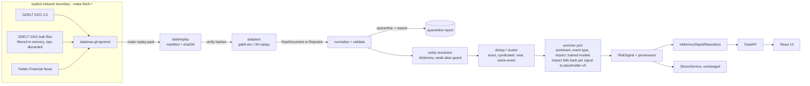
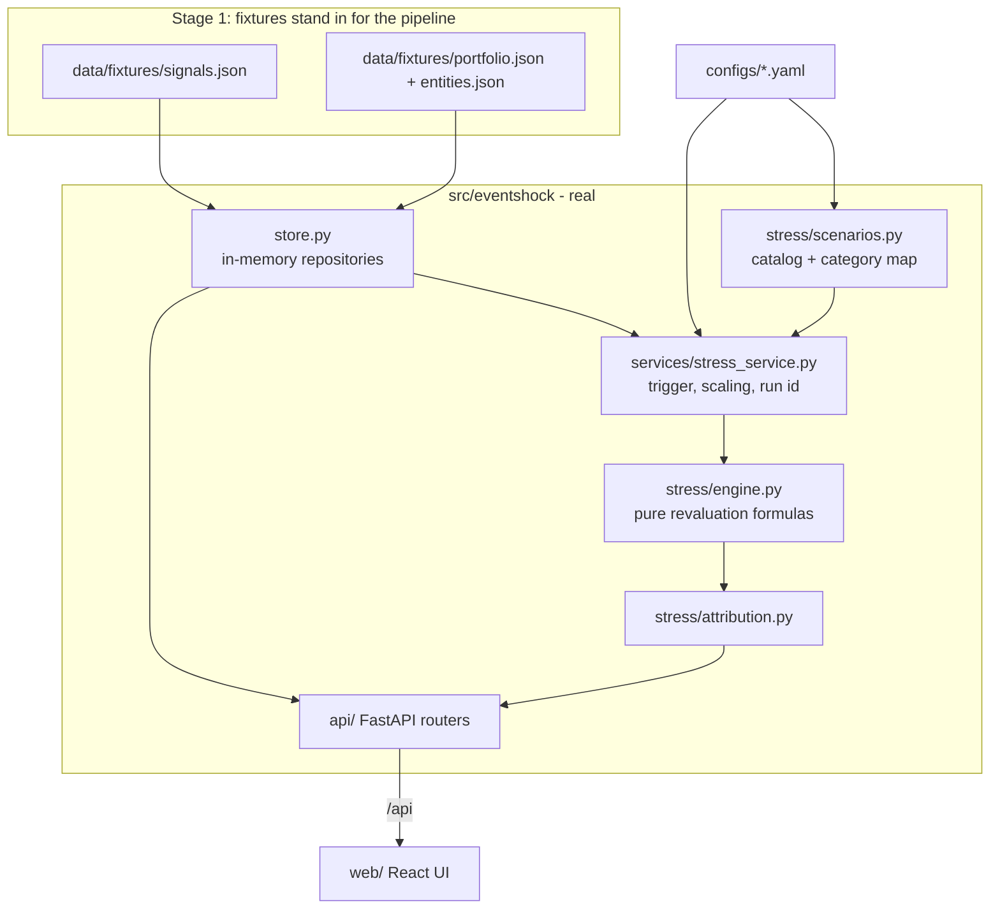

# EventShock — Architecture (current state: Stage 16, 2026-10-09)

This is the **authoritative technical description of what is implemented**. Sections 1-17 describe the system as it stands today;
the *Stage-by-stage design record* after them keeps the per-stage rationale, contracts and numbers in the order they were built (each
stage's story, including what broke, is in [PROJECT_JOURNEY.md](notes/PROJECT_JOURNEY.md)). When the two disagree, sections 1-17 win.
The pictures are [`architecture.png`](architecture.png) (lanes and flow; regenerate: `python scripts/make_architecture_diagram.py --png`),
[`architecture_detailed.png`](architecture_detailed.png) (every module, model, store and route group; `scripts/make_detailed_diagram.py --png`) and
[`architecture_simple.png`](architecture_simple.png) (seven plain steps for a non-technical reader; `scripts/make_simple_diagram.py --png`). All three were
regenerated for Stage 16 and show Module A.


**Naming.** The original research, PRD and architecture notes (kept locally in `guiding files/`, not part of the submission) were written under
the working name *SignalForge*. The product is **EventShock**. Where the implementation departs from those notes the reason is in
[section 14](#14-architectural-decisions-and-trade-offs) and the [PRD coverage table](#15-requirement-coverage-against-the-original-prd).

Status words used here: **implemented** (runs in the shipped replay and has tests), **partial** (works with a stated limit), **deferred**
(designed, not built), **excluded** (rejected on purpose).

## 1. System overview

EventShock turns financial text into an auditable **risk signal** and shows what that signal would do to a portfolio under an explicit,
deterministic stress scenario.

```
RawDocument ─► validate · dedupe · resolve entity ─► sentiment · event · scope · novelty ─► impact (post-pass)
            ─► RiskSignal ─► side-cars (assessment, intelligence, analogues, propagation, monitor …)
            ─► trigger (severity ≥ 7) ─► Scenario ─► deterministic stress engine ─► StressResult ─► API ─► UI
```

One process (FastAPI) serves the API and the built UI. At start-up it verifies the frozen replay pack, loads three trained model
artifacts, runs the pack through the pipeline and keeps the result in memory (start-up time is measured in
[SUBMISSION_CHECKLIST.md](notes/SUBMISSION_CHECKLIST.md#measured-in-this-repository)). Pasted text and the optional live
feed enter through the **same** `RiskEngine`, so there is one code path for every source.

Three rules shape everything:

1. **The language model reads, code decides.** A model may fill a closed schema that is checked against the text; severity, the trigger and
   every portfolio number are explicit, deterministic code. With no key the whole app works (rule-based reading, labelled).
2. **Derived views are side-cars.** Assessment, intelligence, analogues, propagation, monitor, review and the rest are computed from a signal on
   demand and never stored on it, so no replay digest or golden run id moves when a side-car changes. Import rules are enforced by
   architecture tests (`tests/unit/test_{intel,propagation,decision,rebalancer}_architecture.py`).
3. **Never invent a number.** Missing or unscorable input produces `PARTIAL`, `UNAVAILABLE`, `NOT_APPLICABLE` or an abstention with the reason, never a
   placeholder that looks like a result.

## 2. Component architecture

| Component | Module | Responsibility | Status |
|---|---|---|---|
| Contracts | `domain/` | Pydantic v2 models (`RiskSignal`, `Scenario`, `StressResult`, scope, provenance); validators enforce invariants (probabilities sum to 1, `PARTIAL ⇒ no impact`, tz-aware times) | implemented |
| Source adapters | `ingestion/` (`gdelt.py`, `tfn.py`, `edgar_live.py`, `live.py`, `fetch.py`) | provider-specific parsing into `RawDocument` / `Rejected`; `fetch.py` is the **only** module that opens a socket | implemented |
| Pipeline | `pipeline/` | normalise → validate/quarantine → entity resolution → dedup → enrichers; `engine.py` (`RiskEngine`) is the incremental door | implemented |
| Trained models | `pipeline/{sentiment,event,impact}_model.py`, `models/` | load integrity-checked artifacts, score, expose model cards | implemented (experimental) |
| Scope | `pipeline/scope.py`, `configs/scope.yaml` | COMPANY / SECTOR / MARKET / UNRESOLVED from deterministic vocabulary rules | implemented |
| Assessment | `assessment/`, `llm/` | `severity-v2` scorecard; optional LLM reader with grounding and rules fallback | implemented |
| Intelligence | `intelligence/` | multi-scope hierarchy, event grouping, evidence tier, novelty, velocity, claims, lifecycle | implemented |
| Analogues | `retrieval/`, `services/analogues.py` | point-in-time retrieval over a hash-pinned e5 index; display only | implemented |
| Propagation | `propagation/` | event → factor → holdings graph, materiality, generated scenario, attribution, concentration | implemented |
| Stress | `stress/` + `services/stress_service.py` | scenario catalog, pure revaluation functions, attribution, run id, history check | implemented |
| Portfolio | `portfolio/` | default synthetic book, personal portfolios, exposure, Wholesale Book v2 preset | implemented |
| Rebalancer (Module A) | `rebalancer/` + `configs/rebalancer.yaml` | mock 15-stock index whose weights follow `sentiment.score`: decayed, one-source-one-vote score → exponential tilt → exact projection onto bounds → turnover-capped step; trade decisions with a constraint ladder, a closed strategy registry, a point-in-time back-test and lab with a placebo, a simulated hash-chained approval ledger | implemented (a transparent rule, not a claimed return) |
| Decision side-cars | `decision/ monitor/ watchlist/ lab/ explain/ feedback/ brief/ review/ markets/` | what changed, watchlists, scenario lab + reverse stress, reasons, feedback, executive brief, review queue, external-market observation | implemented |
| Adjustments | `adjust/` | whitelisted manual overrides of side-car settings, rebuilt under a lock, rolled back on failure | implemented |
| API | `api/` (21 routers, 93 operations) | thin routers; typed schemas; serves `web/dist` at `/` | implemented |
| Dashboard | `web/` | React 19 SPA, types generated from the OpenAPI schema | implemented |
| Research code | `modeling/`, `scripts/` | training, leakage guard, evidence studies, data builders (offline, not imported by the server at run time except model loading) | implemented |

**Module boundaries that are tested:** no core package (`assessment pipeline stress modeling domain retrieval portfolio intelligence llm
ingestion services`) imports a side-car (`propagation adjust decision monitor watchlist lab explain feedback brief review markets`), and nothing imports `rebalancer` (`tests/unit/test_rebalancer_architecture.py`); the
external-market provider is never an input to a score; nothing is stored on a `RiskSignal` by a side-car.

## 3. Data flow

```
snapshot (sha256-verified) / pasted text / live poll
   → adapter                         RawDocument | Rejected(reason)
   → normalise, validate             clean doc | quarantine(reason code)
   → entity resolution               EntityMention (UNKNOWN_ENTITY is a state)
   → dedup / cluster                 exact folded; syndicated, near, same-event → corroboration
   → sentiment      tfidf-lr-v2      (text only; v1 stays the reference the impact models were trained on)
   → event type     hybrid-event-v2  (TF-IDF ‖ pinned e5-large vector; can say NONE / UNCERTAIN)
   → scope          scope-v1         (rules)
   → novelty, corroboration          (evidence, kept apart from model confidence)
   → impact         impact-v2        (post-pass: market state + event calendar + TF-IDF event probabilities)
   → RiskSignal     every stage records model id, artifact sha256, origin
   → repositories   InMemorySignalRepository (replay) + LiveSignalStore (bounded) → CombinedSignalRepository
   → side-cars on read (assessment → severity; intelligence; propagation; …)
   → StressService  trigger, scaling, scenario, engine, attribution, run id
   → API → UI
```

**Train/serve parity.** The user-facing event stage serves the hybrid, but both impact models were fitted on the *TF-IDF* event model's
probabilities (and on sentiment v1). `ImpactModelEnricher` re-reads the text with those reference models and feeds *them* to the impact stage; feeding the
newer outputs would silently change the model's inputs. The reference is announced in `/api/meta` and pinned by
`tests/e2e/test_replay_served.py`.

**Timestamps.** GDELT `seendate` is first-seen, not publication time (flagged). Tweets have no timestamps; replay assigns deterministic ones
(`SYNTHETIC_REPLAY_CLOCK`) and such documents are never correlated by time, so velocity, lifecycle and novelty report *unavailable* for them.

## 4. API flow

Browser/other consumer → `/api/...` router → service → domain objects → typed response. Routers hold no logic. The UI never computes a
risk number; it renders what the API returns, and `make types` regenerates `web/src/api/schema.d.ts` from the exported OpenAPI so the two cannot drift
silently. A representative chain for one event: `GET /signals` → `GET /signals/{id}` → `/assessment` → `/intelligence` → `/propagation` →
`POST /signals/{id}/portfolio-stress` (or `POST /stress-test` for a catalog scenario) → `GET /stress-runs/{id}/attribution`.

Contract: a well-formed stress request always returns **200** and the `status` field says whether numbers were produced (`COMPLETED`,
`NOT_TRIGGERED`, `NO_SCENARIO`, `NOT_APPLICABLE`, `UNAVAILABLE`); **404** for an unknown id; **422** for invalid input. There is no authentication
(single-user prototype). The full list is the [API reference](#17-api-reference).

## 5. Storage

There is deliberately **no database** in the MVP: nothing needs durability beyond files, and every repository sits behind a Protocol
(`ports.py`) so SQLite is a drop-in.

| What | Where | Tracked | Notes |
|---|---|---|---|
| Frozen replay pack | `data/replay/` (JSON/JSONL, NPZ vectors, `manifest.json` with sha256 + counts) | yes | mismatch stops start-up |
| Model artifacts + cards | `models/{sentiment,event,impact}/<id>/` (`model.joblib`, `model_card.json`) | yes | integrity-checked at load |
| Configuration | `configs/*.yaml` (30) | yes | all pinned by `docs/freeze_manifest.json` |
| Signals | in memory (rebuilt at start-up) + bounded live store | no | digest `078a70ae…` for the replay |
| Live journal, portfolios, overrides, decisions, LLM cache | `data/live/…` (atomic JSON/JSONL files) | git-ignored | `EVENTSHOCK_*_PATH` env redirects; tests redirect all of them |
| Training / evaluation data | `data/modeling/`, `data/gold*/`, `data/event_labels/`, `data/events/` | partly | large derived tables are git-ignored and rebuildable |
| Raw downloads | `data/raw/` | git-ignored | bulk; created by `make fetch-*` |

## 6. ML pipeline, inference, training and evaluation

**Inference.** Each model is loaded once, refused if its artifact hash or the scikit-learn version differs, and exposes a card. A
missing hybrid event model or pinned vectors falls back to the TF-IDF reference (labelled in `model_versions`); a missing impact-v2 falls back to
impact-v1, then to the labelled placeholder rule; a *modified* artifact always stops start-up. New text (paste, live) uses the TF-IDF event model
when no encoder is installed. The impact model scores a report only inside its frozen market-context calendar (plus five days).

**Training and evaluation flow** (offline; `make train-*`, deterministic, fixed seeds):
1. Build modelling tables (`modeling/`), audit them, and **register every impact feature** by availability class in `modeling/leakage.py`
   (`AT_EVENT_TIME` allowed; `POST_EVENT` and banned features refused).
2. Split chronologically with a 5-session embargo and rolling-origin folds for selection and calibration; the test year and the live year are scored once.
3. Evaluate against **pre-registered** acceptance checks (`configs/impact_model.yaml`, `evidence_v2.yaml`, `evidence_v3.yaml`) that are never edited after
   results; the lifecycle word (`placeholder | experimental | validated`) is derived from the card, not asserted.
4. Write the card; `make freeze-write` re-pins the manifest only after a deliberate, journalled change.

**What each model may and may not use** is tabulated in [FINAL_MODEL_REPORT.md](notes/FINAL_MODEL_REPORT.md). Current lifecycle: sentiment *experimental* (no bar written),
event *experimental* (fails the independent-set check), impact *experimental* (fails C5 calibration coverage and C7 placebo). Nothing is *validated*.

## 7. Portfolio and stress engine

`stress/engine.py` holds pure revaluation functions; `services/stress_service.py` is the only door to them (trigger, severity scaling, scenario
class, run id, audit block). Formulas, scaling, scope precedence and the abstention states are in [Stage-by-stage → Stress model](#stress-model) and in
the README §7. Additive mechanics (Stage 11-13) are opt-in per position and omitted from the JSON when unset, so the default book's content hash and
`GOLDEN_RUN_ID` never moved: FX/commodity factors, `spread_sensitivity`, bond convexity, loan spread-to-PD link, derivative gamma, counterparty CVA.
Scenarios: 8 single-factor templates (`configs/scenarios.yaml`) + 4 multi-factor (`configs/scenarios_multifactor.yaml`), plus the scenario generated for
an event by `propagation/scenario_gen.py` (gated, labelled *SCENARIO SIMULATION — NOT A PREDICTION*). Portfolios: default synthetic book (103 positions, USD
860.1M), read-only Wholesale Book v2 preset, and personal portfolios used only when a request carries `portfolio_id`.

## 8. Dashboard

`web/` (React 19, Vite, TypeScript, Tailwind v4, TanStack Query). Nine pages gated by `/api/meta` capabilities (Desk, Today, Review, Analyze, Event,
Stress Lab, Portfolios, Rebalancer, Evidence), one navigation source (`lib/nav.ts`), a ⌘K palette, light/dark tokens with WCAG pairs enforced by tests
(`styles/tokens.test.ts`), hand-drawn CSS/SVG charts (no chart library). Progressive disclosure through drawers addressed by `?open=` and tabs by `?tab=`.
The UI renders four kinds of number distinctly (model prediction, historical observation, scenario assumption, realised outcome).

## 9. Error handling

| Where | Behaviour |
|---|---|
| Start-up | strict config models, hash-pinned snapshot and artifacts: any mismatch is a `ConfigError` that names the file; the server does not start in a degraded silent mode |
| Ingestion | every record ends in exactly one bucket (quarantined, folded duplicate, or a report inside a signal); closed reject codes |
| Models | fallbacks are labelled per signal; non-events and uncertain texts are `PARTIAL` with no impact |
| LLM | 30 s budget, 30 calls/min cap, grounding checks, cache; any failure → labelled rules fallback |
| Live | poller backs off, reports `OFF / OK / DEGRADED / ERROR / IDLE`; a result arriving after the switch is turned off is dropped |
| Stress | typed statuses; never a zero P&L for "no exposure"; uncovered positions listed |
| API | 404 / 422 with a body naming the problem; derived views refuse to store runs (`store=False`) |

## 10. Configuration

Product rules live outside code: `configs/*.yaml` loaded into strict Pydantic models (extra keys are errors), overridable by `EVENTSHOCK_*` environment
variables (`.env.example` documents all of them). Judgement priors (thresholds, transmission weights, keep rules) are marked as such and pinned in the freeze
manifest. Manual overrides (`/api/adjustments`) patch the raw YAML *before* validation, are stored in git-ignored `data/live/overrides/`, are server-global,
labelled `USER_ASSUMPTION` and counted on every answer.

## 11. Deployment

Single process, local: `python src/main.py` (uvicorn, `127.0.0.1:8000`) serving the API and `web/dist`. `make dev` runs the API with reload and Vite on `:5173`.
There is no Dockerfile, no CI workflow and no hosted deployment in this repository; the demo is meant to run from a clone with the README commands.

## 12. Security

No authentication (local single-user); CORS limited to the Vite dev origins by default. Secrets only from the environment/`.env` (git-ignored); keys never appear in
configs. The LLM is off by default and, when on, only the (≤ 2,000-character) report text leaves the machine; the UI says so. The server makes no outbound request
unless the Live switch is on, and then only through `ingestion/fetch.py`. User text is rendered by React (escaped); a pasted `url` is attribution only and is never
fetched. Data is public or synthetic; the SEC contact is declared in a header for fair access. Not in scope: authn/z, rate limiting of inbound traffic, TLS, audit
log retention, multi-tenant isolation.

## 13. Reproducibility

Pinned dependencies (`requirements.txt`, `uv.lock`); artifact and snapshot hashes checked at load; replay clock fixed at 2026-10-01 12:00 UTC; ids derive from content;
`run_id = sha256(signal, scenario version, score, force, portfolio hash, status)`; golden tests pin the headline run and the served digest;
`make freeze-check` verifies models, configs, gold sets, calendars, replay and evidence against `docs/freeze_manifest.json`; `make smoke` starts the real server and checks the same.

## 14. Architectural decisions and trade-offs

| Decision | Chosen | Alternative | Why chosen | Main cost |
|---|---|---|---|---|
| Downstream module | **B** (stress tester), plus **A** (index rebalancer) added in Stage 16 as a separate side-car | A only | event → exposure → loss is the story a risk desk needs; A is a sentiment-to-weight map, kept apart so neither contaminates the other | A claims a transparent rule, not a return (`docs/notes/REBALANCER.md`) |
| NLP approach | classical supervised models + deterministic engine | LLM-first | reproducible, cheap, auditable, runs offline; the LLM is an optional reader | weaker semantic understanding without it |
| Sentiment model | TF-IDF + LR (tfidf-lr-v2) | FinBERT (frozen or fine-tuned) | CPU-only, byte-reproducible, no torch at run time, trained on in-domain tweet labels. FinBERT was **probed, not served**: on a 30-pair polarity probe finbert-tone and ProsusAI/finbert got 93 % right against 77 % for the shipped model (`docs/evidence/representation_bakeoff.json`, a diagnostic never used to choose), and as frozen features they added nothing to the event model | weak out of domain (≈ 0.44-0.53 macro-F1); a FinBERT sentiment head was never compared with it on a labelled benchmark and is the most obvious open improvement |
| Event model | hybrid TF-IDF + e5-large + LR with abstention | fine-tuned transformer; zero-shot | won a pre-registered five-way representation comparison; abstains | labels are AI-annotated |
| Impact model | additive gradient boosting, rank-calibrated | XGBoost + SHAP; neural | tabular features; exact additive attributions; scikit-learn keeps the dependency set small | no event-specific skill shown |
| Headline severity | transparent scorecard (severity-v2) | weighted average (severity-v1); learned score | v1 compressed the scale to 4-7; a scorecard is auditable | not outcome-calibrated |
| Evidence vs impact | separate | single confidence number | corroboration is not model confidence | two things to explain |
| Replay mode | frozen, hash-pinned pack | live-only demo | deterministic, offline-safe demo | not a live system (live exists, opt-in) |
| API / UI | FastAPI + React | Streamlit | product-grade, accessible, mobile UI; typed contracts | more code than Streamlit |
| Storage | files + memory | SQLite / DuckDB / Parquet | nothing needs durability; behind Protocols | state rebuilt at start-up |
| Portfolio | synthetic on real issuers | real data | no proprietary data allowed; reproducible | realism is limited |
| Exposure mapping | relational (rules + tables) | Neo4j / GNN | graph size is tiny; every edge needs a rule and basis | no learned transmission |
| Streaming | none (batch + poll) | Kafka | one process, one demo machine | no 100× throughput claim |
| Retrieval | static e5 index, display only | RAG feeding the score | pre-registered test found no added information about the move | no generative explanation |
| Scenario engine | deterministic | ML / LLM | shocks are assumptions to be audited; arithmetic must be reproducible | no data-driven calibration |
| Model versioning | id + artifact sha256 on every stage + freeze manifest | model registry | enough for one repo | no registry UI |

## 15. Requirement coverage against the original PRD

| PRD area | Status | Note |
|---|---|---|
| ≥ 2 text sources | implemented | GDELT news metadata + finance tweets in the replay; SEC 8-K as optional live source |
| Sentiment −1…+1 | implemented | `tfidf-lr-v2`, experimental |
| Event classification | implemented | 8 classes + NONE/UNCERTAIN, experimental, weak classes disclosed |
| Impact 1-10 | implemented (experimental) | `impact-v2` plus the severity-v2 scorecard as headline; neither validated |
| Expose signals (API/file) | implemented | `/api/signals…`; `make ingest` also exports files to `data/processed` |
| Module B stress tester | implemented | synthetic book, 4 asset classes, 12 scenarios, generated scenario, attribution, before/after dashboard |
| Module A rebalancer | implemented (Stage 16) | 15-stock mock index, sentiment tilt, bounds, turnover cap, weights-over-time dashboard `/rebalancer`, illustrative back-test with a placebo; `docs/notes/REBALANCER.md` |
| Entity resolution | partial | 34-issuer dictionary; no NER |
| Dedup / corroboration | implemented | contradiction detection is closed-lexicon only |
| Evidence layer | implemented | provenance, evidence tier, novelty, lifecycle; separate from impact |
| Calibration | implemented | rank calibration with empirical interval; calibration coverage check fails (C5) |
| Persistence (SQLite) | deferred | in-memory + files |
| NewsAPI / X / Alpha Vantage live | deferred | need keys; GDELT and EDGAR are the live adapters |
| FinBERT sentiment | not served | evaluated as frozen features and on a 30-pair probe only; TF-IDF/LR chosen (see trade-offs) |
| XGBoost + SHAP impact | not used | scikit-learn boosting with exact additive attributions |
| Streamlit dashboard | not used | React |
| Kafka / Neo4j / vector DB | excluded | static retrieval index only |
| LLM-based risk reading | implemented, optional | OFF by default; rules fallback |

## 16. Production evolution (not built)

Ingestion adapters → a queue → normalisation workers → a model-serving tier with versioned artifacts → a signal store (Postgres) → scenario jobs → the API →
dashboard, with authentication, per-user portfolios, drift and calibration monitoring, scheduled retraining on human-adjudicated labels, a licensed market-data feed
and a real position source. None of this is required for the MVP's single-process, single-window workload and none is claimed.

## 17. API reference

Generated from the exported OpenAPI (`web/src/api/openapi.json`, 93 operations under `/api`; live docs at `/api/docs`).

| Method | Endpoint | Purpose | Request | Response |
|---|---|---|---|---|
| DELETE | `/api/adjustments` | remove overrides (all, or one `path`) | query: path | AdjustmentState |
| GET | `/api/adjustments` | current manual overrides of the side-car settings | – | AdjustmentState |
| PUT | `/api/adjustments` | set overrides (validated through the real config models, rolled back on failure) | body: PutRequest | AdjustmentState |
| POST | `/api/adjustments/reset` | restore every shipped default | – | AdjustmentState |
| POST | `/api/adjustments/validate` | dry-run an override set without saving | body: PutRequest | ValidationReport |
| POST | `/api/analyze` | score pasted text through the same engine as the live feed | body: AnalyzeRequest | AnalyzeResponse |
| GET | `/api/concentration` | meaningful concentration in the active portfolio | query: portfolio_id | ConcentrationView |
| GET | `/api/concentration/overlaps` | independent events on the same risk factor and holdings | query: portfolio_id, signal_id | OverlapView |
| GET | `/api/events/{event_id}/analogues` | historical analogues for an event (retrieved, hindsight, display only) | path: event_id | AnalogueSet |
| GET | `/api/events/{event_id}/brief` | sixteen-section executive brief (template-written, every statement sourced) | path: event_id; query: format, cycle, portfolio_id | Brief |
| GET | `/api/events/{event_id}/explanation` | structured reasons why the event matters | path: event_id; query: subject, cycle, change_id, portfolio_id | Explanation |
| GET | `/api/events/{event_id}/external-markets` | what a prediction market prices on the same theme (observation only) | path: event_id; query: cycle, portfolio_id | EventMarketView |
| GET | `/api/events/{event_id}/market-timeline` | external-market series beside the event | path: event_id; query: cycle, portfolio_id | MarketTimeline |
| GET | `/api/events/{event_id}/timeline` | event lifecycle timeline | path: event_id; query: portfolio_id | EventMemory |
| GET | `/api/evidence` | model lifecycle, checks passed out of total, limits | – | EvidenceBundle |
| GET | `/api/evidence/outcome-check` | severity scale vs realised moves (committed evidence) | – | OutcomeCheck |
| GET | `/api/feedback` | list analyst feedback | query: event_id, limit | FeedbackList |
| POST | `/api/feedback` | record feedback (append-only; never alters a model) | query: portfolio_id; body: FeedbackInput | – |
| GET | `/api/feedback/statistics` | feedback counts | – | FeedbackStats |
| GET | `/api/health` | liveness | – | object |
| GET | `/api/lab/options` | what the scenario lab can vary | query: portfolio_id | LabOptions |
| POST | `/api/live/refresh` | poll the live source now (only when live is on) | – | LiveStatus |
| PUT | `/api/live/state` | switch live ON/OFF and choose the source | body: LiveStateRequest | LiveStatus |
| GET | `/api/live/status` | live status, last poll, source choices | – | LiveStatus |
| GET | `/api/meta` | mode, profile, replay digest, model versions, capabilities | – | Meta |
| GET | `/api/models/event` | event model card | – | EventModelCard |
| GET | `/api/models/impact` | impact model card | – | ImpactModelCard |
| GET | `/api/models/sentiment` | sentiment model card | – | SentimentModelCard |
| GET | `/api/monitor/changes` | risk changes by named rule | query: mode, cycle, window, types, since, portfolio_id | ChangeSet |
| GET | `/api/monitor/cycles` | monitor cycles | – | [MonitorCycle] |
| GET | `/api/monitor/digest` | ranked digest of what changed (no blended score) | query: mode, cycle, window, portfolio_id | Digest |
| POST | `/api/monitor/refresh` | run a monitor cycle | – | MonitorStatus |
| GET | `/api/monitor/status` | monitor status | query: mode | MonitorStatus |
| GET | `/api/pipeline/report` | ingestion counts, per-source quarantine, versions | – | PipelineReport |
| GET | `/api/portfolio/assets` | positions of the default book | query: portfolio_id | [PortfolioAsset] |
| GET | `/api/portfolio/exposure` | exposure breakdowns incl. sector × asset-class matrix | query: portfolio_id | PortfolioExposure |
| GET | `/api/portfolio/summary` | default book summary | query: portfolio_id | PortfolioSummary |
| GET | `/api/portfolios` | list personal portfolios | – | [PortfolioListItem] |
| POST | `/api/portfolios` | create one | body: PortfolioInput-Input | – |
| POST | `/api/portfolios/compare` | compare portfolios under one event | body: CompareRequest | PortfolioComparison |
| POST | `/api/portfolios/parse` | parse quick text (`AAPL 20%`) into holdings | body: ParseRequest | ParseResult |
| GET | `/api/portfolios/presets` | read-only presets (Wholesale Book v2) | – | [PortfolioListItem] |
| POST | `/api/portfolios/validate` | validate a portfolio and list issues | body: PortfolioInput-Input | ResolvedPortfolio |
| DELETE | `/api/portfolios/{portfolio_id}` | delete | path: portfolio_id | – |
| GET | `/api/portfolios/{portfolio_id}` | get one | path: portfolio_id | PortfolioView |
| PUT | `/api/portfolios/{portfolio_id}` | update | path: portfolio_id; body: PortfolioInput-Input | PortfolioView |
| POST | `/api/portfolios/{portfolio_id}/duplicate` | duplicate | path: portfolio_id | – |
| GET | `/api/portfolios/{portfolio_id}/exposure` | exposure of one portfolio | path: portfolio_id | PortfolioExposureDetail |
| GET | `/api/rebalancer/backtest` | derived back-test of the weight path (point-in-time, 5 bp cost, shuffled-score placebo); STALE if the served weights differ | – | RebalancerBacktestView |
| GET | `/api/rebalancer/cycles/{index}` | one cycle: weights, scores, per-stock reason, contributing reports | path: index; query: tilt, half_life_hours, max_turnover, include_live, strategy | RebalanceCycleDetail |
| GET | `/api/rebalancer/cycles/{index}/decisions` | the cycle as a proposed rebalance: before / target / after, trade, evidence, the rules that bound each stock, `proposal_sha256` | path: index; query: tilt, half_life_hours, max_turnover, include_live, strategy | RebalanceDecisions |
| GET | `/api/rebalancer/lab` | every strategy plus equal weight and buy-and-hold on one window, sensitivity grid, placebo verdict | – | RebalancerLabView |
| GET | `/api/rebalancer/ledger` | simulated approvals (append-only, hash-chained; `chain_ok`) | – | LedgerView |
| POST | `/api/rebalancer/proposals/decision` | approve all, approve a subset, or reject a proposal (simulated; 409 if the proposal changed) | body: DecisionRequest | LedgerEntry |
| GET | `/api/rebalancer/overview` | the index, its parameters, universe and latest cycle | – | RebalancerOverview |
| GET | `/api/rebalancer/timeline` | weights over time for the stacked chart | query: tilt, half_life_hours, max_turnover, include_live, strategy | RebalancerTimeline |
| POST | `/api/reverse-stress` | bounded-grid search for the mildest shock combination reaching a loss target | body: ReverseStressRequest | ReverseStressResult |
| POST | `/api/reverse-stress/explanation` | explain a reverse-stress result | body: ReverseStressRequest | Explanation |
| GET | `/api/review/decisions` | decision history | query: event_id, limit | ReviewDecisionList |
| POST | `/api/review/decisions` | record REVIEWED / DISMISSED / OPEN | body: ReviewDecisionInput | – |
| GET | `/api/review/queue` | events queued for review, with the rule that queued each | query: mode, status, limit, portfolio_id | ReviewQueue |
| GET | `/api/scenarios` | scenario catalog and defaults by event class | – | ScenarioList |
| POST | `/api/scenarios` | run a custom scenario in the lab | body: ScenarioRequest-Input | LabResult |
| POST | `/api/scenarios/compare` | compare scenarios | body: LabCompareRequest | Comparison |
| POST | `/api/scenarios/explanation` | explain a scenario run | body: ScenarioRequest-Input | Explanation |
| POST | `/api/scenarios/validate` | validate a custom scenario | body: ScenarioRequest-Input | LabPlan |
| GET | `/api/scenarios/{scenario_id}` | one scenario | path: scenario_id | Scenario |
| GET | `/api/scenarios/{scenario_id}/history-check` | rank scenario shocks against 1/5/21-session history | path: scenario_id; query: severity_scale | ScenarioHistoryCheck |
| GET | `/api/scope` | scope vocabulary and levels | – | ScopeInfo |
| GET | `/api/signals` | the feed (filters, change counter `seq`) | query: category, source_type, min_impact, q, event_status, scope_level, scope_type, channel, since_seq, portfolio_id | SignalPage |
| GET | `/api/signals/{signal_id}` | one `RiskSignal` with provenance | path: signal_id | RiskSignal |
| GET | `/api/signals/{signal_id}/analogues` | historical analogues (point-in-time, story-collapsed) | path: signal_id | AnalogueSet |
| GET | `/api/signals/{signal_id}/assessment` | severity-v2 scorecard, reading, provenance | path: signal_id; query: refine | RiskAssessment |
| GET | `/api/signals/{signal_id}/context` | model inputs by availability class, filings before/after, realised outcome | path: signal_id | SignalContext |
| GET | `/api/signals/{signal_id}/evidence` | evidence behind the assessment (quotes, indicators) | path: signal_id | EvidenceView |
| GET | `/api/signals/{signal_id}/intelligence` | scope, grouping, evidence tier, lifecycle | path: signal_id; query: as_of, portfolio_id | EventIntelligence |
| GET | `/api/signals/{signal_id}/materiality` | materiality of the event to the portfolio | path: signal_id; query: portfolio_id | PortfolioMateriality |
| POST | `/api/signals/{signal_id}/portfolio-stress` | run the generated scenario through the engine, with attribution | path: signal_id; body: AutoStressRequest | AutoStressResult |
| GET | `/api/signals/{signal_id}/propagation` | event → factor → holdings graph and generated scenario | path: signal_id; query: portfolio_id | PortfolioFlow |
| GET | `/api/signals/{signal_id}/relevance` | what the event means for the book (holdings only) | path: signal_id; query: portfolio_id | PortfolioRelevance |
| GET | `/api/signals/{signal_id}/timeline` | what was known when | path: signal_id | TimelineView |
| GET | `/api/stress-runs` | stored runs (filter by signal) | query: signal_id, portfolio_id | [StressResult] |
| GET | `/api/stress-runs/{run_id}` | one stored run | path: run_id | StressResult |
| GET | `/api/stress-runs/{run_id}/attribution` | loss by shock kind, issuer, sector, factor, class, position | path: run_id | StressAttribution |
| GET | `/api/stress-runs/{run_id}/exposure-chain` | event → shock → exposure → change | path: run_id | ExposureChain |
| POST | `/api/stress-test` | run a catalog scenario for a signal (always 200; `status` says if numbers exist) | body: StressRequest | StressResult |
| GET | `/api/watchlists` | list | – | WatchlistList |
| POST | `/api/watchlists` | create | body: WatchlistInput | – |
| GET | `/api/watchlists/vocabulary` | what a watchlist can match | – | WatchVocabulary |
| DELETE | `/api/watchlists/{watchlist_id}` | delete | path: watchlist_id | – |
| GET | `/api/watchlists/{watchlist_id}` | get | path: watchlist_id | Watchlist |
| PUT | `/api/watchlists/{watchlist_id}` | update | path: watchlist_id; body: WatchlistInput | Watchlist |
| GET | `/api/watchlists/{watchlist_id}/activity` | matching events | path: watchlist_id; query: mode, cycle, window, portfolio_id | WatchlistActivity |

---

# Stage-by-stage design record

The sections below were written as each stage was built and are kept as the design record (contracts, per-stage rationale, numbers). Sections 1-17 above supersede them where they differ.

## Final served data flow (Stages 3-4)

```
snapshot (hash-verified) → normalise → validate/quarantine → entity resolution → dedup
   → sentiment            tfidf-lr-v2            (text only; v1 is the reference the impact models were trained on)
   → event type           hybrid-event-v2        (TF-IDF ‖ pinned e5-large vector; can say NONE / UNCERTAIN)
   → impact (post-pass)   impact-v2              (market state + event calendar + TF-IDF event probabilities)
   → RiskSignal (every stage records model id, artifact sha256, origin) → evidence → scenario mapping → stress engine → API → UI
```

* **Train/serve parity.** The user-facing event stage serves the hybrid, but both impact models were fitted on the *TF-IDF* event model's probabilities. `ImpactModelEnricher` therefore re-decides each text with `tfidf-lr-event-v1` (`impact_event_model`) and feeds that, not the hybrid, to the impact stage. Feeding it the hybrid would silently change the model's inputs. The reference is announced in `/api/meta` and pinned by `tests/e2e/test_replay_served.py`.
* **Lifecycle** is derived, never asserted: each card carries its pre-registered acceptance result; `services/evidence.py` turns that into `validated | experimental | placeholder` for `/api/evidence`, and the UI reads the same objects. All three trained stages are currently *experimental*.
* **Fallbacks are labelled.** A missing hybrid or pinned vectors falls back to the TF-IDF reference; a missing impact-v2 falls back to impact-v1, then to the placeholder rule; every signal says which one ran. A *modified* artifact or snapshot file always stops start-up.
* **Frozen state.** `docs/freeze_manifest.json` pins every model, config, gold, calendar, replay and evidence file (`make freeze-check`); `make smoke` runs the real server and checks that the API serves those same artifacts. See [FINAL_MODEL_REPORT.md](notes/FINAL_MODEL_REPORT.md).
* The diagram and tables below describe the Stage 1-2 skeleton that these stages plug into.

## Stage 2: real sources through one pipeline

Real financial text now reaches the **same** `RiskSignal` → stress → UI path. The server never calls the
internet: sources are fetched explicitly (`make fetch-*`), frozen into a hash-pinned snapshot
(`data/replay/`, `make replay-pack`), and replayed through the pipeline at startup.



| Concern | Decision |
|---|---|
| Raw vs processed | `data/raw` (ignored, bulk) → `data/replay` (committed, small, frozen) → in-memory pipeline output (`make ingest` exports to ignored `data/processed`) |
| Determinism | manifest pins sha256 + record counts (mismatch fails startup); replay clock `replay_as_of` is the only "now"; ids derive from content; clusters process in `(published_at, id)` order; output digest is pinned by a golden test and is order-independent |
| Timestamps | GDELT `seendate` = first seen (flagged); TFN has none, so replay assigns deterministic times (flagged `SYNTHETIC_REPLAY_CLOCK`) and such documents are never correlated by time |
| Validation | closed set of reject codes; every record ends in exactly one bucket (quarantined / folded duplicate / report inside a signal) |
| Entity resolution | cashtag → legal name → alias → bare ticker → *weak alias* (ordinary words like Apple/Visa/Target: case-sensitive and only with finance context or another strong mention) → restrained fuzzy; multiple issuers cap confidence; anything uncertain is `UNKNOWN_ENTITY`; the audit records what was considered and refused |
| Dedup | blocked by entity; star clustering against the earliest report (no single-link chaining); exact duplicates are folded and not counted, syndicated/near/same-event reports become `Evidence.corroborating` |
| Enrichment | `Enricher` port. `ModelEnricher` (served) = trained sentiment model (`pipeline/sentiment_model.py`) + trained event model (`pipeline/event_model.py`, 9-way: 8 classes + `NONE`, calibrated, one 0.5 commit threshold) + the `placeholder-v0` impact heuristic. `ImpactModelEnricher` (served when `models/impact/` and `data/replay/market/context.json` exist) replaces the heuristic **per signal, after novelty**, with the trained impact model (`pipeline/impact_model.py`, [IMPACT_MODEL.md](notes/IMPACT_MODEL.md)); a signal it cannot score keeps the labelled heuristic with the reason in `provenance.impact_note`. Artifacts in `models/sentiment/`, `models/event/` and `models/impact/` are integrity-checked at load and never fall back to rules (a *missing* impact artifact degrades to the labelled heuristic unless `configs/impact_model.yaml` says `require: true`). An event the model judges a non-event (`NO_EVENT`) or will not type (`UNCERTAIN`) gets **no impact**: the signal is `PARTIAL` with a reason and the stress engine reports it unavailable. `ModelSentimentEnricher` and `PlaceholderEnricher` remain as regression anchors. Documents a model cannot score are quarantined (`UNSCORABLE_TEXT`). Every stage is labelled in `SignalProvenance.stage_origins` and `ModelVersions`; `SignalProvenance.sentiment` / `.event` / `.impact` carry model id, artifact sha256, calibrated confidence and `seen_in_training`; `data_origin = REAL_SOURCE_MIXED_NLP` |
| Profiles | `data.profile: replay` (default, real pack) or `demo` (Stage-1 fixtures); same container, same contracts |
| Dependencies | ingestion is stdlib (`urllib`, `difflib`, `hashlib`); the sentiment model adds numpy, scikit-learn, joblib (pinned in `requirements.txt`; the artifact is refused if the scikit-learn version differs) |
| Impact stage | Two scopes in one artifact: `ISSUER` (one resolved listed company; target its abnormal return) and `MARKET` (no company named; target the S&P 500's own move), each with its own lifecycle `NOT_AVAILABLE → DATASET → BASELINE → TRAINED → CALIBRATED → PRODUCTION` (UI: placeholder rule / experimental model / validated model). Event-time price features come from a frozen, hash-pinned **market context** (derived statistics, no prices) so the server stays offline. The 1-10 score is rank-calibrated (no hand thresholds) with an empirical uncertainty interval and exact-or-labelled attributions. The stress engine is unchanged: it reads the integer score, and its audit records which stage produced it |
| Model cards | `GET /api/models/sentiment`, `/event` and `/impact` serve the typed model cards (`SentimentModelCard`, `EventModelCard`, `ImpactModelCard`); the Data pipeline page renders all three. The event card adds the pre-registered acceptance verdict, per-class reliability and the abstention policy |

What is real: ingestion, validation, entity resolution, deduplication, corroboration counts, provenance, the sentiment
model, the event model (weak, flagged per class, see notes/EVENT_MODEL.md), the impact model (experimental: market-state skill, no measurable event skill, see notes/IMPACT_MODEL.md), the stress engine. What is a stand-in: the placeholder impact rule for signals the model cannot score, the portfolio (synthetic positions on real issuers), scenario magnitudes.

## What existed at the end of Stage 1 (historical skeleton)



| Concern | Where | Notes |
|---|---|---|
| Contracts | `src/eventshock/domain/` | Pydantic v2. Validators enforce invariants (probabilities sum to 1, `PARTIAL ⇒ no impact`, per-asset-class required fields, tz-aware timestamps) |
| Config | `configs/app.yaml`, `event_taxonomy.yaml`, `scenarios.yaml` | Loaded and validated at startup; bad config fails loudly. Env overrides: `EVENTSHOCK_*` |
| Extension points | `src/eventshock/ports.py` | `SourceAdapter`, `SignalRepository`, `PortfolioRepository` Protocols |
| Replay source | `ingestion/replay.py` (fixtures), `ingestion/gdelt.py`, `ingestion/tfn.py` (real) | Adapters emit `RawDocument` or `Rejected` |
| Stress engine | `stress/engine.py` | Pure functions; every position records the formula used |
| Orchestration | `services/stress_service.py` | Trigger rule, severity scaling, deterministic run id, audit block |
| HTTP | `api/` | Thin routers; serves `web/dist` at `/` when built |
| UI | `web/src/` | `pages/{FeedPage,EventPage,StressPage}`, `components/`, `api/` (generated types), `lib/` |

## Contracts

- **`RiskSignal`** — document, entity (`UNKNOWN_ENTITY` is a first-class state), sentiment
  (`positive/neutral/negative/score`), event (category + full probability distribution), impact
  (`1–10` + continuous `raw` + drivers) or `null`, evidence (source count, unique outlets, mention
  velocity, novelty, model confidence, contradictions, corroborating items), `status`
  (`COMPLETE | PARTIAL`), `data_origin` (`DEMO_FIXTURE | MODEL_OUTPUT`), `model_versions`.
- **`Scenario`** — id, version, category, `reference_impact`, shocks `{factor, scope, value, rationale}`.
  Factors: `EQUITY`, `RATES_BPS`, `CREDIT_SPREAD_BPS`, `PD_MULTIPLIER`, `LGD_ADD`. Scopes:
  `MARKET`, `SECTOR`, `ISSUER`.
- **`StressResult`** — status (`COMPLETED | NOT_TRIGGERED | NO_SCENARIO | UNAVAILABLE`), severity scaling,
  applied shocks, summary (before/after/P&L), positions with formulas, contributions (asset class,
  sector, issuer, risk factor, top positions), uncovered exposure, audit block.

The OpenAPI schema (`/api/openapi.json`) is exported and turned into TypeScript types (`make types`), so
the UI and API cannot drift silently. All public models inherit `ContractModel`, which makes fields with
defaults appear as always-present in the response schema.

## Stress model

Shocks are specified in `scenarios.yaml` at a `reference_impact` (7) and scaled per event:

```
scale = clamp(impact / reference_impact, 0.5, 1.5)           # shown in the UI
shock' = shock * scale          (PD multiplier: 1 + (m - 1) * scale)
```

For each factor the most specific applicable scope wins (`ISSUER > SECTOR > MARKET`), so nothing is
double counted. Unresolved entities only receive `MARKET` shocks (issuer/sector shocks are marked
not applicable). Per asset class:

| Class | Revaluation |
|---|---|
| Equity | `ΔV = V·β·s` for market-wide shocks; `V·s` for sector/issuer shocks |
| Bond | `ΔP/P = −D·(Δrates + Δspread)/10⁴`, floored at −100% |
| Loan | value = EAD − EL; `PD' = PD·(1+(m−1)·sens)`, `LGD' = LGD + a`; `ΔV = −(EAD·PD'·LGD' − EAD·PD·LGD)` |
| Derivative | `ΔV = delta · underlying · s` (first order; gamma deferred) |

Attribution by risk factor sums exactly to the position change (bond: rates vs. spread; loan: PD vs.
LGD, sequential). Positions that receive no shock are reported as *uncovered*, never as safe.

**Trigger rule:** `impact ≥ trigger_threshold` (config, default 7). Below it the result is
`NOT_TRIGGERED` unless the analyst runs a flagged what-if. A signal without impact is `UNAVAILABLE`
even when forced: the engine never fabricates a score.

**Determinism:** `run_id = sha256(signal, scenario version, impact, force, portfolio hash, status)`.
In replay mode `calculated_at` is the fixture clock, so the same request returns an identical result.
`tests/e2e/test_replay_golden.py` pins the headline demo run.

## Provenance and honesty (labels of the Stage-1 `demo` profile; the replay profile labels every stage by its model and origin, see `RiskSignal.provenance`)

| Item | Label |
|---|---|
| Signals | `data_origin = DEMO_FIXTURE`, `model_versions = fixture-v0` |
| Impact drivers | "Fixture drivers · illustrative, not SHAP" |
| Scenario magnitudes | "Illustrative scenario assumptions" |
| Stress arithmetic | "Computed · deterministic engine" |
| Mode | "Replay · demo fixtures" badge on every screen |

## API (`/api`), Stage-1 subset (the complete list is the API reference above)

`GET /health` · `GET /meta` · `GET /signals` (`category`, `source_type`, `min_impact`, `q`) ·
`GET /signals/{id}` · `GET /scenarios` · `GET /scenarios/{id}` · `GET /portfolio/summary|exposure|assets` ·
`POST /stress-test {signal_id, scenario_id?, force?, impact_override?}` · `GET /stress-runs/{id}`.
A well-formed stress request always returns 200; `status` says whether numbers were produced.
404 for unknown ids, 422 for invalid input. Interactive docs: `/api/docs`.

## Where the next stages plug in

| Stage | Replaces / adds | Plugs into | Contract kept |
|---|---|---|---|
| ~~Real/replay ingestion (GDELT, Twitter Financial News)~~ **done in Stage 2**; NewsAPI / EDGAR 8-K next | `ingestion/*.py` adapters | `SourceAdapter` → `RawDocument` | `RawDocument` |
| ~~Validation + dedup~~ **done**; contradiction detection still open | `pipeline/validate.py`, `dedup.py` | between adapter and NLP | `Evidence.corroborating`, `contradicted_by` |
| ~~Entity resolution~~ **done** (dictionary); NER/market-wide pseudo-entities open | `pipeline/entities.py` | fills `EntityMention` incl. `UNKNOWN_ENTITY` | `EntityMention` |
| ~~Sentiment~~ **done in Stage 3** (TF-IDF + LR); a domain-adapted model is open | `pipeline/sentiment_model.py` | fills `SentimentResult`; `model_versions.sentiment` | `SentimentResult` |
| ~~Event classification~~ **done in Stage 3b** (`pipeline/event_model.py`, [EVENT_MODEL.md](notes/EVENT_MODEL.md)); embeddings and human-adjudicated labels next | `pipeline/event_model.py` | fills `EventClassification` incl. `status` | taxonomy in `event_taxonomy.yaml` |
| ~~Calibrated impact~~ **done in Stage 3c** as an experimental model (`pipeline/impact_model.py`, `modeling/impact_*.py`, [IMPACT_MODEL.md](notes/IMPACT_MODEL.md)); scikit-learn boosting, exact-or-labelled attributions instead of SHAP; earnings-calendar features and 2023-25 news next | `ImpactModelEnricher`; `ImpactAssessment` (+ prediction, range, p_extreme), `ImpactAudit` | `ImpactAssessment` |
| ~~Evidence / corroboration~~ **done** (dedup corroboration in Stage 2; independent sources, evidence tier, novelty, lifecycle in Stage 10) | `pipeline/dedup.py`, `intelligence/evidence.py` | fills `Evidence`; the side-car reports the tier | `Evidence` |
| Signal store | **deferred**: SQLite repository (pipeline output is still rebuilt in memory at start-up; the live overlay is bounded memory + a git-ignored journal) | would implement `SignalRepository` | `RiskSignal` |
| ~~Exposure mapping~~ **done** (synthetic book from a public card-transaction spend mix, Stage 2; personal portfolios, Stage 9; event → holdings graph, Stage 11) | `portfolio/`, `propagation/` | `PortfolioRepository`, `PortfolioAsset` | `PortfolioAsset` |
| ~~Scenario modelling~~ **done** (FX/commodity factors Stage 12, four multi-factor scenarios Stage 13, generated scenarios Stage 11); curve twist and liquidity factor still open | `RiskFactor`, `scenarios*.yaml`, engine | `Scenario`, `StressResult` | `Scenario`, `StressResult` |
| ~~Stress extensions~~ **done** (gamma, convexity, CVA, spread-to-PD opt-in, Stage 13; bounded-grid reverse stress, Stage 12) | `stress/engine.py`, `lab/` | `PositionResult.formula` | `PositionResult.formula` |
| ~~Evaluation~~ **done** (`modeling/`, model cards, `GET /api/evidence`, the Evidence page) | `modeling/`, `services/evidence.py` | read cards and `docs/evidence/*.json` | — |

The stage rule from `CLAUDE.md` still holds: implement one stage, test it, freeze it, move on.

## Decisions and deviations (Stage 1 record; the current decision table is section 14 above)

1. **React instead of Streamlit.** The architecture doc picks Streamlit as the fastest demo path and
   names React as the alternative. This project needs a product-grade UI (three linked screens, designed
   components, accessibility, mobile) that Streamlit cannot deliver. The API is unchanged either way.
2. **No SQLite.** (Still true at Stage 16.) Nothing built so far needs persistence beyond atomic files; repositories sit behind Protocols so SQLite
   is a drop-in. (Stress runs are kept in memory for `GET /stress-runs/{id}`.)
3. **No model code in Stage 1** (superseded by Stages 3-4, 7). Signals were fixtures with an explicit `data_origin`; building NLP now
   would pre-empt later stages. The deterministic stress engine is the only computed component.
4. **Hand-drawn charts.** Bars and ladders are plain HTML/CSS, not a charting library: fewer
   dependencies, exact control, and they are accessible by construction.
5. **Fictional entities.** Avoids fabricated news about real companies.
6. **Name.** The guiding documents say "SignalForge"; the product is **EventShock**.

## Testing

`pytest` — domain validators, per-class formulas against hand-computed values, scope precedence,
severity scaling and clamps, trigger rule, catalog completeness, config errors, fixture integrity
(referential integrity, no timestamps after the replay clock, byte-stable regeneration), API contracts
and error paths, SPA serving, and an e2e golden replay. `vitest` — formatters, severity bands,
accessible meters, and page-level states (feed, filters, API outage, partial signal, not-triggered,
completed run) against a mocked API.


## Stage 5: the judge-facing UI and its one read-only endpoint

The frontend tells one story, **text → event understanding → impact → evidence → scenario → portfolio stress**, as five chapters on the
event page plus the stress and evidence screens. Technical depth sits behind progressive disclosure (drawers addressed by `?open=`, tabs by
`?tab=`). Nothing in the models, the configuration or `RiskSignal` changed.

`GET /api/signals/{id}/context` (`services/signal_context.py`) is the only backend addition, and it is read-only:

- the impact model's inputs for that signal, grouped by family with their availability class (read from the audit the signal already carries);
- the issuer's 8-K filings placed around the report using the calendar's own rule (a filing is *before* only if accepted **strictly** earlier),
  each labelled *feeds the model* / *before, not used* / *after the report*;
- the realised two-session move that followed (`data/outcomes/replay_outcomes.json`, exported by `make outcomes`), kept off the signal so it can
  never become an input and the replay digest is untouched.

The timeline in the UI is built from exactly that payload plus the signal's own cluster of reports; its view-model (`web/src/lib/timeline.ts`)
returns only what the cursor has reached, so a later fact cannot be rendered in an earlier state (tested). There is no retrieval of similar
*individual* past events anywhere in the system: "comparable events" are statistics of the model's own score bucket, and the UI says so.

## Stage 6: one engine, several doors

```
 paste (POST /api/analyze) ─┐
 live GDELT poll ───────────┼─► RiskEngine.ingest(records, channel, now)
 capture file (offline) ────┘     prepare_record  = normalise → validate → can-it-be-scored → entity resolution   (shared with run_documents)
                                  cluster_items   = the same dedup, over the bounded live window                 (shared)
                                  build_signal    = sentiment, event, SCOPE, evidence                            (shared)
                                  novelty → impact post-pass                                                     (shared)
                                              │
                         LiveSignalStore (age- and count-bounded, change counter) ┐
                         InMemorySignalRepository (the frozen replay run)         ┴► CombinedSignalRepository ► API ► UI
```

**Scope (`domain/scope.py`, `pipeline/scope.py`, `configs/scope.yaml`).** Every `RiskSignal` says what it is about: `COMPANY`, `SECTOR`, `MARKET` or `UNRESOLVED`, with the
terms and the rule that decided it. Company resolution is an enrichment, never a gate: an unresolved event is kept, read, and either given the subject its text supports or
labelled unresolved with the reason. The rules are a deterministic vocabulary table, not a model; `make scope-eval` measures the sector vocabulary on documents whose company
resolved (docs/evidence/scope_eval.json, with its bias stated). There is no industry level: the entity master has none.

**Stress binding.** `ISSUER` shocks need a `COMPANY` scope, `SECTOR` shocks a sector (named or implied), `MARKET` shocks always apply; a skipped shock carries its reason. If
none binds the run is `NOT_APPLICABLE` (before Stage 6 it was `COMPLETED` with a P&L of zero). `GET /api/signals/{id}/relevance` (`services/relevance.py`) reports what the event
reaches in the book (issuer, sector, region, whole book) from holdings alone; shock sizes remain the scenario's illustrative assumptions.

**Models for new text.** The engine reuses the models loaded at start-up. The served hybrid event model needs an encoder for any text that is not in the pinned replay vectors; if
none is installed the engine serves the TF-IDF reference model for live and pasted text (the impact model was fitted on its outputs), and the model id on every signal says which ran.
The impact model scores a report only inside its frozen market-context calendar (plus five days); later reports keep the labelled placeholder rule with `impact_note`.

**Live (`ingestion/live.py`, `services/live.py`, `configs/live.yaml`).** Off by default. `fetch.py` stays the only HTTP code: the live source drives `fetch_gdelt` and hands records to
`GdeltAdapter.parse`. The poller backs off, reports `OFF / OK / DEGRADED / ERROR / IDLE`, and never turns a failure into data. Raw inputs are journalled (git-ignored) so a restart is
warm and a live session can be replayed through the same engine; a capture file is delivered in batches on its own clock and labelled *simulated*. The server calls out only when
`EVENTSHOCK_LIVE=1` and the source is GDELT.

**API additions.** `POST /analyze`, `GET /signals/{id}/relevance`, `GET /live/status`, `POST /live/refresh`, `GET /scope`; `GET /signals` gains `channel`, `scope_level`, `since_seq`
and returns a change counter `seq`; each row carries scope, channel and relevance.


## Stage 7: the risk assessment (an additive layer; severity-v2 scorecard)

```
 RiskSignal (frozen shape: trained sentiment / event / impact-v2, scope, novelty)         ← unchanged, digests unchanged
        │
        ▼
 AssessmentService.assess(signal)                                                         ← derived, memoised, never stored on the signal
   SemanticExtractor:  cache → LLM (forced tool call) → grounding ──┐ on any failure
     (reads: class, tone, entities, 4 rubric answers + reasons,     └──────────────► RuleExtractor (labelled, no key needed)
      indicators, quotes)
   RubricDeriver:      rules baseline for 4 answers (intensity, reach, certainty, direction)  +  AI answer, bounded to ONE step
                       (a verbatim quote lets it stand only where the rules had no evidence), each answer needs a reason
   SeverityScorer:     fixed matrix anchor[intensity] + reach offset → certainty × direction scaling
                       → 2 bounded data adjustments (VIX regime within freshness policy, novelty) → round, clamp → 1-10, band
                       + rules-only baseline score, ai_effect, sensitivity range, reliability (shown beside, never inside)
   Provenance:         every part tagged AI / DATA / RULES / HYBRID / ASSUMPTION
   ThresholdState:     score vs the stress trigger, in words
        │
        ├─► GET /signals/{id}/assessment · /evidence · /timeline
        └─► StressService(severity_provider): trigger + scaling + scenario class + sector, then the deterministic engine
```

`docs/notes/RISK_ASSESSMENT.md` is the reference: why the headline changed (the severity-v1 average compressed the scale), the scorecard, what the AI may and may not do, evidence classes, market freshness, the temporal rule, the fallback, the measured benchmark
and its limits. Modules: `llm/` (client, cache, schema, prompt, config), `assessment/` (config, vocab, cues, rules, grounding, extractor, rubric, severity, freshness, service, views, model, benchmark). Configs: `semantics.yaml` (the closed vocabulary
and indicator levels), `severity.yaml` (anchors, offsets, factors, AI bound, market policy), `llm.yaml` (all in the freeze manifest). Benchmark: `data/benchmarks/`, `scripts/severity_benchmark.py`, `scripts/severity_ablation.py`.

Two decisions worth defending. (1) **Side-car, not a field**: the assessment is derived from the signal, so the replay output digest, the fixtures and the stress goldens stay valid, and the trained stages remain exactly
what their cards describe. (2) **The LLM reads, code decides**: severity, the trigger and the portfolio arithmetic are explicit and deterministic; the model fills a closed schema whose every claim is checked against the text.


## Stage 8: outcome audit, historical analogues, scenario reality check (additive side-cars)

```
report ─► prepare/dedup/entity ─► reading (LLM -> grounding -> rules fallback) ─► severity-v2 scorecard ─► default scenario ─► deterministic stress   [unchanged]
              │
              └─► e5 vector (pinned for replay; optional live encoder) ─► AnalogueIndex (point-in-time, story-collapsed) ─► GET /signals/{id}/analogues   [RETRIEVED, hindsight, display only]
prices (local, git-ignored) ─► outcome-v2 / outcome-v3 ─► outcome_audit.json, severity_validity.json, analogue_*.json ─► GET /evidence/outcome-check
scenarios ─► shock_history.json (quantiles only) ─► GET /scenarios/{id}/history-check                                                       [read-only]
```
- New code: `modeling/outcome_v3.py`, `outcome_audit.py`, `severity_validity.py`, `evidence_v3.py`; `retrieval/` (`corpus`, `index`, `search`, `relevance_eval`, `outcome_value`, `build`, `config`, `model`); `services/analogues.py`, `services/outcome_check.py`; `stress/history_check.py`; web `AnaloguesPanel`, `HistoryCheck`, `OutcomeCheckTab`.
- **Nothing existing changed in behaviour:** `RiskSignal`, the replay digests, `GOLDEN_RUN_ID`, the trained artifacts, `severity.yaml`, the stress engine and the scenario catalogue are untouched. The analogue service is never stored on a signal (like the assessment) and has no path into the severity score or the stress trigger (a test asserts the assessment and the signal are identical before and after an analogue request).
- **Experimental vs production:** the experiments (`make outcome-audit severity-validity analogue-*`) run offline against git-ignored data and write committed evidence; the server only reads the committed pack and evidence. A missing index, unrun floor rule or absent encoder is a labelled `UNAVAILABLE`.
- **Provenance:** `Origin.RETRIEVED` / `Kind.RETRIEVED` (a past report found by similarity: precedent about other events, never a reading of this one) join AI, DATA, RULES, HYBRID, ASSUMPTION; the realised outcome of an analogue is hindsight and is labelled so.
- **Why retrieval is not a score input:** the pre-registered test (`docs/notes/ANALOGUES.md` section 5) found no improvement in predicting the realised move; the earlier "runtime RAG is excluded" rule stays true in spirit: nothing generative reads the retrieved text, and retrieval runs over a static, hash-pinned index.

## Stage 9: optional personal portfolios (additive; the synthetic book stays the default)
- `src/eventshock/portfolio/`: `models` (stored input vs resolved result, issues with levels, field sources), `resolve` (pure input -> engine `Portfolio`; quick-text parser), `store` (one JSON file per portfolio, atomic, git-ignored `data/live/portfolios/`, `EVENTSHOCK_PORTFOLIO_STORE_PATH`), `service` (default + saved, `None`/`"default"` = the synthetic book), `exposure`, `chain` (event -> shock -> exposure -> modeled change, regrouped from a finished run), `compare`, `betas`/`catalog` (single-factor trailing betas, reference instruments).
- Seam: `StressService.run(..., portfolio=)` and `RelevanceService.assess(..., portfolio=)`; the engine is unchanged except `CASH` / `OTHER` asset classes and a bond `spread_sensitivity` (omitted from serialisation at its default, so the default book's `content_hash` and every run id are unchanged).
- API: `/api/portfolios` (+ `/parse`, `/validate`, `/compare`, `/{id}`, `/{id}/duplicate`, `/{id}/exposure`), optional `portfolio_id` on `/stress-test`, `/stress-runs`, `/signals`, `/signals/{id}/relevance`, `/portfolio/*`; `GET /stress-runs/{id}/exposure-chain`. Active selection is client state; the server holds none.
- Full rationale, validation rules, methodology table and limits: `docs/notes/PORTFOLIOS.md`.

## Stage 10: multi-scope event intelligence (additive side-car; no signal, model or digest changed)
- `src/eventshock/intelligence/`: `scope` (COMPANY / INDUSTRY / SECTOR / GEOGRAPHY / MACRO / MARKET / THEME / UNRESOLVED, path, evidence, status), `grouping` (report clusters -> events, star-anchored, trusted clocks only), `evidence` (independent sources, strength tier, model confidence kept apart), `novelty` (NEW / CONTINUATION / UPDATE / RECURRING / UNKNOWN), `velocity`, `claims` (closed-lexicon claims and contradiction), `lifecycle` (rule-driven state machine with a timeline), `service` (assembles one `EventIntelligence`, memoised on the repository counter, `as_of`-aware, every section able to abstain).
- Seam: a pure function of the signal and the combined repository (replay, live and pasted alike). It reads the assessment (reading), the relevance service and the stress engine; none of them imports it (`tests/unit/test_intel_architecture.py`). Nothing is stored on a `RiskSignal`, so the replay digest (`70478b2d...`) and `GOLDEN_RUN_ID` hold.
- Unified ingestion: `RawDocument` is the normalised observation; replay (batch) and live / pasted (engine) share every stage function, proven by a parity test. A pasted `url` attributes the outlet and is never fetched.
- API: `GET /api/signals/{id}/intelligence?as_of=`, `intelligence` on `POST /api/analyze` (+ optional `headline`, `url`), `scope_type` on the feed and its filter, `capabilities.intelligence`. Config: `configs/intelligence.yaml` (judgement priors, in the freeze manifest).
- Full rationale, rules and limits: `docs/notes/EVENT_INTELLIGENCE.md`.

## Stage 11: event to portfolio propagation and adjustable side-cars (additive; no signal, model, severity or digest changed)
- `src/eventshock/propagation/`: `mapping` (event -> scope -> risk factor -> holdings graph; every edge a rule, a basis and OBSERVED / SCENARIO_ASSUMPTION / USER_ASSUMPTION), `materiality` (LOW..CRITICAL by an explicit exposure x severity lookup with a bump and two named caps; abstains), `scenario_gen` (deterministic: the catalog scenario of the event class plus propagated sector shocks; gated; SCENARIO UNAVAILABLE with the reason otherwise; labelled a simulation), `attribution` (a completed run regrouped by shock kind, issuer, sector, industry, market factor, risk factor, asset class and position; every table reconciles to the total or the builder raises), `concentration` (flags only meaningful concentration; overlapping events on one risk factor and the same holdings), `service` (`PropagationService`, memoised).
- `src/eventshock/adjust/`: `registry` (the whitelist of adjustable settings with bounds), `store` (git-ignored `data/live/overrides/overrides.json`, atomic), `service` (list, validate through the real config models, persist, roll back). Loaders take `overrides` and patch the raw YAML before the strict model validates it (`config_overrides.py`); `api/deps.py::rebuild_sidecars` rebuilds relevance bands, intelligence and propagation and swaps them in.
- Seam: nothing in `assessment/ pipeline/ stress/ modeling/ domain/ retrieval/ portfolio/ intelligence/ llm/ ingestion/ services/` imports `propagation` or `adjust` (`tests/unit/test_propagation_architecture.py`). Reuses the Stage 10 scope, the assessment's severity / class / direction, the Stage 9 portfolio and relevance, and the unchanged stress engine (`StressService.run_scenario` runs a generated `Scenario` through `_evaluate`). The only engine edit is additive: a SECTOR shock may name its sector (`ShockSpec.sector`), regression-tested; catalog scenarios name none, so `GOLDEN_RUN_ID` and the replay digest hold.
- API: `GET /api/signals/{id}/propagation|materiality`, `POST /api/signals/{id}/portfolio-stress`, `GET /api/stress-runs/{id}/attribution`, `GET /api/concentration`, `/api/concentration/overlaps`, `GET|PUT|DELETE /api/adjustments`, `POST /api/adjustments/validate|reset`; `capabilities.propagation|adjustments`. Config: `configs/propagation.yaml` (judgement priors, in the freeze manifest).
- UI: `web/src/components/propagation/*` inside the Event page's Stress chapter (why it matters, my exposure, scenario, portfolio impact, why it moved, concentration and blind spots), the Stress page, the portfolio editor; `web/src/components/adjust/*` (one drawer in the shell, `?open=adjust`).
- Full rationale, rules and limits: `docs/notes/PORTFOLIO_PROPAGATION.md`.

## Stage 12: decision intelligence and external market observation (additive side-cars; no model, severity or digest changed)
- `src/eventshock/{decision,monitor,watchlist,lab,explain,feedback,markets,brief}/` + `configs/decision.yaml`, `configs/external_markets.yaml` (judgement priors, in the freeze manifest). Monitor and event memory (`EventState`, pure `diff_states` → `RiskChange` by named rule; REPLAY is a pure function on a fixed 12 h cycle grid), watchlists matched on the resolved scope, scenario lab (BASE / ASSESSED / CUSTOM, every user value a labelled scenario assumption), bounded-grid reverse stress, structured reasons, append-only feedback, a sixteen-section template-written executive brief, and Kalshi observation that is never an input to a score.
- Seam: no core package imports any of them (`tests/unit/test_decision_architecture.py`); derived views never store stress runs (`store=False`), a regression found and fixed in this stage.
- Full rationale and limits: `docs/notes/DECISION_INTELLIGENCE.md`, `docs/notes/EXTERNAL_MARKETS.md`.

## Stage 13: model and stress-engine improvements (one deliberate re-pin, journalled)
- Sentiment is served from `tfidf-lr-v2` (class-balanced); v1 stays the reference the impact models were trained on (`ImpactModelEnricher(impact_sentiment_model=…)`), so train/serve parity holds. The served digest moved `70478b2d…` → `078a70ae…`; a test proves v1 still reproduces the old run.
- Stress engine, all opt-in per position and omitted from the JSON when unset: convexity, spread-to-PD link, gamma, counterparty CVA, descriptive rating / spread. Read-only Wholesale Book v2 preset and four multi-factor scenarios. A real bug fixed: the event-driven path dropped `currency` from catalog FX shocks.
- See `docs/notes/SENTIMENT_MODEL.md` "v2" and `docs/notes/PORTFOLIOS.md` "Wholesale Book v2".

## Stages 14-15: judge-first UI, re-skin, live switch, second live source, review queue
- Frontend and live service only: no model, config or digest change. Desk with a six-station signal trace, Stress Lab, ⌘K palette, sidebar shell on the "Harbour" tokens (Inter + IBM Plex Mono, light and dark, WCAG pairs enforced by tests).
- Runtime Live ON/OFF switch (`PUT /api/live/state`; OFF at every start), a committed simulated-live capture, SEC EDGAR 8-K as the second live source, exposure and loss heatmaps, the contagion map, and the analyst review queue (`src/eventshock/review/`, append-only decisions that reopen when an event's own evidence changes).

## Stage 16: Module A, the tactical index rebalancer (additive side-car; no model, severity, scenario, replay or digest change)
- `src/eventshock/rebalancer/` (`scoring`, `weights`, `service`, `decisions`, `risk`, `lab`, `backtest`, `ledger`, `models`, `config`) + `configs/rebalancer.yaml` (judgement priors, in the freeze manifest) + `data/rebalancer/{backtest,lab,risk_inputs}.json` (derived, committed, no prices).
- Rule: per company a decayed, one-source-one-vote, shrunk mean of `sentiment.score` → exponential tilt of the equal-weight benchmark (k = 2) → exact Euclidean projection onto per-stock bounds (and, for `sentiment_risk`, a sector cap) → turnover-capped step (4 % one-way per cycle). Every cycle self-checks (Σw = 1, bounds, cap) or raises. Only sentiment is read; replay-assigned clocks are excluded and counted.
- Second pass: trade decisions with a constraint ladder (the effect of each rule telescopes to the target), a closed strategy registry (`sentiment` baseline, `sentiment_risk`, `sentiment_impact`), a lab with equal-weight and buy-and-hold references, a sensitivity grid and a placebo-based verdict, and a simulated approval ledger (append-only hash chain, 409 on a changed proposal, nothing sent anywhere).
- Seam: nothing imports `rebalancer` (`tests/unit/test_rebalancer_architecture.py`); the baseline's weight-path digest equals `data/rebalancer/backtest.json`'s (`tests/e2e/test_rebalancer_replay.py`).
- Honest result: +0.19 % against equal weight over 10 sessions, at the 82nd percentile of a 200-shuffle placebo, i.e. within chance; every strategy in the lab is inside its placebo range. No skill is claimed. Full rule, research notes and limits: `docs/notes/REBALANCER.md`.
