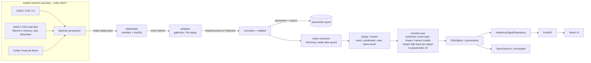
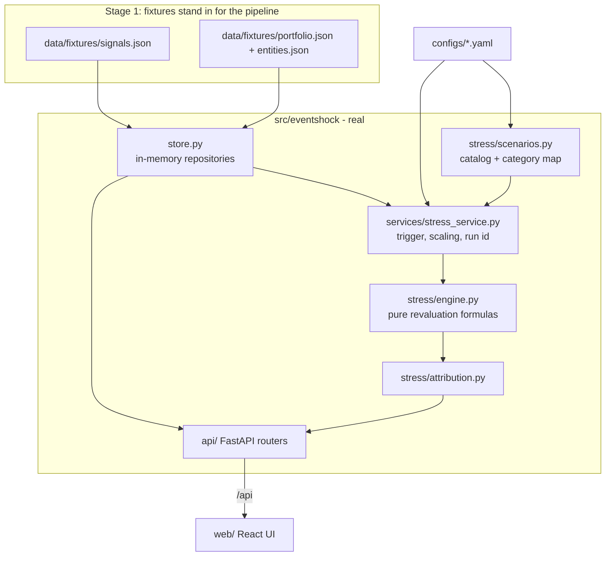

# EventShock — Architecture (Stages 1–4, frozen 2026-10-03)

EventShock turns financial text into an auditable **risk signal** and shows what that signal would do to
a portfolio under an explicit stress scenario.

```
RawDocument → [validate · dedupe · resolve entity] → [sentiment · event · impact · evidence]
            → RiskSignal → trigger (impact ≥ threshold) → Scenario → stress engine → StressResult → UI
```

The source documents (PRD, architecture, research) live in `guiding files/`. Where this document
differs from them, the difference is listed under [Decisions](#decisions-and-deviations).

## Final served data flow (Stages 3-4)

```
snapshot (hash-verified) → normalise → validate/quarantine → entity resolution → dedup
   → sentiment            tfidf-lr-v1            (text only)
   → event type           hybrid-event-v2        (TF-IDF ‖ pinned e5-large vector; can say NONE / UNCERTAIN)
   → impact (post-pass)   impact-v2              (market state + event calendar + TF-IDF event probabilities)
   → RiskSignal (every stage records model id, artifact sha256, origin) → evidence → scenario mapping → stress engine → API → UI
```

* **Train/serve parity.** The user-facing event stage serves the hybrid, but both impact models were fitted on the *TF-IDF* event model's probabilities. `ImpactModelEnricher` therefore re-decides each text with `tfidf-lr-event-v1` (`impact_event_model`) and feeds that, not the hybrid, to the impact stage. Feeding it the hybrid would silently change the model's inputs. The reference is announced in `/api/meta` and pinned by `tests/e2e/test_replay_served.py`.
* **Lifecycle** is derived, never asserted: each card carries its pre-registered acceptance result; `services/evidence.py` turns that into `validated | experimental | placeholder` for `/api/evidence`, and the UI reads the same objects. All three trained stages are currently *experimental*.
* **Fallbacks are labelled.** A missing hybrid or pinned vectors falls back to the TF-IDF reference; a missing impact-v2 falls back to impact-v1, then to the placeholder rule; every signal says which one ran. A *modified* artifact or snapshot file always stops start-up.
* **Frozen state.** `docs/freeze_manifest.json` pins every model, config, gold, calendar, replay and evidence file (`make freeze-check`); `make smoke` runs the real server and checks that the API serves those same artifacts. See [FINAL_MODEL_REPORT.md](FINAL_MODEL_REPORT.md).
* The diagram and tables below describe the Stage 1-2 skeleton that these stages plug into.

## Stage 2: real sources through one pipeline

Real financial text now reaches the **same** `RiskSignal` → stress → UI path. The server never calls the
internet: sources are fetched explicitly (`make fetch-*`), frozen into a hash-pinned snapshot
(`data/replay/`, `make replay-pack`), and replayed through the pipeline at startup.



| Concern | Decision |
|---|---|
| Raw vs processed | `data/raw` (ignored, bulk) → `data/replay` (committed, small, frozen) → in-memory pipeline output (`make ingest` exports to ignored `data/processed`) |
| Determinism | manifest pins sha256 + record counts (mismatch fails startup); replay clock `replay_as_of` is the only "now"; ids derive from content; clusters process in `(published_at, id)` order; output digest is pinned by a golden test and is order-independent |
| Timestamps | GDELT `seendate` = first seen (flagged); TFN has none, so replay assigns deterministic times (flagged `SYNTHETIC_REPLAY_CLOCK`) and such documents are never correlated by time |
| Validation | closed set of reject codes; every record ends in exactly one bucket (quarantined / folded duplicate / report inside a signal) |
| Entity resolution | cashtag → legal name → alias → bare ticker → *weak alias* (ordinary words like Apple/Visa/Target: case-sensitive and only with finance context or another strong mention) → restrained fuzzy; multiple issuers cap confidence; anything uncertain is `UNKNOWN_ENTITY`; the audit records what was considered and refused |
| Dedup | blocked by entity; star clustering against the earliest report (no single-link chaining); exact duplicates are folded and not counted, syndicated/near/same-event reports become `Evidence.corroborating` |
| Enrichment | `Enricher` port. `ModelEnricher` (served) = trained sentiment model (`pipeline/sentiment_model.py`) + trained event model (`pipeline/event_model.py`, 9-way: 8 classes + `NONE`, calibrated, one 0.5 commit threshold) + the `placeholder-v0` impact heuristic. `ImpactModelEnricher` (served when `models/impact/` and `data/replay/market/context.json` exist) replaces the heuristic **per signal, after novelty**, with the trained impact model (`pipeline/impact_model.py`, [IMPACT_MODEL.md](IMPACT_MODEL.md)); a signal it cannot score keeps the labelled heuristic with the reason in `provenance.impact_note`. Artifacts in `models/sentiment/`, `models/event/` and `models/impact/` are integrity-checked at load and never fall back to rules (a *missing* impact artifact degrades to the labelled heuristic unless `configs/impact_model.yaml` says `require: true`). An event the model judges a non-event (`NO_EVENT`) or will not type (`UNCERTAIN`) gets **no impact**: the signal is `PARTIAL` with a reason and the stress engine reports it unavailable. `ModelSentimentEnricher` and `PlaceholderEnricher` remain as regression anchors. Documents a model cannot score are quarantined (`UNSCORABLE_TEXT`). Every stage is labelled in `SignalProvenance.stage_origins` and `ModelVersions`; `SignalProvenance.sentiment` / `.event` / `.impact` carry model id, artifact sha256, calibrated confidence and `seen_in_training`; `data_origin = REAL_SOURCE_MIXED_NLP` |
| Profiles | `data.profile: replay` (default, real pack) or `demo` (Stage-1 fixtures); same container, same contracts |
| Dependencies | ingestion is stdlib (`urllib`, `difflib`, `hashlib`); the sentiment model adds numpy, scikit-learn, joblib (pinned in `requirements.txt`; the artifact is refused if the scikit-learn version differs) |
| Impact stage | Two scopes in one artifact: `ISSUER` (one resolved listed company; target its abnormal return) and `MARKET` (no company named; target the S&P 500's own move), each with its own lifecycle `NOT_AVAILABLE → DATASET → BASELINE → TRAINED → CALIBRATED → PRODUCTION` (UI: placeholder rule / experimental model / validated model). Event-time price features come from a frozen, hash-pinned **market context** (derived statistics, no prices) so the server stays offline. The 1-10 score is rank-calibrated (no hand thresholds) with an empirical uncertainty interval and exact-or-labelled attributions. The stress engine is unchanged: it reads the integer score, and its audit records which stage produced it |
| Model cards | `GET /api/models/sentiment`, `/event` and `/impact` serve the typed model cards (`SentimentModelCard`, `EventModelCard`, `ImpactModelCard`); the Data pipeline page renders all three. The event card adds the pre-registered acceptance verdict, per-class reliability and the abstention policy |

What is real: ingestion, validation, entity resolution, deduplication, corroboration counts, provenance, the sentiment
model, the event model (weak, flagged per class, see EVENT_MODEL.md), the impact model (experimental: market-state skill, no measurable event skill, see IMPACT_MODEL.md), the stress engine. What is a stand-in: the placeholder impact rule for signals the model cannot score, the portfolio (synthetic positions on real issuers), scenario magnitudes.

## What exists today



| Concern | Where | Notes |
|---|---|---|
| Contracts | `src/eventshock/domain/` | Pydantic v2. Validators enforce invariants (probabilities sum to 1, `PARTIAL ⇒ no impact`, per-asset-class required fields, tz-aware timestamps) |
| Config | `configs/app.yaml`, `event_taxonomy.yaml`, `scenarios.yaml` | Loaded and validated at startup; bad config fails loudly. Env overrides: `EVENTSHOCK_*` |
| Extension points | `src/eventshock/ports.py` | `SourceAdapter`, `SignalRepository`, `PortfolioRepository` Protocols |
| Replay source | `ingestion/replay.py` (fixtures), `ingestion/gdelt.py`, `ingestion/tfn.py` (real) | Adapters emit `RawDocument` or `Rejected` |
| Stress engine | `stress/engine.py` | Pure functions; every position records the formula used |
| Orchestration | `services/stress_service.py` | Trigger rule, severity scaling, deterministic run id, audit block |
| HTTP | `api/` | Thin routers; serves `web/dist` at `/` when built |
| UI | `web/src/` | `pages/{FeedPage,EventPage,StressPage}`, `components/`, `api/` (generated types), `lib/` |

## Contracts

- **`RiskSignal`** — document, entity (`UNKNOWN_ENTITY` is a first-class state), sentiment
  (`positive/neutral/negative/score`), event (category + full probability distribution), impact
  (`1–10` + continuous `raw` + drivers) or `null`, evidence (source count, unique outlets, mention
  velocity, novelty, model confidence, contradictions, corroborating items), `status`
  (`COMPLETE | PARTIAL`), `data_origin` (`DEMO_FIXTURE | MODEL_OUTPUT`), `model_versions`.
- **`Scenario`** — id, version, category, `reference_impact`, shocks `{factor, scope, value, rationale}`.
  Factors: `EQUITY`, `RATES_BPS`, `CREDIT_SPREAD_BPS`, `PD_MULTIPLIER`, `LGD_ADD`. Scopes:
  `MARKET`, `SECTOR`, `ISSUER`.
- **`StressResult`** — status (`COMPLETED | NOT_TRIGGERED | NO_SCENARIO | UNAVAILABLE`), severity scaling,
  applied shocks, summary (before/after/P&L), positions with formulas, contributions (asset class,
  sector, issuer, risk factor, top positions), uncovered exposure, audit block.

The OpenAPI schema (`/api/openapi.json`) is exported and turned into TypeScript types (`make types`), so
the UI and API cannot drift silently. All public models inherit `ContractModel`, which makes fields with
defaults appear as always-present in the response schema.

## Stress model

Shocks are specified in `scenarios.yaml` at a `reference_impact` (7) and scaled per event:

```
scale = clamp(impact / reference_impact, 0.5, 1.5)           # shown in the UI
shock' = shock * scale          (PD multiplier: 1 + (m - 1) * scale)
```

For each factor the most specific applicable scope wins (`ISSUER > SECTOR > MARKET`), so nothing is
double counted. Unresolved entities only receive `MARKET` shocks (issuer/sector shocks are marked
not applicable). Per asset class:

| Class | Revaluation |
|---|---|
| Equity | `ΔV = V·β·s` for market-wide shocks; `V·s` for sector/issuer shocks |
| Bond | `ΔP/P = −D·(Δrates + Δspread)/10⁴`, floored at −100% |
| Loan | value = EAD − EL; `PD' = PD·(1+(m−1)·sens)`, `LGD' = LGD + a`; `ΔV = −(EAD·PD'·LGD' − EAD·PD·LGD)` |
| Derivative | `ΔV = delta · underlying · s` (first order; gamma deferred) |

Attribution by risk factor sums exactly to the position change (bond: rates vs. spread; loan: PD vs.
LGD, sequential). Positions that receive no shock are reported as *uncovered*, never as safe.

**Trigger rule:** `impact ≥ trigger_threshold` (config, default 7). Below it the result is
`NOT_TRIGGERED` unless the analyst runs a flagged what-if. A signal without impact is `UNAVAILABLE`
even when forced: the engine never fabricates a score.

**Determinism:** `run_id = sha256(signal, scenario version, impact, force, portfolio hash, status)`.
In replay mode `calculated_at` is the fixture clock, so the same request returns an identical result.
`tests/e2e/test_replay_golden.py` pins the headline demo run.

## Provenance and honesty

| Item | Label |
|---|---|
| Signals | `data_origin = DEMO_FIXTURE`, `model_versions = fixture-v0` |
| Impact drivers | "Fixture drivers · illustrative, not SHAP" |
| Scenario magnitudes | "Illustrative scenario assumptions" |
| Stress arithmetic | "Computed · deterministic engine" |
| Mode | "Replay · demo fixtures" badge on every screen |

## API (`/api`)

`GET /health` · `GET /meta` · `GET /signals` (`category`, `source_type`, `min_impact`, `q`) ·
`GET /signals/{id}` · `GET /scenarios` · `GET /scenarios/{id}` · `GET /portfolio/summary|exposure|assets` ·
`POST /stress-test {signal_id, scenario_id?, force?, impact_override?}` · `GET /stress-runs/{id}`.
A well-formed stress request always returns 200; `status` says whether numbers were produced.
404 for unknown ids, 422 for invalid input. Interactive docs: `/api/docs`.

## Where the next stages plug in

| Stage | Replaces / adds | Plugs into | Contract kept |
|---|---|---|---|
| ~~Real/replay ingestion (GDELT, Twitter Financial News)~~ **done in Stage 2**; NewsAPI / EDGAR 8-K next | `ingestion/*.py` adapters | `SourceAdapter` → `RawDocument` | `RawDocument` |
| ~~Validation + dedup~~ **done**; contradiction detection still open | `pipeline/validate.py`, `dedup.py` | between adapter and NLP | `Evidence.corroborating`, `contradicted_by` |
| ~~Entity resolution~~ **done** (dictionary); NER/market-wide pseudo-entities open | `pipeline/entities.py` | fills `EntityMention` incl. `UNKNOWN_ENTITY` | `EntityMention` |
| ~~Sentiment~~ **done in Stage 3** (TF-IDF + LR); a domain-adapted model is open | `pipeline/sentiment_model.py` | fills `SentimentResult`; `model_versions.sentiment` | `SentimentResult` |
| ~~Event classification~~ **done in Stage 3b** (`pipeline/event_model.py`, [EVENT_MODEL.md](EVENT_MODEL.md)); embeddings and human-adjudicated labels next | `pipeline/event_model.py` | fills `EventClassification` incl. `status` | taxonomy in `event_taxonomy.yaml` |
| ~~Calibrated impact~~ **done in Stage 3c** as an experimental model (`pipeline/impact_model.py`, `modeling/impact_*.py`, [IMPACT_MODEL.md](IMPACT_MODEL.md)); scikit-learn boosting, exact-or-labelled attributions instead of SHAP; earnings-calendar features and 2023-25 news next | `ImpactModelEnricher`; `ImpactAssessment` (+ prediction, range, p_extreme), `ImpactAudit` | `ImpactAssessment` |
| Evidence / corroboration | `risk/evidence.py` | fills `Evidence` from the narrative layer | `Evidence` |
| Signal store | SQLite repository (pipeline output is currently rebuilt in memory at startup) | implements `SignalRepository` (replace `InMemorySignalRepository`) | `RiskSignal` |
| Exposure mapping | portfolio loader from public transaction data | implements `PortfolioRepository` | `PortfolioAsset` |
| Scenario modelling | richer templates, FX/commodity factors | extend `RiskFactor` + `scenarios.yaml` + engine | `Scenario`, `StressResult` |
| Stress extensions | gamma, convexity, reverse stress | `stress/engine.py` | `PositionResult.formula` |
| Evaluation | `eval/` scripts + notebooks, model-status screen | read signals and models; expose in `/models` | — |

The stage rule from `CLAUDE.md` still holds: implement one stage, test it, freeze it, move on.

## Decisions and deviations

1. **React instead of Streamlit.** The architecture doc picks Streamlit as the fastest demo path and
   names React as the alternative. This project needs a product-grade UI (three linked screens, designed
   components, accessibility, mobile) that Streamlit cannot deliver. The API is unchanged either way.
2. **No SQLite yet.** Nothing in this slice needs persistence; repositories sit behind Protocols so SQLite
   is a drop-in. (Stress runs are kept in memory for `GET /stress-runs/{id}`.)
3. **No model code in Stage 1.** Signals are fixtures with an explicit `data_origin`; building NLP now
   would pre-empt later stages. The deterministic stress engine is the only computed component.
4. **Hand-drawn charts.** Bars and ladders are plain HTML/CSS, not a charting library: fewer
   dependencies, exact control, and they are accessible by construction.
5. **Fictional entities.** Avoids fabricated news about real companies.
6. **Name.** The guiding documents say "SignalForge"; the product is **EventShock**.

## Testing

`pytest` — domain validators, per-class formulas against hand-computed values, scope precedence,
severity scaling and clamps, trigger rule, catalog completeness, config errors, fixture integrity
(referential integrity, no timestamps after the replay clock, byte-stable regeneration), API contracts
and error paths, SPA serving, and an e2e golden replay. `vitest` — formatters, severity bands,
accessible meters, and page-level states (feed, filters, API outage, partial signal, not-triggered,
completed run) against a mocked API.


## Stage 5: the judge-facing UI and its one read-only endpoint

The frontend tells one story, **text → event understanding → impact → evidence → scenario → portfolio stress**, as five chapters on the
event page plus the stress and evidence screens. Technical depth sits behind progressive disclosure (drawers addressed by `?open=`, tabs by
`?tab=`). Nothing in the models, the configuration or `RiskSignal` changed.

`GET /api/signals/{id}/context` (`services/signal_context.py`) is the only backend addition, and it is read-only:

- the impact model's inputs for that signal, grouped by family with their availability class (read from the audit the signal already carries);
- the issuer's 8-K filings placed around the report using the calendar's own rule (a filing is *before* only if accepted **strictly** earlier),
  each labelled *feeds the model* / *before, not used* / *after the report*;
- the realised two-session move that followed (`data/outcomes/replay_outcomes.json`, exported by `make outcomes`), kept off the signal so it can
  never become an input and the replay digest is untouched.

The timeline in the UI is built from exactly that payload plus the signal's own cluster of reports; its view-model (`web/src/lib/timeline.ts`)
returns only what the cursor has reached, so a later fact cannot be rendered in an earlier state (tested). There is no retrieval of similar
*individual* past events anywhere in the system: "comparable events" are statistics of the model's own score bucket, and the UI says so.

## Stage 6: one engine, several doors

```
 paste (POST /api/analyze) ─┐
 live GDELT poll ───────────┼─► RiskEngine.ingest(records, channel, now)
 capture file (offline) ────┘     prepare_record  = normalise → validate → can-it-be-scored → entity resolution   (shared with run_documents)
                                  cluster_items   = the same dedup, over the bounded live window                 (shared)
                                  build_signal    = sentiment, event, SCOPE, evidence                            (shared)
                                  novelty → impact post-pass                                                     (shared)
                                              │
                         LiveSignalStore (age- and count-bounded, change counter) ┐
                         InMemorySignalRepository (the frozen replay run)         ┴► CombinedSignalRepository ► API ► UI
```

**Scope (`domain/scope.py`, `pipeline/scope.py`, `configs/scope.yaml`).** Every `RiskSignal` says what it is about: `COMPANY`, `SECTOR`, `MARKET` or `UNRESOLVED`, with the
terms and the rule that decided it. Company resolution is an enrichment, never a gate: an unresolved event is kept, read, and either given the subject its text supports or
labelled unresolved with the reason. The rules are a deterministic vocabulary table, not a model; `make scope-eval` measures the sector vocabulary on documents whose company
resolved (docs/evidence/scope_eval.json, with its bias stated). There is no industry level: the entity master has none.

**Stress binding.** `ISSUER` shocks need a `COMPANY` scope, `SECTOR` shocks a sector (named or implied), `MARKET` shocks always apply; a skipped shock carries its reason. If
none binds the run is `NOT_APPLICABLE` (before Stage 6 it was `COMPLETED` with a P&L of zero). `GET /api/signals/{id}/relevance` (`services/relevance.py`) reports what the event
reaches in the book (issuer, sector, region, whole book) from holdings alone; shock sizes remain the scenario's illustrative assumptions.

**Models for new text.** The engine reuses the models loaded at start-up. The served hybrid event model needs an encoder for any text that is not in the pinned replay vectors; if
none is installed the engine serves the TF-IDF reference model for live and pasted text (the impact model was fitted on its outputs), and the model id on every signal says which ran.
The impact model scores a report only inside its frozen market-context calendar (plus five days); later reports keep the labelled placeholder rule with `impact_note`.

**Live (`ingestion/live.py`, `services/live.py`, `configs/live.yaml`).** Off by default. `fetch.py` stays the only HTTP code: the live source drives `fetch_gdelt` and hands records to
`GdeltAdapter.parse`. The poller backs off, reports `OFF / OK / DEGRADED / ERROR / IDLE`, and never turns a failure into data. Raw inputs are journalled (git-ignored) so a restart is
warm and a live session can be replayed through the same engine; a capture file is delivered in batches on its own clock and labelled *simulated*. The server calls out only when
`EVENTSHOCK_LIVE=1` and the source is GDELT.

**API additions.** `POST /analyze`, `GET /signals/{id}/relevance`, `GET /live/status`, `POST /live/refresh`, `GET /scope`; `GET /signals` gains `channel`, `scope_level`, `since_seq`
and returns a change counter `seq`; each row carries scope, channel and relevance.


## Stage 7: the risk assessment (an additive layer; severity-v2 scorecard)

```
 RiskSignal (frozen shape: trained sentiment / event / impact-v2, scope, novelty)         ← unchanged, digests unchanged
        │
        ▼
 AssessmentService.assess(signal)                                                         ← derived, memoised, never stored on the signal
   SemanticExtractor:  cache → LLM (forced tool call) → grounding ──┐ on any failure
     (reads: class, tone, entities, 4 rubric answers + reasons,     └──────────────► RuleExtractor (labelled, no key needed)
      indicators, quotes)
   RubricDeriver:      rules baseline for 4 answers (intensity, reach, certainty, direction)  +  AI answer, bounded to ONE step
                       (a verbatim quote lets it stand only where the rules had no evidence), each answer needs a reason
   SeverityScorer:     fixed matrix anchor[intensity] + reach offset → certainty × direction scaling
                       → 2 bounded data adjustments (VIX regime within freshness policy, novelty) → round, clamp → 1-10, band
                       + rules-only baseline score, ai_effect, sensitivity range, reliability (shown beside, never inside)
   Provenance:         every part tagged AI / DATA / RULES / HYBRID / ASSUMPTION
   ThresholdState:     score vs the stress trigger, in words
        │
        ├─► GET /signals/{id}/assessment · /evidence · /timeline
        └─► StressService(severity_provider): trigger + scaling + scenario class + sector, then the deterministic engine
```

`docs/RISK_ASSESSMENT.md` is the reference: why the headline changed (the severity-v1 average compressed the scale), the scorecard, what the AI may and may not do, evidence classes, market freshness, the temporal rule, the fallback, the measured benchmark
and its limits. Modules: `llm/` (client, cache, schema, prompt, config), `assessment/` (config, vocab, cues, rules, grounding, extractor, rubric, severity, freshness, service, views, model, benchmark). Configs: `semantics.yaml` (the closed vocabulary
and indicator levels), `severity.yaml` (anchors, offsets, factors, AI bound, market policy), `llm.yaml` (all in the freeze manifest). Benchmark: `data/benchmarks/`, `scripts/severity_benchmark.py`, `scripts/severity_ablation.py`.

Two decisions worth defending. (1) **Side-car, not a field**: the assessment is derived from the signal, so the replay output digest, the fixtures and the stress goldens stay valid, and the trained stages remain exactly
what their cards describe. (2) **The LLM reads, code decides**: severity, the trigger and the portfolio arithmetic are explicit and deterministic; the model fills a closed schema whose every claim is checked against the text.


## Stage 8: outcome audit, historical analogues, scenario reality check (additive side-cars)

```
report ─► prepare/dedup/entity ─► reading (LLM -> grounding -> rules fallback) ─► severity-v2 scorecard ─► default scenario ─► deterministic stress   [unchanged]
              │
              └─► e5 vector (pinned for replay; optional live encoder) ─► AnalogueIndex (point-in-time, story-collapsed) ─► GET /signals/{id}/analogues   [RETRIEVED, hindsight, display only]
prices (local, git-ignored) ─► outcome-v2 / outcome-v3 ─► outcome_audit.json, severity_validity.json, analogue_*.json ─► GET /evidence/outcome-check
scenarios ─► shock_history.json (quantiles only) ─► GET /scenarios/{id}/history-check                                                       [read-only]
```
- New code: `modeling/outcome_v3.py`, `outcome_audit.py`, `severity_validity.py`, `evidence_v3.py`; `retrieval/` (`corpus`, `index`, `search`, `relevance_eval`, `outcome_value`, `build`, `config`, `model`); `services/analogues.py`, `services/outcome_check.py`; `stress/history_check.py`; web `AnaloguesPanel`, `HistoryCheck`, `OutcomeCheckTab`.
- **Nothing existing changed in behaviour:** `RiskSignal`, the replay digests, `GOLDEN_RUN_ID`, the trained artifacts, `severity.yaml`, the stress engine and the scenario catalogue are untouched. The analogue service is never stored on a signal (like the assessment) and has no path into the severity score or the stress trigger (a test asserts the assessment and the signal are identical before and after an analogue request).
- **Experimental vs production:** the experiments (`make outcome-audit severity-validity analogue-*`) run offline against git-ignored data and write committed evidence; the server only reads the committed pack and evidence. A missing index, unrun floor rule or absent encoder is a labelled `UNAVAILABLE`.
- **Provenance:** `Origin.RETRIEVED` / `Kind.RETRIEVED` (a past report found by similarity: precedent about other events, never a reading of this one) join AI, DATA, RULES, HYBRID, ASSUMPTION; the realised outcome of an analogue is hindsight and is labelled so.
- **Why retrieval is not a score input:** the pre-registered test (`docs/ANALOGUES.md` section 5) found no improvement in predicting the realised move; the earlier "runtime RAG is excluded" rule stays true in spirit: nothing generative reads the retrieved text, and retrieval runs over a static, hash-pinned index.

## Stage 9: optional personal portfolios (additive; the synthetic book stays the default)
- `src/eventshock/portfolio/`: `models` (stored input vs resolved result, issues with levels, field sources), `resolve` (pure input -> engine `Portfolio`; quick-text parser), `store` (one JSON file per portfolio, atomic, git-ignored `data/live/portfolios/`, `EVENTSHOCK_PORTFOLIO_STORE_PATH`), `service` (default + saved, `None`/`"default"` = the synthetic book), `exposure`, `chain` (event -> shock -> exposure -> modeled change, regrouped from a finished run), `compare`, `betas`/`catalog` (single-factor trailing betas, reference instruments).
- Seam: `StressService.run(..., portfolio=)` and `RelevanceService.assess(..., portfolio=)`; the engine is unchanged except `CASH` / `OTHER` asset classes and a bond `spread_sensitivity` (omitted from serialisation at its default, so the default book's `content_hash` and every run id are unchanged).
- API: `/api/portfolios` (+ `/parse`, `/validate`, `/compare`, `/{id}`, `/{id}/duplicate`, `/{id}/exposure`), optional `portfolio_id` on `/stress-test`, `/stress-runs`, `/signals`, `/signals/{id}/relevance`, `/portfolio/*`; `GET /stress-runs/{id}/exposure-chain`. Active selection is client state; the server holds none.
- Full rationale, validation rules, methodology table and limits: `docs/PORTFOLIOS.md`.

## Stage 10: multi-scope event intelligence (additive side-car; no signal, model or digest changed)
- `src/eventshock/intelligence/`: `scope` (COMPANY / INDUSTRY / SECTOR / GEOGRAPHY / MACRO / MARKET / THEME / UNRESOLVED, path, evidence, status), `grouping` (report clusters -> events, star-anchored, trusted clocks only), `evidence` (independent sources, strength tier, model confidence kept apart), `novelty` (NEW / CONTINUATION / UPDATE / RECURRING / UNKNOWN), `velocity`, `claims` (closed-lexicon claims and contradiction), `lifecycle` (rule-driven state machine with a timeline), `service` (assembles one `EventIntelligence`, memoised on the repository counter, `as_of`-aware, every section able to abstain).
- Seam: a pure function of the signal and the combined repository (replay, live and pasted alike). It reads the assessment (reading), the relevance service and the stress engine; none of them imports it (`tests/unit/test_intel_architecture.py`). Nothing is stored on a `RiskSignal`, so the replay digest (`70478b2d...`) and `GOLDEN_RUN_ID` hold.
- Unified ingestion: `RawDocument` is the normalised observation; replay (batch) and live / pasted (engine) share every stage function, proven by a parity test. A pasted `url` attributes the outlet and is never fetched.
- API: `GET /api/signals/{id}/intelligence?as_of=`, `intelligence` on `POST /api/analyze` (+ optional `headline`, `url`), `scope_type` on the feed and its filter, `capabilities.intelligence`. Config: `configs/intelligence.yaml` (judgement priors, in the freeze manifest).
- Full rationale, rules and limits: `docs/EVENT_INTELLIGENCE.md`.
